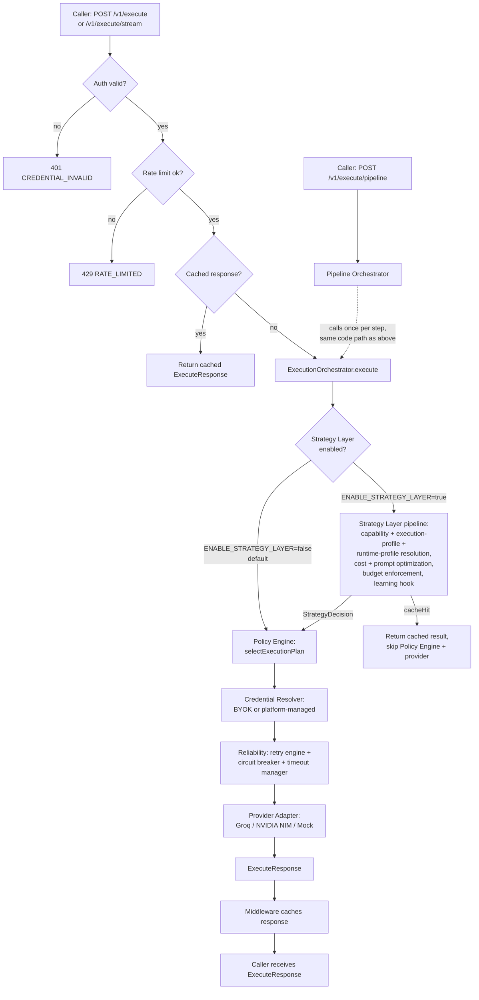

# AI Gateway (RuntimeOS)

A universal AI execution platform: callers describe _what they want done_
(`task`, content, constraints) and the gateway routes, executes, retries,
and fails over across providers — without the caller ever naming a
provider or model directly. Optionally, the platform can also apply
capability/cost/prompt-aware Strategy Layer routing, chain multiple
requests into a Pipeline, and enforce per-tenant spend budgets.

**Current release: v1.2.0 (EM-0 – EM-11).** See
[`CHANGELOG.md`](CHANGELOG.md) for exactly what shipped in each tagged
release, and ["Engineering milestones"](#engineering-milestones) below
for what each milestone delivered.

---

## Find what you need — by role

| If you are a...                                                                              | Start here                                                                                                                                                                                                                                                                                                                                                                                                                             |
| -------------------------------------------------------------------------------------------- | -------------------------------------------------------------------------------------------------------------------------------------------------------------------------------------------------------------------------------------------------------------------------------------------------------------------------------------------------------------------------------------------------------------------------------------- |
| **Executive / Product stakeholder** — what is this, why does it exist, what does it do today | This page's ["What is AI Gateway"](#what-is-ai-gateway) and ["What v1.2 delivers"](#what-v12-delivers) sections, then [`docs/release/RELEASE_NOTES.md`](docs/release/RELEASE_NOTES.md)                                                                                                                                                                                                                                                 |
| **Enterprise Architect** — evaluating the platform's design, guarantees, and boundaries      | This page's ["Platform architecture at a glance"](#platform-architecture-at-a-glance) diagram for a quick overview, then [`docs/architecture/architecture-spec.md`](docs/architecture/architecture-spec.md) (frozen source of truth), [`docs/adr/README.md`](docs/adr/README.md) (settled and open architectural decisions), [`docs/release/KNOWN_LIMITATIONS.md`](docs/release/KNOWN_LIMITATIONS.md)                                  |
| **Platform Engineer** — building or modifying a package in this monorepo                     | ["Repository layout"](#repository-layout) and ["Engineering milestones"](#engineering-milestones) below, [`docs/architecture/engineering-blueprint.md`](docs/architecture/engineering-blueprint.md), the README inside the package you're touching, [`CONTRIBUTING.md`](CONTRIBUTING.md)                                                                                                                                               |
| **Application Developer** — calling a running gateway from your own service                  | [`apps/runtime-studio`](apps/runtime-studio) (an interactive reference client — point it at a running gateway and exercise every endpoint from a browser), [`apps/gateway-server/README.md`](apps/gateway-server/README.md)'s Public API section, [`examples/minimal-node-client`](examples/minimal-node-client), [`examples/streaming-client`](examples/streaming-client), and [`examples/pipeline-client`](examples/pipeline-client) |
| **Runtime Operator** — deploying and running the gateway                                     | [`docs/release/DEPLOYMENT.md`](docs/release/DEPLOYMENT.md) (Node/container) or [`docs/release/DEPLOYMENT-VERCEL.md`](docs/release/DEPLOYMENT-VERCEL.md) (Vercel), [`docs/release/KNOWN_LIMITATIONS.md`](docs/release/KNOWN_LIMITATIONS.md), [`docs/release/SUPPORT_POLICY.md`](docs/release/SUPPORT_POLICY.md)                                                                                                                         |

## What is AI Gateway

Applications that call an LLM directly couple themselves to one vendor's
API, model lifecycle, and outage schedule. AI Gateway removes that
coupling: a caller submits a `TaskType` plus content and constraints —
never a provider or model name — and the platform's Policy Engine
selects a suitable model, executes the request, retries transient
failures per a configurable backoff policy, and fails over to the next
candidate provider if one becomes unavailable, all behind a circuit
breaker so a struggling provider stops receiving traffic until it
recovers.

See [`docs/architecture/architecture-spec.md`](docs/architecture/architecture-spec.md)
(frozen) for the full architecture and
[`docs/architecture/engineering-blueprint.md`](docs/architecture/engineering-blueprint.md)
(frozen) for the milestone-by-milestone implementation plan. Every
"architecture §N" / "Blueprint §N" reference anywhere in this repository
(package READMEs, ADRs, this file) points into one of those two
documents; section numbering is unchanged from the original.

## What v1.2 delivers

- **Provider-agnostic execution core (v1.0, EM-0 – EM-5):** `POST
/v1/execute` and `POST /v1/execute/stream`, automatic retry/failover,
  BYOK and platform-managed credentials with multi-tenant isolation,
  API-key auth, rate limiting, response caching, and a real
  `GET /v1/health` readiness check. Two production-capable provider
  adapters ship: Groq and NVIDIA NIM.
- **Strategy Layer (v1.1/v1.2, EM-6 – EM-8):** capability-aware,
  execution-profile-aware, cost-aware, and prompt-optimization-aware
  routing composed into one immutable `StrategyDecision`, ahead of
  Policy Engine. **Opt-in and off by default** — set
  `ENABLE_STRATEGY_LAYER=true` to enable; see
  [`docs/release/DEPLOYMENT.md`](docs/release/DEPLOYMENT.md#strategy-layer-em-8-v11v12)
  before enabling in production.
- **Pipeline Orchestration (v1.2, EM-10):** `POST /v1/execute/pipeline` —
  sequential multi-step execution through the exact same
  `ExecutionOrchestrator.execute()` a single-step request uses. Always
  available, no feature flag.
- **Budget Governance (v1.2, EM-10 – EM-11):** per-tenant daily/monthly
  spend budgets with configurable threshold actions (`alert`,
  `downgrade_model`, `switch_provider`, `block`). Ships in **shadow
  mode by default** — enforcement is an explicit opt-in
  (`budgetEnforcementMode: "enforcing"`), and it is **not configurable
  through the published `apps/gateway-server` binary's environment
  variables** — see
  [`docs/release/DEPLOYMENT.md`](docs/release/DEPLOYMENT.md#budget-governance-em-10-v12)
  and [`docs/release/KNOWN_LIMITATIONS.md` §9.3](docs/release/KNOWN_LIMITATIONS.md#93-neither-deployment-application-has-a-configuration-surface-for-budget-governance)
  for what that means and how to configure it anyway.
- **`plugin-system` (EM-7) remains built but unintegrated** — the
  Gateway Plugin framework (contract, registration, lifecycle,
  discovery, loading) exists and is tested in isolation, but nothing in
  the running gateway constructs or calls a plugin yet. A later
  milestone's work.

For the full, honestly-disclosed list of what does _not_ work yet or has
a documented caveat, see
[`docs/release/KNOWN_LIMITATIONS.md`](docs/release/KNOWN_LIMITATIONS.md)
— it is the single consolidated source for this, current through v1.2.

## Platform architecture at a glance

The request path below is drawn directly from the wiring in
`packages/middleware/src/pipeline.ts`, `packages/orchestrator/src/orchestrator.ts`,
and `packages/strategy-layer/src/strategy-layer.ts` — not a simplified
or aspirational version of it. For the authoritative, complete version,
see architecture §17 (the "request-lifecycle prefix" this diagram's
Middleware Pipeline box implements exactly) and §30 (Strategy Layer).



**Two things this diagram deliberately makes visible:** the Strategy
Layer is a genuine fork in the request path, not a bolt-on that always
runs (it's off by default — see ["What v1.2
delivers"](#what-v12-delivers)); and Pipeline Orchestration is not a
second execution engine — every step runs through the exact same
`ExecutionOrchestrator.execute()` a single-step request uses, one step
at a time.

## Repository layout

```
apps/                       deployable applications
  gateway-server/             Node/container composition root — HTTP/SSE server wiring
                               every platform package into a running gateway
  vercel-adapter/              Vercel-hosted composition root, sharing gateway-runtime
                               with apps/gateway-server rather than duplicating it (ADR-0012)
  runtime-studio/               RuntimeOS Reference Playground — a browser-based reference
                                  client for any running gateway (this or a real deployment);
                                  see apps/runtime-studio/README.md
packages/                   library packages — the bulk of the platform
  core-contracts/              public request/response/error contracts, frozen at 1.0.0
  agent-registry/              versioned specialist-agent contracts and capability discovery
  agent-orchestration/         typed execution plans, DAG validation and bounded scheduling
  config/                      Zod/JSON-schema validated configuration loader
  telemetry/                   OpenTelemetry tracer/metrics/logger wrapper
  providers/provider-sdk/      ProviderAdapter interface, Mock Adapter, conformance harness
  providers/groq/               Groq ProviderAdapter implementation
  providers/nvidia-nim/         NVIDIA NIM ProviderAdapter implementation
  reliability/                 retry engine, circuit breaker, timeout manager, health monitor
  model-registry/              queryable, config-driven model registry
  credential-resolver/         BYOK-aware credential resolution with per-tenant isolation
  policy-engine/                task-to-model scoring, ranking, and ExecutionPlan assembly
  streaming/                   StreamManager and SSE transport
  orchestrator/                ExecutionOrchestrator — the full request lifecycle
  middleware/                  auth, rate limiting, and response caching pipeline
  gateway-runtime/             shared bootstrap()/HTTP composition layer used by every app (ADR-0012)
  capability-registry/         (EM-6) task -> abstract CapabilitySet mapping
  execution-profile-registry/  (EM-6) task -> ExecutionProfile (inference params, retry, streaming/caching defaults)
  runtime-profiles/            (EM-6) deployment/tenant-wide behavior overlay (provider pref, cost, telemetry, caching)
  cost-optimizer/               (EM-7) model-downgrade/cache/streaming/free-tier optimization decisions
  prompt-optimizer/             (EM-7) provider-independent prompt transformation pipeline
  learning/                     (EM-7) Intelligent Learning extension points (no-op-by-default sockets)
  plugin-system/                (EM-7) Gateway Plugin framework — built, not yet wired into the running gateway
  strategy-layer/               (EM-8) integrates capability/execution-profile/runtime-profile resolution + cost/prompt
                                  optimization + learning hooks + budget enforcement into an immutable StrategyDecision;
                                  wired into orchestrator behind enableStrategyLayer
  pipeline-orchestrator/        (EM-10) sequential multi-step execution over ExecutionOrchestrator.execute()
  budget-governance/            (EM-10) per-tenant budget policies, ledger, and threshold-action enforcement
examples/                   example clients calling a running gateway over its public REST API
tools/                      shared cross-package tooling, e.g. adapter-conformance-tests,
                              orchestrator-integration-tests, em6-strategy-foundation-demo
docs/adr/                   architecture decision records — see docs/adr/README.md for the index
docs/architecture/          the Architecture Specification and Engineering Blueprint (see below)
docs/history/                historical build records, e.g. IMPLEMENTATION_PROGRESS.md
docs/release/                release governance: notes, limitations, deployment, versioning, support (see docs/release/README.md)
.github/workflows/ci.yml    CI: format, dependency graph, lint, typecheck, test, build
```

This mirrors the architecture spec's repository structure (§9), with
`docs/architecture/`, `docs/history/`, and `docs/release/` added during
successive documentation-stabilization passes so the source documents,
historical build record, and release-governance artifacts are part of
the repository itself rather than external documents.

## Engineering milestones

All milestones below are complete; see
[`docs/history/IMPLEMENTATION_PROGRESS.md`](docs/history/IMPLEMENTATION_PROGRESS.md)
for full acceptance-criteria detail on each. That document is a
chronological build record, not living reference documentation — for
current package responsibilities, see ["Repository layout"](#repository-layout)
above; for the authoritative milestone sequence, see the Engineering
Blueprint's §7 (`docs/architecture/engineering-blueprint.md`).

| Milestone | Delivered                                                                                                                                                                                                                                                                                                                                                                                                                                                                                                                                                      |
| --------- | -------------------------------------------------------------------------------------------------------------------------------------------------------------------------------------------------------------------------------------------------------------------------------------------------------------------------------------------------------------------------------------------------------------------------------------------------------------------------------------------------------------------------------------------------------------- |
| EM-0      | Monorepo scaffold, shared tooling, `core-contracts` implemented and frozen at `1.0.0`                                                                                                                                                                                                                                                                                                                                                                                                                                                                          |
| EM-1      | `config`, `telemetry`, `provider-sdk` (incl. Mock Adapter and conformance harness)                                                                                                                                                                                                                                                                                                                                                                                                                                                                             |
| EM-2      | `reliability` (retry engine, circuit breaker, timeout manager, health monitor), `model-registry`, `credential-resolver`[^em2]                                                                                                                                                                                                                                                                                                                                                                                                                                  |
| EM-3      | `policy-engine` (task-to-model scoring, ranking, `ExecutionPlan` assembly), `providers/groq`, `providers/nvidia-nim`, `streaming`                                                                                                                                                                                                                                                                                                                                                                                                                              |
| EM-4      | `orchestrator` (full request lifecycle), end-to-end integration/chaos tests (`tools/orchestrator-integration-tests`)                                                                                                                                                                                                                                                                                                                                                                                                                                           |
| EM-5      | `middleware`, `apps/gateway-server` (the composition root), `examples/*`                                                                                                                                                                                                                                                                                                                                                                                                                                                                                       |
| EM-6      | `capability-registry`, `execution-profile-registry`, `runtime-profiles` — the Strategy Layer foundation (architecture §30–§37); no orchestrator/policy-engine wiring yet                                                                                                                                                                                                                                                                                                                                                                                       |
| EM-7      | `cost-optimizer`, `prompt-optimizer`, `learning`, `plugin-system` — Optimization Pipeline & Plugin System foundation (architecture §33/§34/§36/§11); no orchestrator/policy-engine wiring yet                                                                                                                                                                                                                                                                                                                                                                  |
| EM-8      | `strategy-layer` (architecture §30) — integrates every EM-6/EM-7 foundation package (except `plugin-system`) into an immutable `StrategyDecision`; wired into `orchestrator` behind the `enableStrategyLayer` feature flag (ADR-0017); `policy-engine` receives the decision via `PolicyContext`. Runtime Profile scoring activation is attributed elsewhere in this repository to "EM-9," but `docs/history/IMPLEMENTATION_PROGRESS.md` has no standalone EM-9 section — see that document's EM-11 entry for the open documentation note tracking this.[^em9] |
| EM-10     | `pipeline-orchestrator` (multi-step execution via `ExecutionOrchestrator.execute()` only, `maxSteps`-capped) and `budget-governance` (shadow-mode-first cost governance: thresholds, per-provider caps, cumulative ledger). An Independent Architecture Review returned REQUIRES REWORK on two findings; both were closed in a follow-up rework pass and independently re-verified (ADR-0026).                                                                                                                                                                 |
| EM-11     | Platform hardening and v1.2 production-readiness validation — no new architecture, package, or interface. Full regression/conformance/chaos validation (1,239/1,239 tests), an in-process performance smoke-test, and a documentation-completeness pass. Budget Governance's Enforcement Mode independently verified end-to-end for the first time (it remains off by default — see ["What v1.2 delivers"](#what-v12-delivers) above).                                                                                                                         |

[^em2]:
    `CHANGELOG.md`'s milestone table also attributes `model-registry`
    and `credential-resolver` to EM-2; `docs/history/IMPLEMENTATION_PROGRESS.md`
    has no standalone `## EM-2` section to independently confirm this against
    (it goes from `## EM-1` directly to `## EM-3`), and EM-3's own scope line
    explicitly does not include either package. This table follows
    `CHANGELOG.md`'s attribution as the best available evidence; see that
    document's history section for the same open note.

[^em9]:
    Multiple documents in this repository (`packages/policy-engine/README.md`,
    `packages/strategy-layer/README.md`, ADR-0018) refer to "EM-9" as settled
    history for Runtime Profile scoring activation, but no standalone EM-9
    section exists in the implementation history. This is believed to be a
    documentation omission (the work was very likely folded into EM-8's
    section at original authoring time) rather than evidence the work didn't
    happen — the described behavior is implemented and tested regardless.
    Flagged for a future documentation pass rather than silently resolved,
    per this repository's own "document, don't invent a solution" convention
    for cross-milestone findings.

## Getting started

```bash
corepack enable
pnpm install
pnpm build          # turbo run build — builds every package, dependency-order aware
pnpm test           # turbo run test
pnpm test:coverage  # turbo run test:coverage
pnpm lint           # turbo run lint (ESLint, incl. package-boundary rule)
pnpm typecheck      # turbo run typecheck
pnpm graph:check    # dependency-cruiser: zero cycles, Section 4.1 boundaries enforced
pnpm format         # prettier --write .
pnpm format:check   # prettier --check .
```

All of the above run in CI on every push/PR — see `.github/workflows/ci.yml`.

To run the gateway server itself, see
[`apps/gateway-server/README.md`](apps/gateway-server/README.md) for
configuration and the full public API, and
[`docs/release/DEPLOYMENT.md`](docs/release/DEPLOYMENT.md) for a
production-oriented deployment walkthrough covering v1.0 through v1.2
capabilities. To see it called from the outside, see
[`examples/minimal-node-client`](examples/minimal-node-client),
[`examples/streaming-client`](examples/streaming-client), and
[`examples/pipeline-client`](examples/pipeline-client) — all three are
deliberately dependency-free, written exactly as an external,
non-monorepo caller would write them. For an interactive alternative to
reading and running example scripts, [`apps/runtime-studio`](apps/runtime-studio)
is a browser-based reference client covering every public endpoint,
built specifically to be honest about which RuntimeOS capabilities your
target deployment does and doesn't currently expose — see that app's own
README before assuming a panel that shows "not configured" means
RuntimeOS itself lacks the capability. If any of the above steps fail,
see [`docs/release/TROUBLESHOOTING.md`](docs/release/TROUBLESHOOTING.md).

## Tooling choices (Section 3 of [the Blueprint](docs/architecture/engineering-blueprint.md))

| Concern                      | Choice                                              | Why                                                                                                                                                                                                  |
| ---------------------------- | --------------------------------------------------- | ---------------------------------------------------------------------------------------------------------------------------------------------------------------------------------------------------- |
| Package manager / workspaces | pnpm workspaces                                     | Strict, non-hoisted `node_modules` catches undeclared cross-package imports at resolution time — see `docs/adr/0003-boundary-enforcement-layers.md` for a worked example of this actually happening. |
| Build orchestration          | Turborepo                                           | Dependency-graph-aware task scheduling and caching (`turbo.json` mirrors the package dependency graph).                                                                                              |
| Language                     | TypeScript, strict mode                             | `tsconfig.base.json` — `strict`, `noUncheckedIndexedAccess`, `noImplicitOverride`, etc.                                                                                                              |
| Runtime validation           | Zod                                                 | Every `core-contracts` type has a companion schema for trust-boundary validation.                                                                                                                    |
| Linting                      | ESLint 9 (flat config) + `eslint-plugin-boundaries` | Category-level package-boundary enforcement, defense-in-depth alongside dependency-cruiser.                                                                                                          |
| Dependency graph enforcement | dependency-cruiser                                  | The canonical, CI-gated check: zero cycles, and every package's allowed dependencies generated directly from the Section 4.1 table (`.dependency-cruiser.cjs`).                                      |
| Testing                      | Vitest                                              | Per-package `vitest.config.ts`; coverage via `@vitest/coverage-v8`.                                                                                                                                  |
| Versioning                   | Changesets                                          | Independent per-package semver (`.changeset/config.json`); `core-contracts` is the first package at `1.0.0`.                                                                                         |

## Architecture decision records

**27 ADRs** are on record in `docs/adr/` (`0000` is the template, not a
decision), spanning EM-0 through EM-10. **16 are Accepted or Superseded**
— settled design decisions reflected in the codebase as implemented.
**10 are Proposed/Draft implementation-gap findings** — real, verified
inconsistencies between the frozen Architecture Specification and the
implementation, not yet ruled on by the Architecture Review Board. None
currently produces an incorrect runtime behavior except
[ADR-0025](docs/adr/0025-budget-enforcer-provider-id-and-exclusion-gap.md)
(`switch_provider` budget threshold actions), which does. **One more
(ADR-0027) is a different kind of "Proposed"** — a forward-looking
roadmap recommendation for OpenAPI generation, not a discovered gap; see
["Roadmap"](#roadmap) below. See
[`docs/adr/README.md`](docs/adr/README.md) for the full index and
[`docs/release/KNOWN_LIMITATIONS.md`](docs/release/KNOWN_LIMITATIONS.md) §6
for how each open implementation-gap ADR maps to an operator-facing
limitation.

## Terminology

A short glossary for readers new to the platform's vocabulary — see the
Architecture Specification for the authoritative, complete definitions.

| Term               | Meaning                                                                                                                                                                                                                                                                                              |
| ------------------ | ---------------------------------------------------------------------------------------------------------------------------------------------------------------------------------------------------------------------------------------------------------------------------------------------------- |
| `TaskType`         | The public vocabulary callers use instead of a model name — a known value from `core-contracts`'s `KNOWN_TASK_TYPES` (e.g. `"summarization"`, `"complex_reasoning"`, `"code_generation"`) or any custom, config-registered string; see `packages/core-contracts/src/task.ts` and architecture §10.1. |
| `ExecutionPlan`    | Policy Engine's output: a ranked list of candidate `(provider, model)` pairs for a given request.                                                                                                                                                                                                    |
| `StrategyDecision` | Strategy Layer's output (when enabled): an immutable bundle of capability, execution-profile, cost, and prompt-optimization decisions, consumed ahead of Policy Engine.                                                                                                                              |
| Runtime Profile    | A deployment/tenant-wide behavior overlay (provider preference, cost posture, telemetry, caching) selected via `GatewayConfig.runtimeProfileId`.                                                                                                                                                     |
| Execution Profile  | A per-task-type set of inference parameters, retry behavior, and streaming/caching defaults — distinct from a Runtime Profile; see `packages/runtime-profiles/README.md`'s "Distinction from Execution Profiles."                                                                                    |
| Budget Policy      | A tenant's spend limits and the ordered threshold actions (`alert`, `downgrade_model`, `switch_provider`, `block`) to take as spend approaches them.                                                                                                                                                 |
| Shadow mode        | A Budget Governance mode that computes real enforcement decisions and records them to telemetry, but never blocks or alters routing. The default mode, on or off `budgetPolicies`.                                                                                                                   |
| Pipeline           | A sequence of `ExecuteRequest`s run through `ExecutionOrchestrator.execute()` one after another via `POST /v1/execute/pipeline`.                                                                                                                                                                     |
| BYOK               | Bring-your-own-key — a caller-supplied provider credential, as opposed to a platform-managed one.                                                                                                                                                                                                    |

## Release governance

AI Gateway v1.2.0 is the current tagged release (v1.0.0 was the first).
See [`CHANGELOG.md`](CHANGELOG.md) for what's in each release,
[`docs/release/RELEASE_NOTES.md`](docs/release/RELEASE_NOTES.md) for a
user-facing description, and
[`docs/release/KNOWN_LIMITATIONS.md`](docs/release/KNOWN_LIMITATIONS.md)
for the single, consolidated list of documented limitations, current
through v1.2 — and, specifically for what each deployment app currently
lets an operator configure vs. what RuntimeOS itself supports,
[`docs/release/RUNTIME_CONFIGURATION_MATRIX.md`](docs/release/RUNTIME_CONFIGURATION_MATRIX.md).
[`docs/release/README.md`](docs/release/README.md) indexes
the full set of release-governance documents, including deployment
(`docs/release/DEPLOYMENT.md`, `docs/release/DEPLOYMENT-VERCEL.md`),
versioning (`docs/release/VERSIONING.md`), support
(`docs/release/SUPPORT_POLICY.md`), the release checklist
(`docs/release/RELEASE_CHECKLIST.md`), and — if you have an existing
v1.0 integration and want to adopt Strategy Layer, Pipeline
Orchestration, or Budget Governance — a migration guide
(`docs/release/MIGRATION.md`). Contributing and security policies
live at [`CONTRIBUTING.md`](CONTRIBUTING.md) and [`SECURITY.md`](SECURITY.md).

## Roadmap

Not committed scope — recorded so early architectural decisions are made
with these directions in mind, without building them prematurely. See
architecture §27 for the full detail.

- **Near-term (v1.3 candidates):** wiring `plugin-system` into the
  running gateway; a durable, shared `BudgetLedger` implementation;
  exposing the full `GatewayRuntimeConfig` surface through
  `apps/gateway-server`/`apps/vercel-adapter` (see
  [`docs/backlog/expose-complete-gatewayruntimeconfig-surface.md`](docs/backlog/expose-complete-gatewayruntimeconfig-surface.md)
  and [`docs/release/RUNTIME_CONFIGURATION_MATRIX.md`](docs/release/RUNTIME_CONFIGURATION_MATRIX.md));
  closing the ten open implementation-gap ADRs listed in
  [`docs/adr/README.md`](docs/adr/README.md#proposed--draft--open-for-decision);
  additional `SecretSource` implementations (Vault, AWS/Azure/GCP secret
  managers); WebSocket streaming transport; RBAC enforcement.
- **API contract publication:** generating an OpenAPI schema from
  `core-contracts`' existing Zod schemas rather than hand-writing one —
  see [ADR-0027](docs/adr/0027-api-contract-publication.md) for the
  recommended pipeline and why a hand-maintained schema is explicitly
  ruled out. A prerequisite for the SDK work below, not a parallel track.
- **SDK support, after the API surface (and ADR-0027's schema) stabilize:**
  a TypeScript SDK first, then a Python SDK — in that order, and neither
  started as of v1.2. Both would be generated-client-first (per
  ADR-0027's OpenAPI pipeline) rather than hand-written request/response
  wrappers, for the same "generate, don't hand-maintain a parallel
  description of the API" reason ADR-0027 gives.
- **V2 — Adaptive Intelligence:** learned/adaptive routing, predictive
  rate-limit avoidance, semantic task caching, cost-aware routing
  autoscaling.
- **V3 — Ecosystem Platform:** a plugin marketplace, federated gateway
  deployments, fine-grained per-task SLAs, native multi-modal task types.
