# AI Gateway

## Universal AI Execution Platform — Architecture & Implementation Specification

**Document status:** v1.2 (Refinement of v1.1 — additive, non-breaking; final pre-implementation architecture validation)
**Classification:** Open architecture specification (provider- and application-agnostic)
**Audience:** Platform engineers, SDK authors, infrastructure teams, contributors

**Changelog — v1.1:** Sections 1–28 are the original v1.0 architecture and remain the foundation of the platform; they are unchanged except for the small, explicitly-marked amendments noted inline (Vision, Sections 6/7/9 diagrams, Section 13, Section 17). Sections 29–39 are new: they elevate AI Gateway from a provider-abstraction/routing layer into a full **Intelligent AI Execution Platform** by introducing Execution Profiles, an AI Strategy Layer, a Cost Optimization Engine, a Prompt Optimization Layer, a Capability Registry, Model Lifecycle Management, pluggable Intelligent Learning extension points, and Runtime Profiles. Nothing in v1.1 changes the public request contract's core shape (`task`, not `model`) or removes any v1.0 component — it inserts a new decision layer _between_ the request and the existing Policy Engine.

**Changelog — v1.2:** Sections 1–39 are unchanged. Sections 40–46 are new and constitute a final architecture-validation pass rather than new design: they demonstrate — without modifying any existing contract, package, or diagram — that AI Gateway generalizes across application categories (Section 40), supports multi-step pipelines as a thin, opt-in layer over the existing single-request path (Section 41), naturally extends to non-text-generation AI capabilities (Section 42), gains authoritative budget governance that composes with, rather than duplicates, the existing Cost Optimizer (Section 43), has a credible five-year evolution story rooted in decisions already made (Section 44), and survives a self-critical architectural review with only a small number of concrete, non-breaking improvements recommended (Sections 45–46).

> **Repository location note (added during PG-2 documentation stabilization):**
> This document is the canonical Architecture Specification for AI Gateway and now lives at
> `docs/architecture/architecture-spec.md`, alongside its companion,
> `docs/architecture/engineering-blueprint.md` (the Engineering Blueprint). Every
> "architecture §N" reference found elsewhere in this repository (package READMEs, ADRs, the
> root README) refers to a section number in this document; section numbering is unchanged
> from the original, so those references resolve directly. See the root `README.md` for how
> this document fits into the rest of the repository, and see §26 below for a note on how this
> document's own roadmap section relates to the Engineering Blueprint's milestone sequence,
> which is the one actually implemented.

---

## Table of Contents

1. Executive Summary
2. Vision
3. Architectural Principles
4. Quality Attributes
5. System Context Diagram
6. High-Level Architecture
7. Component Diagram
8. Sequence Diagrams
9. Package Diagram
10. Public APIs
11. Internal Interfaces
12. Provider Abstraction Design
13. Policy Engine Design
14. Model Registry Design
15. Credential Management Architecture
16. BYOK Architecture
17. Request Lifecycle
18. Retry & Failover Strategy
19. Error Handling Strategy
20. Security Architecture
21. Observability Architecture
22. Performance Optimizations
23. Scalability Strategy
24. Testing Strategy
25. Deployment Models
26. Milestone-Based Implementation Roadmap
27. Future Evolution (V2, V3)
28. Architecture Decision Records (ADRs)

**Part II — v1.1 Refinement: The Intelligent Execution Platform**

29. Strengthened Vision — AI Gateway as an Execution Operating System
30. The AI Strategy Layer
31. Execution Profiles
32. Capability Registry & Capability Resolution
33. Cost Optimization Engine
34. Prompt Optimization Layer
35. Model Lifecycle Management
36. Intelligent Learning (Extension Points)
37. Runtime Profiles
38. Updated Request Lifecycle & Roadmap Addendum
39. Architecture Decision Records — v1.1 Additions

**Part III — v1.2 Refinement: Final Architecture Validation**

40. Example Consumer Applications
41. Multi-Step Execution Pipelines
42. Unified AI Capability Architecture
43. Budget & Cost Governance
44. Platform Evolution (Next Five Years)
45. Architectural Validation (Self-Review)
46. Architecture Decision Records — v1.2 Additions

---

## 1. Executive Summary

AI Gateway is a standalone, open-source, provider-agnostic execution layer that sits between applications and Large Language Model (LLM) providers. It exists to remove a recurring architectural problem: every application that adopts LLMs ends up re-implementing the same undifferentiated plumbing — provider SDK integration, retries, timeouts, failover, credential handling, cost tracking, and streaming — while coupling its business logic directly to a specific vendor, model name, and API shape.

AI Gateway inverts this relationship. Applications submit a **task-typed request** ("summarize this," "extract entities," "generate JSON matching this schema") without ever naming a provider or model. A **Policy Engine**, informed by a **Model Registry** and live **provider health/rate-limit telemetry**, decides which provider and model will execute the request, with what parameters, and under what retry/streaming/timeout policy. Credentials are resolved through a layered **BYOK (Bring Your Own Key)** system so that platform, organization, workspace, project, or individual users can supply their own keys without ever exposing them to the calling application.

The system is designed to launch with first-class adapters for **Groq** (primary, optimized for low-latency/high-throughput free-tier inference) and **NVIDIA NIM hosted API** (secondary, for model diversity and failover), while making it structurally trivial to add OpenAI, Anthropic, Gemini, OpenRouter, Ollama, DeepSeek, Mistral, Azure OpenAI, AWS Bedrock, Together AI, and Fireworks AI — because every provider is just an implementation of one `ProviderAdapter` interface.

AI Gateway deliberately does **not** own knowledge management, RAG, vector search, business workflows, prompt libraries, brand voice, or UI concerns. It owns exactly one layer: **AI execution**. This document specifies that layer end-to-end: architecture, interfaces, package structure, reliability model, security model, observability model, and a milestone-based delivery plan.

---

## 2. Vision

> **Applications describe intent. AI Gateway determines execution.**

An application calling AI Gateway never imports a provider SDK, never hardcodes a model string, never writes retry loops, and never handles a raw provider error shape. Instead, it expresses a **Task** — a declarative statement of what needs to happen (classification, extraction, summarization, structured JSON generation, creative writing, complex multi-step reasoning, code generation, marketing copy, etc.) along with the content to operate on, optional constraints (max latency, max cost, required schema), and optional preferences (streaming, temperature hints).

AI Gateway is the single place in the stack that:

- Knows which providers exist and how to talk to them
- Knows which models are good at which tasks, and at what cost/latency/quality tradeoff
- Knows how to resolve credentials safely across a multi-tenant hierarchy
- Knows how to retry, fail over, and degrade gracefully when a provider misbehaves
- Emits the telemetry needed to operate the system with confidence

Everything above that line — knowledge graphs, RAG pipelines, domain prompt engineering, brand tone, UI rendering — belongs to the calling application or to a separate "Intelligence" layer that itself calls into AI Gateway. AI Gateway does not know these layers exist, and must not be designed in a way that assumes them. It is infrastructure, not product.

The long-term vision (5–10 years) is for AI Gateway to function the way a database or message broker does today: a boring, extremely reliable, swappable-underneath commodity layer that many independent products build on, with an ecosystem of community-contributed provider adapters and policy plugins.

> **v1.1 note:** everything above still holds and is the reason this platform exists. Section 29 strengthens this vision further — AI Gateway is not merely a provider abstraction layer, it is the _execution operating system_ that also abstracts model selection, execution strategy, prompt handling, and inference tuning away from applications.

---

## 3. Architectural Principles

| #   | Principle                                                      | Implication                                                                                                                                                                      |
| --- | -------------------------------------------------------------- | -------------------------------------------------------------------------------------------------------------------------------------------------------------------------------- |
| P1  | **Provider agnosticism is non-negotiable**                     | No module outside `packages/providers/*` may import a provider SDK or reference a provider-specific type.                                                                        |
| P2  | **Tasks, not models, are the public vocabulary**               | The public request contract has no `model` field. It has a `task` field. Model selection is an internal decision.                                                                |
| P3  | **Statelessness at the execution core**                        | The orchestrator holds no session state between requests; all state needed for a decision travels with the request or lives in the Model Registry / Health Monitor stores.       |
| P4  | **Everything is an adapter or a plugin**                       | Providers, credential sources, cache backends, and telemetry sinks are all implementations of small interfaces, registered at startup, never hardcoded into core logic.          |
| P5  | **Secrets never cross the trust boundary**                     | Applications receive results, never raw credentials. Credentials are resolved and injected entirely inside the Credential Resolver.                                              |
| P6  | **Fail predictably, degrade gracefully**                       | Every failure mode has a defined, testable behavior: retry, failover, circuit-break, or a typed error — never a silent hang or an unhandled provider exception leaking upstream. |
| P7  | **Configuration over code**                                    | Model capabilities, routing weights, and credential priority are data (config/DB-backed), not conditionals buried in TypeScript.                                                 |
| P8  | **Observability is a first-class output, not an afterthought** | Every request produces a trace, a set of metrics, and a structured log line by construction, not by developer discipline.                                                        |
| P9  | **Composable middleware over monolithic orchestration**        | Cross-cutting concerns (auth, rate limiting, caching, logging) are pipeline middleware, not code sprinkled through the orchestrator.                                             |
| P10 | **Backward-compatible extensibility**                          | New providers, new task types, and new policy rules must be addable without modifying the public API contracts.                                                                  |

---

## 4. Quality Attributes

| Attribute           | Target / Approach                                                                                                                                                                         |
| ------------------- | ----------------------------------------------------------------------------------------------------------------------------------------------------------------------------------------- |
| **Performance**     | P50 gateway overhead (excluding provider inference time) < 15ms; P99 < 60ms. Achieved via in-memory registry cache, connection pooling, and no synchronous disk/DB calls on the hot path. |
| **Scalability**     | Horizontally scalable stateless workers behind a load balancer; shared state (health, rate limits, cache) lives in Redis/equivalent, not in-process.                                      |
| **Availability**    | 99.9% target for the gateway control plane itself, independent of any single provider's uptime, via multi-provider failover.                                                              |
| **Extensibility**   | New provider adapter addable in < 1 day by implementing 1 interface + registry metadata; no core file modifications required.                                                             |
| **Observability**   | 100% of requests traced (OpenTelemetry), with cost/latency/retry metrics exported per request.                                                                                            |
| **Security**        | No plaintext secrets at rest; encrypted-at-rest + encrypted-in-transit credential storage; full audit log of credential resolution and usage.                                             |
| **Multi-tenancy**   | Hard isolation between workspaces/organizations for credentials, rate limits, and telemetry; no cross-tenant data leakage even under shared infrastructure.                               |
| **Maintainability** | Each module independently testable and independently deployable (where the deployment model supports it); no circular package dependencies.                                               |
| **Portability**     | Runs identically on a single Node process, a container, or a serverless function; no provider-specific cloud dependencies in the core.                                                    |
| **Cost efficiency** | Default policy prefers free/low-cost tiers (e.g., Groq free tier) for low-complexity tasks; cost accounting surfaced per request, per workspace, per org.                                 |

---

## 5. System Context Diagram

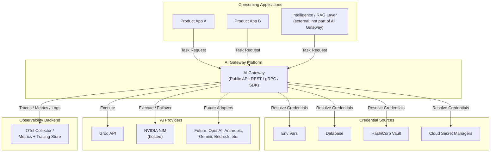

**Key context boundaries:**

- Applications never see arrows into "AI Providers" or "Credential Sources" — those are internal to AI Gateway.
- The "Intelligence / RAG Layer" is drawn explicitly as an external consumer to make clear AI Gateway does not contain it; it is simply another client of the same public API.

---

## 6. High-Level Architecture

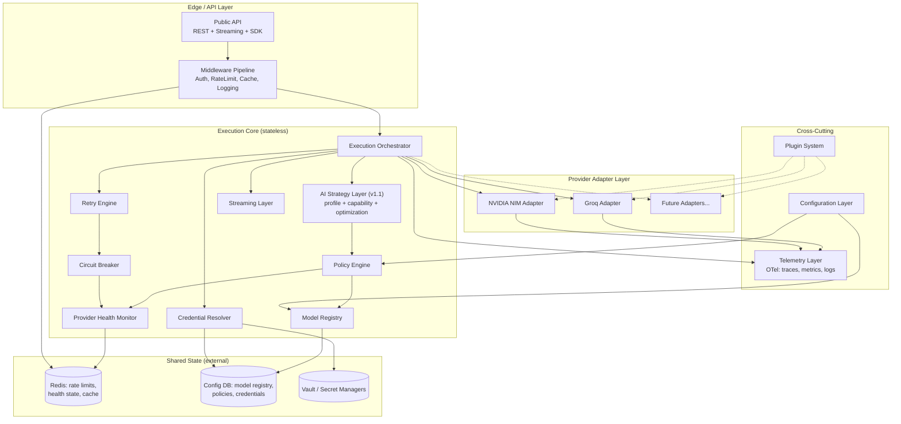

The system separates into four layers:

1. **Edge/API Layer** — public-facing, protocol translation, authn/z, coarse rate limiting, request-level caching.
2. **Execution Core** — the brain: stateless decision-making and orchestration logic. This is where P1–P6 principles are enforced. **(v1.1)** The Execution Core now contains two sub-layers in strict order: the **AI Strategy Layer** decides _how_ a task should be executed (profile, capabilities, optimizations — Sections 30–34), and the existing **Policy Engine** decides _where_ it executes (provider/model routing — Section 13, unchanged). The Orchestrator calls the Strategy Layer first; the Strategy Layer's output is the Policy Engine's input.
3. **Provider Adapter Layer** — one implementation per provider, all conforming to a single `ProviderAdapter` interface.
4. **Shared State & Cross-Cutting** — externalized state (Redis/DB/Vault) so the core stays stateless and horizontally scalable, plus telemetry/config/plugins that every layer above depends on.

---

## 7. Component Diagram

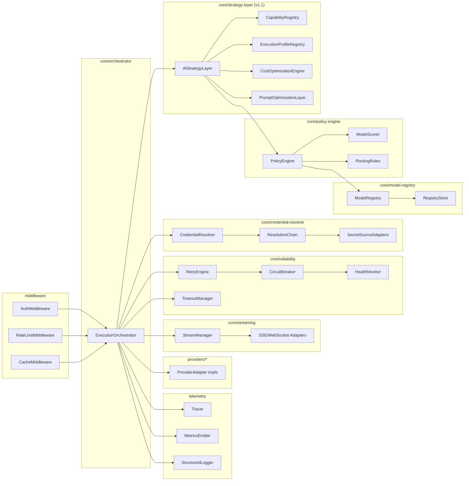

Each box maps directly to a package in the monorepo (Section 9). No component reaches into another component's internals — all cross-component calls go through the exported interface of the target package.

---

## 8. Sequence Diagrams

### 8.1 Standard (non-streaming) Task Execution

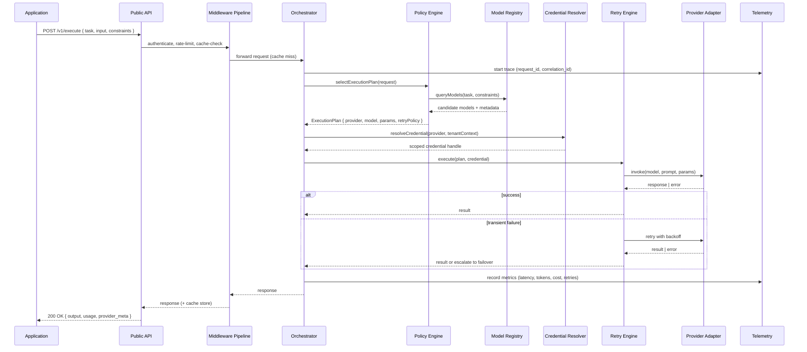

### 8.2 Streaming Execution with Client Cancellation

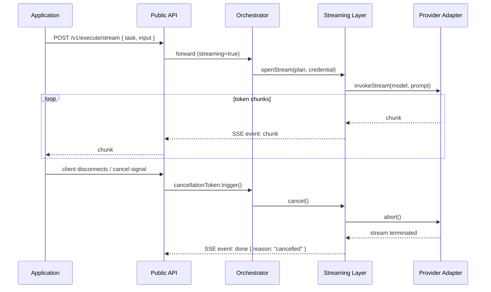

### 8.3 Provider Failover on Rate Limit

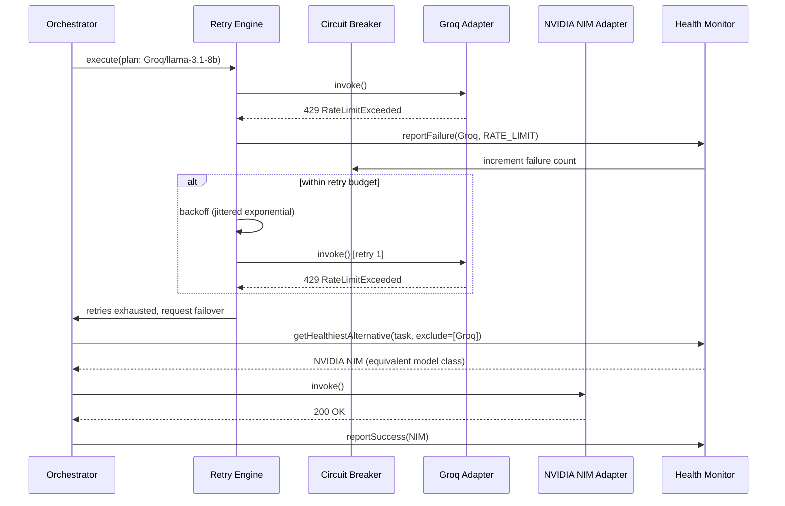

### 8.4 BYOK Credential Resolution

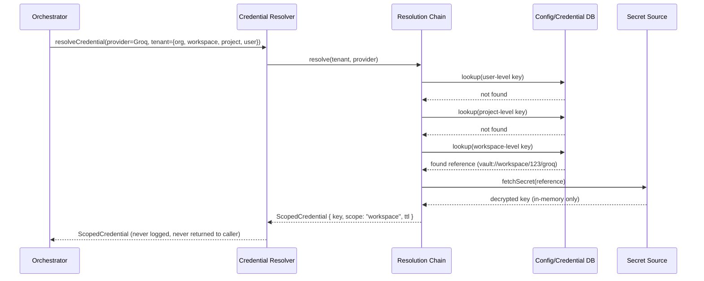

---

## 9. Package Diagram

AI Gateway ships as a TypeScript monorepo (pnpm workspaces + Turborepo, or Nx — either is compatible with this structure).

```
ai-gateway/
├── apps/
│   ├── gateway-server/            # Deployable HTTP/gRPC server (thin wrapper over core)
│   │   ├── src/
│   │   │   ├── http/              # REST route handlers
│   │   │   ├── grpc/              # gRPC service impl (optional milestone)
│   │   │   ├── streaming/         # SSE/WebSocket route handlers
│   │   │   └── bootstrap.ts       # Wires config -> core -> providers -> telemetry
│   │   └── package.json
│   └── admin-console/             # (Optional, later milestone) UI for registry/policy config
│
├── packages/
│   ├── core-contracts/            # Public request/response/error contracts (zero deps)
│   │   └── src/
│   │       ├── task.ts
│   │       ├── request.ts
│   │       ├── response.ts
│   │       ├── errors.ts
│   │       └── streaming.ts
│   │
│   ├── orchestrator/               # ExecutionOrchestrator
│   │   └── src/orchestrator.ts
│   │
│   ├── strategy-layer/              # (v1.1) AI Strategy Layer — decides HOW, before policy-engine decides WHERE
│   │   └── src/
│   │       ├── strategy-layer.ts
│   │       ├── capability-registry.ts
│   │       ├── execution-profile-registry.ts
│   │       ├── cost-optimizer.ts
│   │       ├── prompt-optimizer/
│   │       │   ├── prompt-optimizer.ts
│   │       │   └── transformers/   # compression, trimming, dedup, budgeting, normalization
│   │       └── learning/           # (v1.1, pluggable, no-op by default) LearningSignalCollector, AdaptiveRankingStrategy
│   │
│   ├── policy-engine/
│   │   └── src/
│   │       ├── policy-engine.ts
│   │       ├── model-scorer.ts
│   │       ├── routing-rules.ts
│   │       └── strategies/         # pluggable scoring strategies
│   │
│   ├── model-registry/
│   │   └── src/
│   │       ├── registry.ts
│   │       ├── model-metadata.ts
│   │       ├── lifecycle.ts        # (v1.1) lifecycle states + auto-migration rules
│   │       └── store/              # DB-backed + in-memory cache impls
│   │
│   ├── credential-resolver/
│   │   └── src/
│   │       ├── resolver.ts
│   │       ├── resolution-chain.ts
│   │       └── sources/            # env, db, vault, aws-sm, azure-kv, gcp-sm
│   │
│   ├── reliability/
│   │   └── src/
│   │       ├── retry-engine.ts
│   │       ├── circuit-breaker.ts
│   │       ├── timeout-manager.ts
│   │       ├── health-monitor.ts
│   │       └── backoff-policies.ts
│   │
│   ├── streaming/
│   │   └── src/
│   │       ├── stream-manager.ts
│   │       └── transports/         # sse.ts, websocket.ts
│   │
│   ├── providers/
│   │   ├── provider-sdk/           # ProviderAdapter interface + test harness + mock adapter
│   │   ├── groq/
│   │   ├── nvidia-nim/
│   │   └── _template/              # Copy-paste starting point for new adapters
│   │
│   ├── telemetry/
│   │   └── src/
│   │       ├── tracer.ts           # OpenTelemetry wrapper
│   │       ├── metrics.ts
│   │       └── logger.ts
│   │
│   ├── middleware/
│   │   └── src/
│   │       ├── auth.ts
│   │       ├── rate-limit.ts
│   │       ├── cache.ts
│   │       └── pipeline.ts
│   │
│   ├── plugin-system/
│   │   └── src/
│   │       ├── plugin-host.ts
│   │       └── plugin-contract.ts
│   │
│   ├── runtime-profiles/            # (v1.1) Development / Free Tier / Production / Enterprise / Offline / HA
│   │   └── src/
│   │       ├── runtime-profile.ts
│   │       └── presets/
│   │
│   └── config/
│       └── src/
│           ├── config-loader.ts
│           └── schema/             # zod/JSON-schema validated config
│
├── examples/
│   ├── minimal-node-client/
│   └── streaming-client/
│
├── tools/
│   └── adapter-conformance-tests/  # Shared test suite every provider adapter must pass
│
└── docs/
    └── adr/                        # Architecture Decision Records (Section 28)
```

**Dependency rule:** arrows only point "inward and downward" — `apps/*` depends on `packages/*`; `packages/providers/*` depends on `provider-sdk` and `core-contracts` only; `orchestrator` depends on `strategy-layer`, `policy-engine`, `model-registry`, `credential-resolver`, `reliability`, `streaming`, `telemetry`, `core-contracts`. **(v1.1)** `strategy-layer` depends on `model-registry` (read-only, for capability/lifecycle metadata) and `runtime-profiles`, but `policy-engine` has no dependency on `strategy-layer` — it only ever receives a fully-resolved `StrategyDecision` as a plain input, never reaches upward to ask the Strategy Layer anything. This keeps the v1.0 Policy Engine testable in isolation exactly as before (Section 24). No package under `packages/` may depend on `apps/*`. `core-contracts` has zero internal dependencies, so it can be published and versioned independently as the stable public contract.

---

## 10. Public APIs

### 10.1 Design Goals for the Public Surface

- No field ever accepts a provider name or model name from the caller.
- Every response includes enough metadata (which provider/model executed it, token usage, cost, latency) for the caller to build its own dashboards — without the caller having _chosen_ any of it.
- Errors are typed and provider-independent.

### 10.2 REST Contract

```
POST /v1/execute
POST /v1/execute/stream       (Server-Sent Events)
GET  /v1/tasks                (list supported task types + schemas)
GET  /v1/usage                (usage/cost summary for the authenticated tenant)
POST /v1/credentials           (register a BYOK credential at user/project/workspace/org scope)
DELETE /v1/credentials/:id
GET  /v1/health                (gateway + provider health summary)
```

### 10.3 Request Contract

```typescript
// packages/core-contracts/src/request.ts

export type TaskType =
  | "knowledge_extraction"
  | "entity_extraction"
  | "classification"
  | "summarization"
  | "json_generation"
  | "creative_writing"
  | "complex_reasoning"
  | "marketing_content"
  | "code_generation"
  | (string & {}); // extensible: custom task types registered via config

export interface ExecuteRequest {
  /** What the caller wants done. NEVER a model name. */
  task: TaskType;

  /** The content the task operates on. */
  input: {
    text?: string;
    messages?: ChatMessage[];
    context?: Record<string, unknown>;
  };

  /** Optional caller-side constraints. All optional; the gateway has sane defaults. */
  constraints?: {
    maxLatencyMs?: number;
    maxCostUsd?: number;
    requiredSchema?: JSONSchema; // triggers structured-output routing
    minContextTokens?: number;
    streaming?: boolean;
  };

  /** Optional soft preferences — hints, not guarantees. */
  preferences?: {
    creativity?: "low" | "medium" | "high";
    prioritize?: "cost" | "latency" | "quality";
    /** v1.1, optional, advanced use only: override the auto-resolved Execution Profile (Section 31).
     *  Still a profile ID, never a raw inference parameter — the "never configure model
     *  parameters directly" guarantee (Section 31.1) holds even for this override. */
    executionProfileOverride?: string;
  };

  /** Multi-tenant scoping — used for credential resolution, rate limits, telemetry. */
  tenant: {
    organizationId: string;
    workspaceId?: string;
    projectId?: string;
    userId?: string;
  };

  /** Caller-supplied idempotency/correlation key. */
  requestId?: string;
  correlationId?: string;
}

export interface ChatMessage {
  role: "system" | "user" | "assistant" | "tool";
  content: string;
  name?: string;
}
```

### 10.4 Response Contract

```typescript
// packages/core-contracts/src/response.ts

export interface ExecuteResponse {
  requestId: string;
  output: {
    text?: string;
    json?: unknown; // present when structured output was requested
    toolCalls?: ToolCall[];
  };
  usage: {
    inputTokens: number;
    outputTokens: number;
    estimatedCostUsd: number;
  };
  execution: {
    /** Metadata about the decision — informational only, not controllable by the caller. */
    providerId: string; // e.g. "groq" — informational, opaque identifier
    modelClass: string; // e.g. "fast-extraction" — capability class, not raw model string
    latencyMs: number;
    retries: number;
    failedOver: boolean;
  };
  finishReason: "stop" | "length" | "content_filter" | "tool_call" | "cancelled";
}

export interface StreamChunk {
  requestId: string;
  delta: { text?: string; toolCallDelta?: unknown };
  done: boolean;
  finishReason?: ExecuteResponse["finishReason"];
}
```

### 10.5 Error Model

```typescript
// packages/core-contracts/src/errors.ts

export type GatewayErrorCode =
  | "INVALID_TASK"
  | "INVALID_SCHEMA"
  | "CREDENTIAL_NOT_FOUND"
  | "CREDENTIAL_INVALID"
  | "ALL_PROVIDERS_UNAVAILABLE"
  | "RATE_LIMITED"
  | "TIMEOUT"
  | "CANCELLED"
  | "CONTENT_FILTERED"
  | "INTERNAL_ERROR";

export class GatewayError extends Error {
  constructor(
    public code: GatewayErrorCode,
    message: string,
    public retryable: boolean,
    public details?: Record<string, unknown>,
  ) {
    super(message);
  }
}
```

Callers only ever see `GatewayError` — a raw `GroqApiError` or `NimHttpError` must never escape the provider adapter layer (enforced by the adapter conformance test suite in `tools/adapter-conformance-tests`).

### 10.6 Configuration Model (tenant/admin-facing, not per-request)

```typescript
export interface GatewayConfig {
  credentialPriority: ("user" | "project" | "workspace" | "organization" | "platform")[];
  routing: {
    defaultStrategy: "cost_optimized" | "latency_optimized" | "quality_optimized";
    perTaskOverrides?: Partial<Record<TaskType, RoutingOverride>>;
  };
  reliability: {
    maxRetries: number;
    backoff: "exponential" | "linear";
    circuitBreakerThreshold: number;
  };
}
```

---

## 11. Internal Interfaces

These are the seams that make the system modular. Every one of these is a small, independently-testable TypeScript interface.

```typescript
// packages/providers/provider-sdk/src/provider-adapter.ts
export interface ProviderAdapter {
  readonly id: string; // "groq", "nvidia-nim", ...
  readonly capabilities: ProviderCapabilities;

  invoke(req: NormalizedInvocation, cred: ScopedCredential): Promise<NormalizedResult>;
  invokeStream(req: NormalizedInvocation, cred: ScopedCredential): AsyncIterable<NormalizedChunk>;
  healthCheck(cred: ScopedCredential): Promise<ProviderHealthSnapshot>;
  estimateCost(req: NormalizedInvocation): CostEstimate;
}

// packages/policy-engine/src/policy-engine.ts
export interface PolicyEngine {
  selectExecutionPlan(req: ExecuteRequest, ctx: PolicyContext): Promise<ExecutionPlan>;
}

// packages/model-registry/src/registry.ts
export interface ModelRegistry {
  queryModels(filter: ModelQuery): Promise<ModelDescriptor[]>;
  getModel(providerId: string, modelId: string): Promise<ModelDescriptor | null>;
  upsertModel(descriptor: ModelDescriptor): Promise<void>; // config-driven, no redeploy
}

// packages/credential-resolver/src/resolver.ts
export interface CredentialResolver {
  resolve(provider: string, tenant: TenantContext): Promise<ScopedCredential>;
}

// packages/reliability/src/retry-engine.ts
export interface RetryEngine {
  execute<T>(fn: () => Promise<T>, policy: RetryPolicy): Promise<T>;
}

export interface HealthMonitor {
  reportSuccess(providerId: string, meta: { latencyMs: number }): void;
  reportFailure(providerId: string, reason: FailureReason): void;
  getHealth(providerId: string): ProviderHealthSnapshot;
  getHealthiestAlternative(task: TaskType, exclude: string[]): Promise<string | null>;
}

// packages/streaming/src/stream-manager.ts
export interface StreamManager {
  openStream(plan: ExecutionPlan, cred: ScopedCredential): AsyncIterable<NormalizedChunk>;
  cancel(requestId: string): void;
}

// packages/telemetry/src/index.ts
export interface Telemetry {
  startSpan(name: string, attrs?: Record<string, unknown>): Span;
  recordMetric(name: string, value: number, labels?: Record<string, string>): void;
  log(
    level: "debug" | "info" | "warn" | "error",
    msg: string,
    fields?: Record<string, unknown>,
  ): void;
}

// packages/plugin-system/src/plugin-contract.ts
export interface GatewayPlugin {
  name: string;
  onRequest?(req: ExecuteRequest): Promise<ExecuteRequest>;
  onResponse?(res: ExecuteResponse): Promise<ExecuteResponse>;
  onProviderRegistered?(adapter: ProviderAdapter): void;
}
```

All core packages depend only on these interfaces plus `core-contracts` — never on a concrete provider or concrete infra implementation. Dependency injection happens once, at `apps/gateway-server/src/bootstrap.ts`.

---

## 12. Provider Abstraction Design

### 12.1 Normalized Invocation

Every provider adapter receives the _same_ normalized shape regardless of what the underlying provider API looks like:

```typescript
export interface NormalizedInvocation {
  modelId: string; // provider-specific model identifier, chosen by Policy Engine
  messages: ChatMessage[];
  temperature: number;
  maxOutputTokens: number;
  responseFormat?: { type: "json"; schema?: JSONSchema };
  tools?: ToolDefinition[];
  stream: boolean;
  timeoutMs: number;
}

export interface NormalizedResult {
  text?: string;
  json?: unknown;
  toolCalls?: ToolCall[];
  usage: { inputTokens: number; outputTokens: number };
  finishReason: ExecuteResponse["finishReason"];
  raw?: unknown; // only ever used for adapter-internal debugging, stripped before crossing back out
}
```

Each adapter is responsible for two translation directions:

1. **Inbound:** `NormalizedInvocation` → provider's native request shape (e.g., Groq's OpenAI-compatible chat completions body, or NIM's OpenAI-compatible or native schema).
2. **Outbound:** provider's native response/error → `NormalizedResult` / `GatewayError`.

This is the _only_ place in the codebase that knows a provider's request/response JSON shape.

### 12.2 Provider Capability Declaration

```typescript
export interface ProviderCapabilities {
  supportsStreaming: boolean;
  supportsJsonMode: boolean;
  supportsToolCalling: boolean;
  supportsSystemMessages: boolean;
  maxContextTokens: number;
  rateLimits: { requestsPerMinute?: number; tokensPerMinute?: number };
}
```

The Policy Engine consults this before ever routing a request to a provider — e.g., a request with `constraints.requiredSchema` set will never be routed to a provider whose capability declares `supportsJsonMode: false`.

### 12.3 Reference Adapters at Launch

**Groq Adapter** (`packages/providers/groq`)

- Talks to Groq's OpenAI-compatible `/openai/v1/chat/completions` endpoint.
- Tuned for the free-tier rate limits: adapter-level token-bucket limiter that respects Groq's per-model RPM/TPM headers, proactively throttling before Groq returns a 429 rather than just reacting to one.
- Declares multiple `modelClass` mappings (e.g., `fast-extraction` → a small Llama/Gemma-class model, `complex-reasoning` → a larger reasoning-tuned model) so the Policy Engine can route by capability without hardcoding a model string outside the registry.

**NVIDIA NIM Adapter** (`packages/providers/nvidia-nim`)

- Talks to NVIDIA's hosted NIM inference endpoints (build.nvidia.com-style hosted API), not self-hosted GPU inference — no GPU orchestration concerns belong in this adapter.
- Positioned in the registry primarily as a **failover** and **model-diversity** target, so its routing weight is lower by default than Groq's for latency-sensitive tasks, but can be promoted per-workspace via config.

### 12.4 Adding a New Provider (Design Goal: "Trivial")

To add, say, OpenAI:

1. Copy `packages/providers/_template`.
2. Implement `ProviderAdapter.invoke`, `.invokeStream`, `.healthCheck`, `.estimateCost` against OpenAI's API.
3. Register capability metadata + model descriptors in the Model Registry (config, not code).
4. Run `tools/adapter-conformance-tests` against it — a shared suite that asserts every adapter normalizes errors, respects timeouts, and streams correctly, so behavioral parity across providers is enforced automatically.
5. Register the adapter instance in `bootstrap.ts`.

No change to `orchestrator`, `policy-engine`, `credential-resolver`, or any public contract is required. This is the concrete mechanism behind Design Goal "adding a provider should require minimal implementation effort."

---

## 13. Policy Engine Design

### 13.1 Responsibilities

The Policy Engine converts an `ExecuteRequest` + live system state into a concrete `ExecutionPlan`:

```typescript
export interface ExecutionPlan {
  providerId: string;
  modelId: string;
  modelClass: string;
  temperature: number;
  maxOutputTokens: number;
  timeoutMs: number;
  retryPolicy: RetryPolicy;
  streaming: boolean;
  fallbackPlans: ExecutionPlan[]; // ordered failover chain, pre-computed
}
```

### 13.2 Decision Pipeline

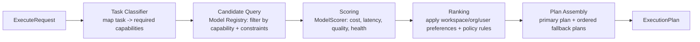

1. **Task Classifier** — maps the `TaskType` (and any schema/latency constraints) to a required-capability set, e.g. `json_generation` + `requiredSchema` → `{supportsJsonMode: true}`.
2. **Candidate Query** — asks the Model Registry for every model satisfying the capability set and any hard constraints (`maxLatencyMs`, `maxCostUsd`, `minContextTokens`).
3. **Scoring** — the `ModelScorer` computes a weighted score per candidate from: current provider health (Section 18), live rate-limit headroom, historical latency percentile, cost per 1K tokens, and a static "quality/creativity" score from registry metadata.
4. **Ranking** — applies `preferences.prioritize` (cost/latency/quality) and any workspace/org-level policy overrides (e.g., "this org always prefers Groq for cost reasons") as weight adjustments on top of the raw score.
5. **Plan Assembly** — top-ranked candidate becomes the primary plan; the next 1–2 candidates become the pre-computed fallback chain used by the Retry Engine on failover, so failover doesn't need to re-run the whole pipeline mid-request.

### 13.3 Scoring Function (illustrative)

```typescript
score(model) =
  w_quality * model.qualityScoreForTask(task) +
  w_latency * normalize(1 / model.p50LatencyMs) +
  w_cost * normalize(1 / model.costPerKTokens) +
  w_health * healthMonitor.getHealth(model.providerId).score -
  penalty_rateLimitPressure(model.providerId);
```

Weights (`w_quality`, `w_latency`, `w_cost`, `w_health`) are part of `GatewayConfig.routing` and are overridable per task type, per workspace, and per organization — enforcing Principle P7 (configuration over code).

### 13.4 Policy Rules Engine

Beyond scoring, discrete **rules** can hard-override routing for enterprise needs, e.g.:

- "Never route PII-tagged requests to Provider X" (data residency/compliance)
- "This workspace's BYOK key for Anthropic must be used for `complex_reasoning` tasks whenever present"
- "Cap workspace Y's cost per day; route to free-tier models only past 80% of budget"

Rules are evaluated after scoring and can veto or force a candidate; they are expressed as small, independently-testable predicate objects (`RoutingRule.applies(ctx)` / `.apply(candidates)`) registered via config, not compiled into the scorer.

### 13.5 Relationship to the AI Strategy Layer (v1.1)

As of v1.1, the Policy Engine no longer receives a raw `ExecuteRequest` directly. The new **AI Strategy Layer** (Section 30) sits immediately in front of it and hands it a `StrategyDecision` — a fully-resolved bundle containing the selected `ExecutionProfile` (Section 31), the required capability set (Section 32, resolved via the Capability Registry rather than inferred ad hoc from `task`), and any cost/prompt optimizations already applied (Sections 33–34). Everything described above in 13.1–13.4 — candidate query, scoring, ranking, plan assembly, routing rules — is **unchanged**; it simply operates on the richer, pre-resolved `StrategyDecision` instead of the raw request. This preserves the Policy Engine's existing test suite and its status as a pure, independently-testable routing function (Section 24): from the Policy Engine's point of view, nothing has changed except where its input comes from.

---

## 14. Model Registry Design

### 14.1 Model Descriptor Schema

```typescript
export interface ModelDescriptor {
  providerId: string; // "groq"
  modelId: string; // provider's native model identifier
  modelClass: string; // "fast-extraction" | "complex-reasoning" | "creative" | ...
  capabilities: {
    contextWindow: number;
    structuredOutput: boolean;
    streaming: boolean;
    toolCalling: boolean;
    reasoningDepth: "shallow" | "moderate" | "deep";
    creativityScore: number; // 0-1, curated/benchmarked
  };
  performance: {
    p50LatencyMs: number;
    p99LatencyMs: number;
    tokensPerSecond: number;
  };
  cost: {
    inputPer1kTokensUsd: number;
    outputPer1kTokensUsd: number;
    tier: "free" | "paid";
  };
  availability: {
    enabled: boolean;
    regions?: string[];
    rateLimits: { requestsPerMinute?: number; tokensPerMinute?: number };
  };
}
```

### 14.2 Storage & Configurability

The registry is backed by a database table (or config file for small deployments) and cached in-memory per gateway instance with a short TTL + invalidation event (published over the same shared Redis used for health/rate-limit state). This satisfies "configurable without code changes" — an operator updates a row/record, and every gateway instance picks it up within seconds, no redeploy required.

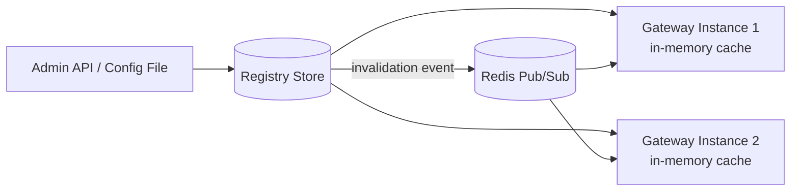

### 14.3 Illustrative Seed Data

| providerId | modelClass        | contextWindow | structuredOutput | tier | notes                                        |
| ---------- | ----------------- | ------------- | ---------------- | ---- | -------------------------------------------- |
| groq       | fast-extraction   | 8K–32K        | yes              | free | small/fast Llama or Gemma-class model        |
| groq       | complex-reasoning | 32K–128K      | yes              | free | larger reasoning-tuned model, higher latency |
| groq       | creative          | 32K           | no/partial       | free | tuned for stylistic generation               |
| nvidia-nim | fast-extraction   | 8K–32K        | yes              | paid | fallback for Groq extraction                 |
| nvidia-nim | complex-reasoning | 32K+          | yes              | paid | model-diversity alternative                  |

Exact model identifiers are deliberately left as configuration, not hardcoded in this spec, since provider-hosted model availability changes frequently — that volatility is precisely what the registry is designed to absorb without a code change.

---

## 15. Credential Management Architecture

### 15.1 Layered Credential Model

Credentials can be supplied at five scopes, resolved in a configurable priority order:

```
User Key  >  Project Key  >  Workspace Key  >  Organization Key  >  Platform-Managed Key
(most specific)                                                    (most general / fallback)
```

The default priority is user-first (an individual's own key wins if present), but `GatewayConfig.credentialPriority` lets an enterprise flip this — e.g., forcing organization-managed keys regardless of user-supplied ones, for compliance.

### 15.2 Credential Resolution Chain

```typescript
export interface ResolutionChain {
  resolve(provider: string, tenant: TenantContext): Promise<ScopedCredential | null>;
}

// Implemented as an ordered list of ScopeResolvers, short-circuiting on first hit:
export interface ScopeResolver {
  scope: "user" | "project" | "workspace" | "organization" | "platform";
  lookup(provider: string, tenant: TenantContext): Promise<CredentialReference | null>;
}
```

Each `CredentialReference` is a _pointer_ (`vault://...`, `aws-sm://...`, a DB row ID) — never the raw secret. The raw secret is only ever fetched from the underlying secret source at the moment of use, decrypted in-memory, used to sign/authorize exactly one provider call, and discarded (never persisted, never logged, never included in traces).

### 15.3 Secret Source Adapters

```typescript
export interface SecretSource {
  id: string; // "env" | "db" | "vault" | "aws-sm" | "azure-kv" | "gcp-sm"
  fetch(reference: CredentialReference): Promise<string>;
}
```

Launch scope: `env` (for platform-managed dev/self-host keys) and `db` (encrypted-at-rest column, for workspace/org/user BYOK keys) are first-class. `vault`, `aws-sm`, `azure-kv`, `gcp-sm` are designed as drop-in `SecretSource` implementations for enterprise self-hosting — no core change required to add one, matching Principle P4.

### 15.4 Credential Lifecycle

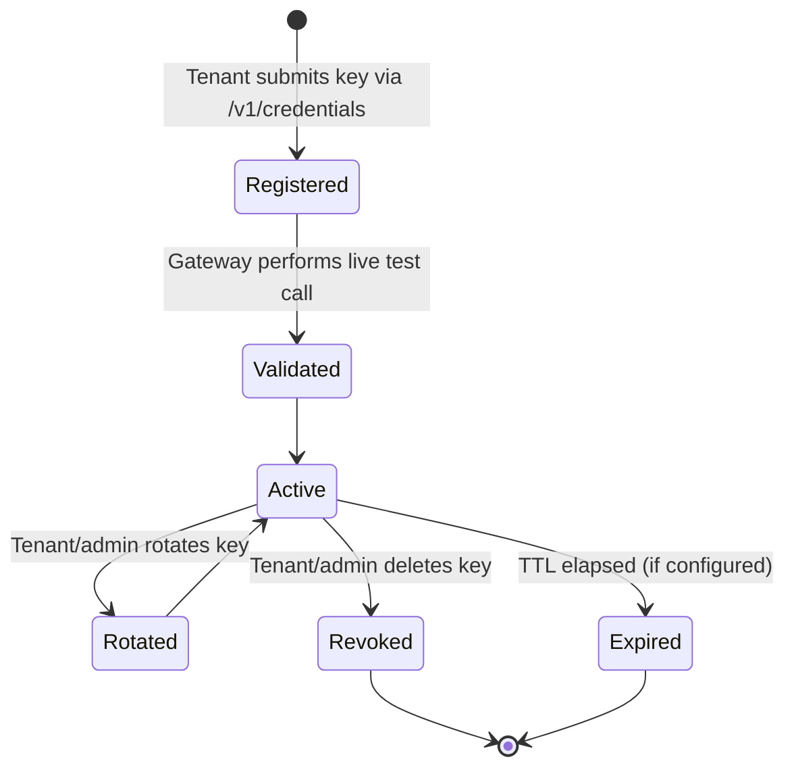

All state transitions are audit-logged (who, when, which scope, which provider — never the key value itself).

---

## 16. BYOK Architecture

### 16.1 Why BYOK Is First-Class, Not Bolted On

BYOK is not an alternate code path — the platform-managed key is modeled as just another `ScopeResolver` (`scope: "platform"`) at the bottom of the same resolution chain used for every other scope. This means a workspace can mix: platform-managed Groq key + a workspace-supplied NVIDIA NIM key + a user-supplied OpenAI key (once that adapter exists) with zero special-casing in the orchestrator.

### 16.2 BYOK Registration Flow

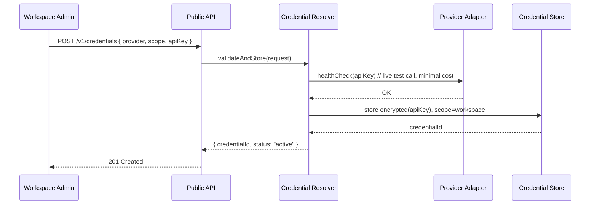

### 16.3 Isolation Guarantee

A BYOK key registered at workspace scope is only ever resolvable by requests whose `tenant.workspaceId` matches — enforced at the data layer (row-level scoping) and re-verified at the resolver layer (defense in depth), so a bug in one layer cannot alone cause cross-tenant credential leakage.

### 16.4 Cost & Quota Attribution

When a BYOK key is used, usage/cost accounting still flows through the same Telemetry Layer as platform-managed keys, tagged with `scope: "byok"` — so a workspace using its own OpenAI key still gets accurate cost dashboards, and platform operators can distinguish "cost we're bearing" from "cost the tenant is bearing on their own key" in aggregate reporting.

---

## 17. Request Lifecycle

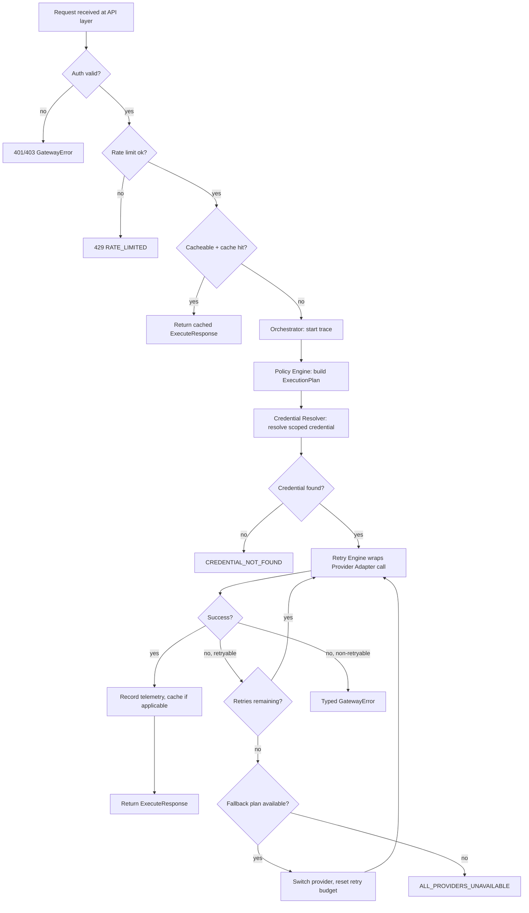

Every terminal node (`Z1`–`Z6`, `L`) emits a structured log line and closes the trace span with a status. There is no code path in the orchestrator that can return without either a typed success or a typed `GatewayError` — unhandled exceptions from provider adapters are caught at the adapter boundary and converted (Section 19).

> **v1.1 note:** this diagram remains accurate as the _outer_ lifecycle. As of v1.1, step **F** ("Policy Engine: build ExecutionPlan") is preceded by a new sub-step where the Orchestrator first calls the AI Strategy Layer to produce a `StrategyDecision`, which the Policy Engine then consumes. Section 38 shows the fully expanded lifecycle with this new sub-step inline.

---

## 18. Retry & Failover Strategy

### 18.1 Retry Policy

```typescript
export interface RetryPolicy {
  maxAttempts: number; // per-provider attempts before failover
  backoff: "exponential" | "linear" | "none";
  baseDelayMs: number;
  maxDelayMs: number;
  jitter: boolean;
  retryableErrorCodes: GatewayErrorCode[]; // e.g. RATE_LIMITED, TIMEOUT
}
```

Default: 2 attempts per provider, exponential backoff with full jitter, base 200ms, max 4s, retryable on `RATE_LIMITED` and `TIMEOUT` only — never on `CONTENT_FILTERED` or `INVALID_SCHEMA`, which are deterministic and retrying wastes latency/cost for no benefit.

### 18.2 Circuit Breaker

Per `(providerId, modelClass)` pair, the Circuit Breaker tracks a rolling failure rate:

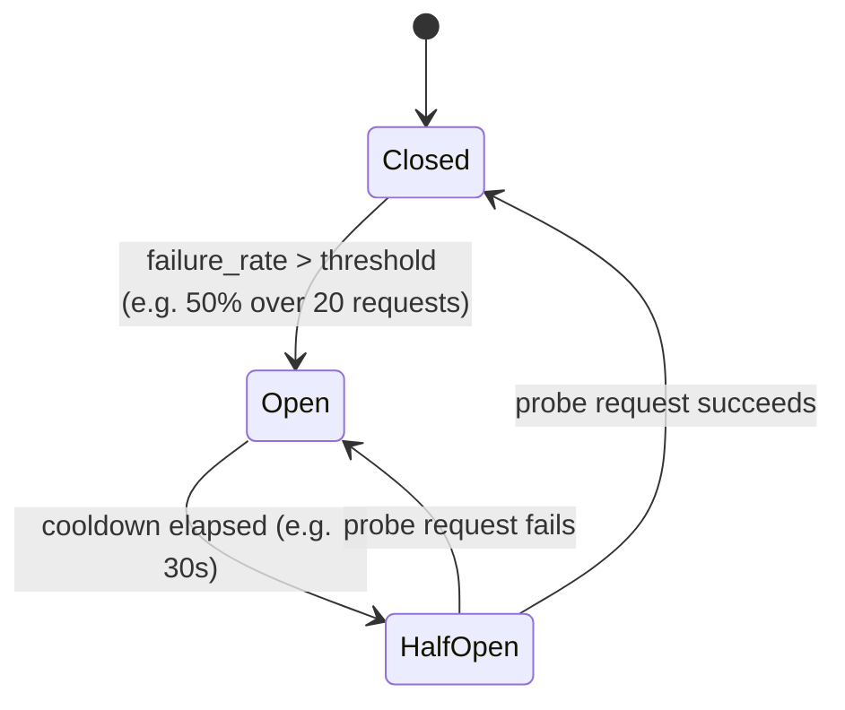

While a breaker is `Open` for `(groq, complex-reasoning)`, the Policy Engine simply excludes that candidate from scoring — no wasted calls, no wasted retry budget — and the pre-computed fallback plan takes over immediately.

### 18.3 Failover Semantics

Failover is **plan-based, not ad hoc**: the Policy Engine computes an ordered `fallbackPlans[]` at plan-assembly time (Section 13), so when the Retry Engine exhausts attempts on the primary plan, it doesn't re-run the whole scoring pipeline mid-request — it simply advances to the next pre-ranked plan, re-resolving only the credential for the new provider. This keeps failover latency low and keeps the decision auditable (the trace shows exactly which plans were computed upfront and which one ultimately served the request).

### 18.4 Timeout & Deadline Propagation

A single end-to-end deadline is computed from `constraints.maxLatencyMs` (or a system default) at request entry and propagated as a `AbortSignal`/deadline timestamp through every layer — Policy Engine, Credential Resolver, Retry Engine, Provider Adapter — so that a slow credential lookup or a slow first attempt correctly shrinks the time budget left for retries/failover, rather than each layer independently applying its own timeout and blowing past the caller's real budget.

---

## 19. Error Handling Strategy

### 19.1 Error Taxonomy

| Category                  | Example Codes                                | Retryable?                              | Typical Handling                                                                           |
| ------------------------- | -------------------------------------------- | --------------------------------------- | ------------------------------------------------------------------------------------------ |
| Client input errors       | `INVALID_TASK`, `INVALID_SCHEMA`             | No                                      | 400, returned immediately, no provider call attempted                                      |
| Auth/credential errors    | `CREDENTIAL_NOT_FOUND`, `CREDENTIAL_INVALID` | No (fails fast)                         | 401/424, audit-logged, does not leak which scope failed to unauthenticated callers         |
| Transient provider errors | `RATE_LIMITED`, `TIMEOUT`                    | Yes                                     | Retry → failover per Section 18                                                            |
| Content policy errors     | `CONTENT_FILTERED`                           | No                                      | Passed through as a typed, non-retryable result                                            |
| Systemic failure          | `ALL_PROVIDERS_UNAVAILABLE`                  | No (already exhausted retries/failover) | 503, triggers alerting                                                                     |
| Internal bugs             | `INTERNAL_ERROR`                             | No                                      | 500, full internal detail captured in trace/log, only a generic message returned to caller |

### 19.2 Adapter Boundary Contract

Every `ProviderAdapter.invoke`/`invokeStream` implementation _must_ catch all provider-SDK/HTTP exceptions internally and translate them to `GatewayError` before returning — enforced by the shared conformance test suite, which deliberately injects malformed responses, timeouts, and non-JSON bodies against each adapter and asserts no raw exception escapes.

### 19.3 Never-Silent-Failure Principle

No path exists where a request simply hangs or vanishes: every request has a deadline (Section 18.4), every deadline expiry emits `TIMEOUT`, and the middleware pipeline has an outer catch-all that converts any unexpected exception into `INTERNAL_ERROR` with a correlation ID the caller can hand to platform operators for debugging — while the _actual_ stack trace only goes to the Telemetry Layer, never to the response body.

---

## 20. Security Architecture

### 20.1 Credential Storage

- Secrets at rest: encrypted with envelope encryption (data-encryption-key per secret, wrapped by a KMS-held key), whether stored in-database or in an external secret manager.
- Secrets in transit: TLS everywhere, including gateway → provider and gateway → secret source.
- In-memory secrets: held only for the duration of a single provider call, zeroed/discarded immediately after, never written to disk, cache, or log.

### 20.2 Secret Rotation

Rotation is modeled as issuing a new `CredentialReference` version while the old one remains valid for an overlap window — so a workspace can rotate a key without a request-serving outage, and the audit log records rotation events distinctly from registration/revocation.

### 20.3 Audit Logging

Every credential lifecycle event (register, resolve — at scope-decision granularity, not per-token, rotate, revoke) is written to an append-only audit log containing: actor, tenant scope, provider, timestamp, and outcome — explicitly excluding the secret value itself.

### 20.4 Multi-Tenancy & Isolation

- **Data isolation:** every credential, usage record, and cached response is tagged with full tenant scope (`organizationId`/`workspaceId`/`projectId`/`userId`) and every read path filters on it — no query is allowed to span tenants implicitly.
- **Rate limit isolation:** rate limit counters are keyed per tenant scope, so one workspace's burst cannot starve another's quota on shared platform-managed keys.
- **Cache isolation:** the response cache key includes tenant scope by default (configurable to relax for genuinely tenant-independent, non-sensitive tasks only), preventing cross-tenant data leakage through a shared cache.

### 20.5 Access Control

Standard RBAC at the API layer: roles (e.g., `org_admin`, `workspace_admin`, `member`) gate who may register/revoke credentials, view usage/cost for which scope, and modify routing policy — implemented as `AuthMiddleware` + a policy-check step, independent of the execution core, so authorization logic can evolve without touching orchestration logic.

### 20.6 Workspace Isolation Diagram

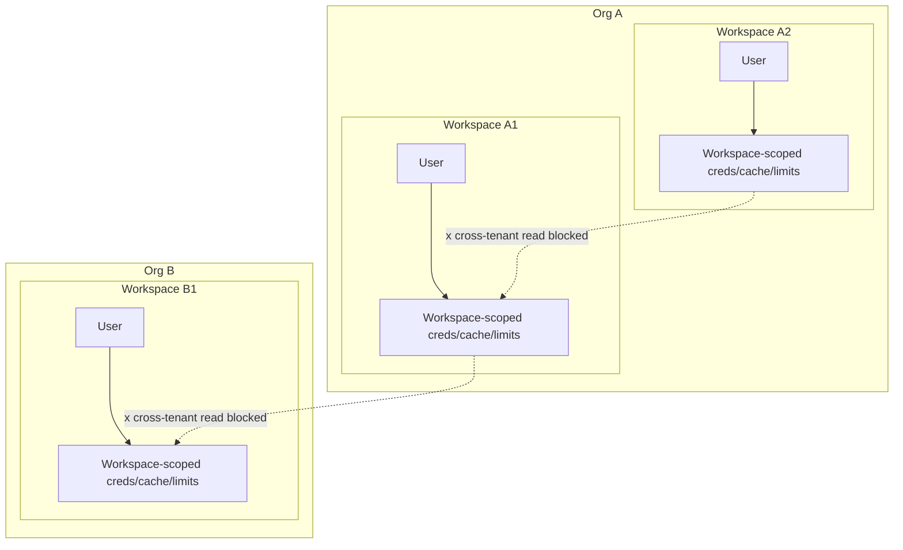

---

## 21. Observability Architecture

### 21.1 Three Pillars, One Correlation ID

Every request generates a `requestId` (caller-suppliable) and an internally-generated `traceId`; both are attached to every log line, every metric label set, and the OpenTelemetry span — allowing an operator to go from "customer reports request X was slow" straight to the exact trace.

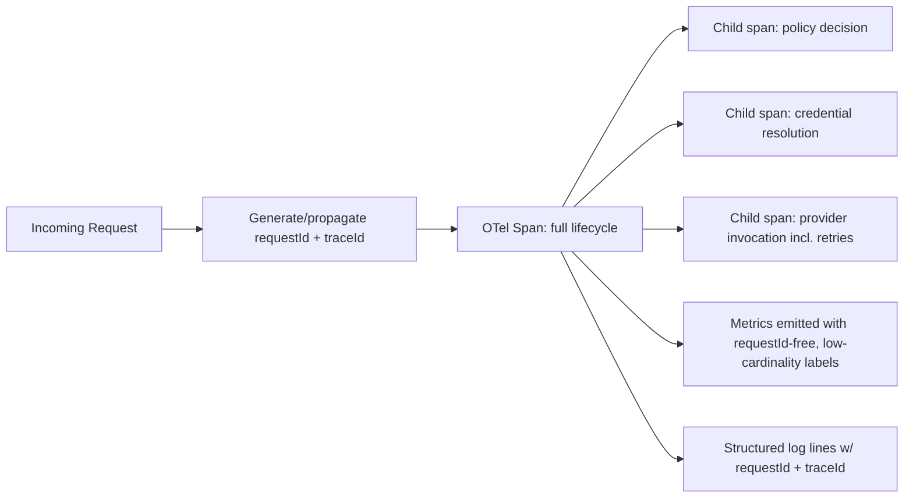

### 21.2 Metrics Catalogue (illustrative)

| Metric                          | Type      | Labels                                      |
| ------------------------------- | --------- | ------------------------------------------- |
| `gateway_request_duration_ms`   | histogram | task, providerId, modelClass, outcome       |
| `gateway_provider_latency_ms`   | histogram | providerId, modelClass                      |
| `gateway_tokens_total`          | counter   | providerId, direction(in/out), tenant scope |
| `gateway_cost_usd_total`        | counter   | providerId, tenant scope, byok(bool)        |
| `gateway_retries_total`         | counter   | providerId, reason                          |
| `gateway_failovers_total`       | counter   | fromProvider, toProvider                    |
| `gateway_circuit_breaker_state` | gauge     | providerId, modelClass                      |
| `gateway_cache_hit_ratio`       | gauge     | task                                        |

### 21.3 Distributed Tracing

Standard OpenTelemetry spans, exportable to any OTLP-compatible backend (Jaeger, Tempo, Honeycomb, Datadog, etc.) — the Telemetry Layer only depends on the OTel SDK, never on a specific vendor, keeping the platform observability-backend-agnostic in the same spirit as provider-agnosticism.

### 21.4 Structured Logging

All logs are JSON, one event per line, with a fixed core schema (`timestamp`, `level`, `requestId`, `traceId`, `tenant`, `message`, `...context`) so they are trivially ingestible by any log pipeline without custom parsers.

### 21.5 Cost & Failure Analytics

Because token usage and cost are recorded per request with full tenant/provider/model-class attribution, the platform can produce (via a downstream analytics job, not inside the hot path) dashboards for: cost per workspace over time, cost per task type, failure/retry rate per provider, and BYOK vs. platform-managed cost split — all without any bespoke instrumentation beyond what every request already emits.

---

## 22. Performance Optimizations

- **In-memory registry cache** with pub/sub invalidation (Section 14.2) removes a DB round-trip from the hot path of every request.
- **Connection pooling / keep-alive** to provider APIs, held per gateway instance, avoiding TCP/TLS handshake cost on every call.
- **Pre-computed fallback plans** (Section 18.3) avoid re-running the Policy Engine's scoring pipeline mid-request during failover.
- **Proactive, adapter-level rate limiting** (Section 12.3) avoids round-tripping to a provider only to receive a 429 — the adapter's token-bucket limiter holds back requests that would certainly fail, freeing that time for a provider that can actually serve the request.
- **Streaming-first design** for long-form tasks (creative writing, complex reasoning) so callers see first-token latency rather than full-completion latency, without any gateway-side buffering of the full response.
- **Request-level response caching** (Section 20.4/17) for idempotent, deterministic task types (e.g., repeated classification of identical input) — off by default for anything non-deterministic (`temperature > 0`) or containing per-user context.
- **Deadline propagation** (Section 18.4) ensures no layer wastes time budget that a later layer actually needed.

---

## 23. Scalability Strategy

### 23.1 Horizontal Scaling of the Execution Core

Because the Execution Core is stateless (Principle P3), any number of gateway instances can run behind a load balancer with zero session affinity requirements. All shared state — rate limit counters, circuit breaker state, registry cache invalidation, response cache — lives in Redis (or an equivalent distributed store), so scaling out is a matter of adding instances, not re-partitioning data.

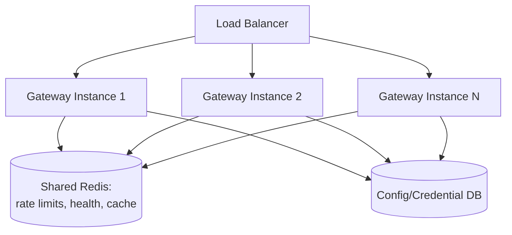

### 23.2 Scaling Dimensions

| Dimension                    | Strategy                                                                                                                                                      |
| ---------------------------- | ------------------------------------------------------------------------------------------------------------------------------------------------------------- |
| Request throughput           | Add stateless gateway instances behind LB; no coordination needed beyond shared Redis/DB                                                                      |
| Provider rate-limit ceilings | Policy Engine + Health Monitor automatically shift load to alternate providers/models as headroom shrinks                                                     |
| Multi-region                 | Deploy gateway instances per region; Redis/DB either regional-replicated or region-local with async cost/usage reconciliation, depending on consistency needs |
| Registry/config growth       | Registry store is a normal relational/document store; scales independently of the execution core                                                              |
| Credential store growth      | Encrypted secret storage scales independently (e.g., dedicated Vault cluster or managed secret service)                                                       |

### 23.3 Backpressure

When a tenant's rate limit or a provider's rate limit is genuinely exhausted with no viable fallback, the gateway returns `RATE_LIMITED`/`ALL_PROVIDERS_UNAVAILABLE` promptly rather than queuing indefinitely — queuing is left to the calling application (which has the business context to decide whether to retry, degrade, or surface to its own user), keeping the gateway's own memory footprint bounded under load.

---

## 24. Testing Strategy

| Layer                              | Strategy                                                                                                                                                                                                                                               |
| ---------------------------------- | ------------------------------------------------------------------------------------------------------------------------------------------------------------------------------------------------------------------------------------------------------ |
| **Provider adapters**              | Shared conformance test suite (`tools/adapter-conformance-tests`) run against every adapter, including a mock-server harness that simulates timeouts, malformed JSON, rate-limit responses, and partial streams — every adapter must pass identically. |
| **Policy Engine**                  | Pure-function unit tests over the scoring/ranking pipeline with synthetic Model Registry fixtures — deterministic given fixed inputs, no network.                                                                                                      |
| **Credential Resolver**            | Unit tests per `ScopeResolver` with fake secret sources; integration tests against a real (test) Vault/DB to validate the full resolution chain and isolation guarantees (Section 16.3).                                                               |
| **Reliability (Retry/CB/Timeout)** | Property-based tests: inject failure sequences and assert retry counts, backoff timing, and circuit state transitions match policy exactly.                                                                                                            |
| **Orchestrator (integration)**     | End-to-end tests using the mock provider adapter, exercising the full request lifecycle (Section 17) including cache hits, failover, and cancellation.                                                                                                 |
| **Streaming**                      | Tests asserting chunk ordering, cancellation propagation (client disconnect → adapter `abort()`), and correct `finishReason` on truncation/cancel/completion.                                                                                          |
| **Security/multi-tenancy**         | Explicit cross-tenant isolation tests: attempt to resolve Tenant A's credential/cache from a Tenant B context and assert failure.                                                                                                                      |
| **Load/performance**               | Benchmark suite measuring gateway-overhead latency (Section 4) excluding provider inference time, run in CI against the mock adapter to catch regressions independent of real provider latency variance.                                               |
| **Contract tests**                 | Schema validation tests ensuring `ExecuteRequest`/`ExecuteResponse`/`GatewayError` remain backward compatible across releases (breaking changes require a major version + ADR).                                                                        |

---

## 25. Deployment Models

AI Gateway is designed to run identically across three deployment shapes, since nothing in the core assumes a specific runtime:

### 25.1 Single-Process (Dev / Small Self-Host)

```mermaid
graph TB
    subgraph "Single Process"
        API[gateway-server] --> CORE[Execution Core]
        CORE --> LOCALCACHE[In-process cache<br/>(Redis optional/embedded)]
    end
```

Suitable for local development, small self-hosted deployments, or CI environments. Redis can be swapped for an in-memory stub implementing the same cache interface.

### 25.2 Containerized / Kubernetes (Production Default)

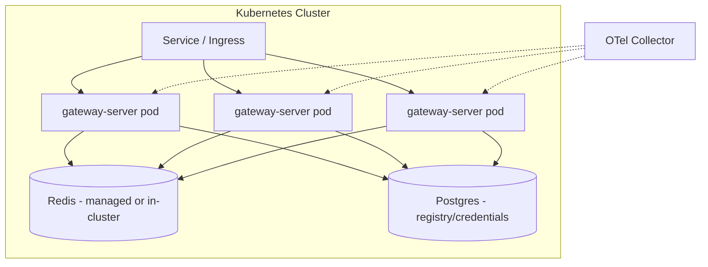

Horizontal Pod Autoscaling driven by request-rate/CPU metrics; readiness probes gate on `/v1/health` reflecting both the gateway's own readiness and a coarse view of provider health.

### 25.3 Serverless / Edge (Optional, Later Milestone)

Because the core has no in-process long-lived state beyond a short-TTL cache, `apps/gateway-server` can be adapted to a serverless function runtime for non-streaming requests; streaming requests require a runtime supporting long-lived connections (container/VM-based, not classic short-lived FaaS), so serverless deployment is scoped as a partial deployment target (non-streaming endpoints only) rather than a universal one.

### 25.4 Configuration Across Environments

A single `GatewayConfig` (Section 10.6) plus environment-specific secret-source wiring is the only thing that changes between dev/staging/production — the compiled application artifact is identical, satisfying "cloud native" and "production ready" without environment-specific code branches.

---

## 26. Milestone-Based Implementation Roadmap

> **Annotation (added during PG-2 documentation stabilization — the roadmap below is
> unmodified from the original architecture text):**
> This section's Milestone 0–7 sequence was this document's own first pass at a build order,
> written alongside the rest of the architecture as a plausibility check on the design — it
> demonstrates that the architecture _can_ be built incrementally, not a commitment to build
> it in exactly this grouping. The **Engineering Blueprint's Section 7 (`EM-0` through
> `EM-11`, see `docs/architecture/engineering-blueprint.md`) is the authoritative implementation
> sequence** actually followed to build this repository, and its milestone scoping differs from
> the one below in several places (for example, this section's Milestone 1 bundles a real
> provider adapter and a basic retry engine into one stage, while the Blueprint's EM-1 delivers
> only the Mock Adapter and defers real provider adapters to EM-3/EM-4). Both documents are kept
> exactly as originally written — this roadmap is preserved below as historical/design-rationale
> context, not as a second, competing implementation plan. Every milestone reference elsewhere in
> this repository (READMEs, ADRs, `docs/history/IMPLEMENTATION_PROGRESS.md`) uses the Blueprint's
> `EM-N` numbering.

Each milestone is independently deliverable and independently valuable — later milestones do not require re-architecting earlier ones.

### Milestone 0 — Contracts & Skeleton

- **Objectives:** Establish the public contract and monorepo skeleton before any provider integration.
- **Scope:** `core-contracts` package; empty `orchestrator` that echoes input; monorepo tooling (build, lint, test) wired up.
- **Deliverables:** `ExecuteRequest`/`ExecuteResponse`/`GatewayError` types; passing CI skeleton.
- **Acceptance criteria:** A client can POST a request and receive a schema-valid (stubbed) response.
- **Risks:** Over-designing contracts before real provider constraints are known — mitigated by treating Milestone 0 contracts as `v0` and explicitly allowed to evolve through Milestone 2.
- **Testing:** Contract/schema tests only.

### Milestone 1 — Single Provider, No Policy Engine

- **Objectives:** Prove the adapter interface against a real provider (Groq) with the simplest possible routing (static task→model mapping).
- **Scope:** `provider-sdk` interface, `groq` adapter, static routing table (no scoring yet), basic Retry Engine (fixed retries, no circuit breaker yet).
- **Deliverables:** End-to-end non-streaming execution against Groq for at least 3 task types.
- **Acceptance criteria:** Adapter passes conformance test suite; P50 gateway overhead measured and under initial target.
- **Risks:** Groq API surface changes — mitigated by conformance tests decoupling core from adapter internals.
- **Testing:** Adapter conformance tests, orchestrator integration tests against mock + real Groq (recorded fixtures).

### Milestone 2 — Model Registry & Policy Engine

- **Objectives:** Replace static routing with the real Policy Engine and configurable Model Registry.
- **Scope:** `model-registry` (DB-backed), `policy-engine` (scoring + ranking), registry seed data for Groq.
- **Deliverables:** Task requests routed by capability/score rather than a hardcoded table; registry updatable without redeploy.
- **Acceptance criteria:** Changing a model's registry entry (e.g., disabling it) changes routing behavior within the cache TTL, with no code deploy.
- **Risks:** Scoring weights need real traffic to tune — mitigated by shipping sane defaults plus full override-ability (Section 13.3) rather than trying to "solve" tuning upfront.
- **Testing:** Policy Engine unit tests with fixtures; A/B comparison of static vs. scored routing on recorded traffic.

### Milestone 3 — Credential Resolver & BYOK

- **Objectives:** Replace hardcoded platform API keys with the full layered credential system.
- **Scope:** `credential-resolver`, `env` + `db` secret sources, `/v1/credentials` API, audit logging.
- **Deliverables:** Workspace/org/user-level BYOK registration and resolution, fully isolated per tenant.
- **Acceptance criteria:** Cross-tenant credential isolation tests pass; rotation/revocation work without downtime.
- **Risks:** Secret handling bugs are high-severity — mitigated by mandatory security review + isolation test suite as a merge gate, not just a nice-to-have.
- **Testing:** Full suite per Section 24's Credential Resolver row, plus a dedicated security review.

### Milestone 4 — Reliability Hardening

- **Objectives:** Add Circuit Breaker, Health Monitor, and real provider failover (NVIDIA NIM as second adapter).
- **Scope:** `nvidia-nim` adapter, `reliability` package's circuit breaker + health monitor, fallback-plan assembly in Policy Engine.
- **Deliverables:** Automatic failover from Groq to NIM under simulated rate-limit/outage conditions.
- **Acceptance criteria:** Chaos test (inject Groq failures) shows automatic failover within the deadline budget, no client-visible errors for the failover-eligible portion of traffic.
- **Risks:** False-positive circuit trips under bursty-but-healthy traffic — mitigated by tuning thresholds against real traffic shape gathered in Milestone 1–3.
- **Testing:** Property-based reliability tests, chaos/fault-injection tests.

### Milestone 5 — Streaming

- **Objectives:** First-class streaming across both adapters with cancellation.
- **Scope:** `streaming` package, SSE transport, cancellation propagation through orchestrator → adapter → provider.
- **Deliverables:** `/v1/execute/stream` fully functional for both providers.
- **Acceptance criteria:** Client disconnect measurably aborts the upstream provider call (verified via adapter-level call tracking in tests), not just the client-facing stream.
- **Risks:** Provider-specific streaming quirks — isolated to adapter layer by design.
- **Testing:** Streaming-specific suite per Section 24.

### Milestone 6 — Observability & Multi-Tenant Hardening

- **Objectives:** Full OTel tracing/metrics, structured logging, cost analytics, and complete workspace/org isolation guarantees under load.
- **Scope:** `telemetry` package, dashboards (external, consuming the metrics catalogue), rate-limit/cache tenant isolation enforcement.
- **Deliverables:** End-to-end trace visible for any `requestId`; per-tenant cost dashboard.
- **Acceptance criteria:** Load test with multiple simulated tenants shows zero cross-tenant rate-limit or cache interference.
- **Risks:** Telemetry overhead on the hot path — mitigated by async/batched export, never blocking the response path.
- **Testing:** Section 24's observability-adjacent tests, plus dashboard/alerting validation.

### Milestone 7 — Enterprise & Ecosystem Readiness

- **Objectives:** Plugin system, additional provider adapters (OpenAI, Anthropic, Gemini at minimum), admin console (optional), enterprise policy rules.
- **Scope:** `plugin-system`, 3+ additional adapters built against the now-stable `provider-sdk`, `RoutingRule` engine (Section 13.4).
- **Deliverables:** Community-contributable adapter template proven by at least one externally-contributed adapter (dogfooding the "trivial to add" design goal).
- **Acceptance criteria:** A new provider adapter can be added and merged by someone unfamiliar with the core codebase, using only `provider-sdk` docs and the conformance suite.
- **Risks:** API stability commitments now constrain future core changes — mitigated by `core-contracts` versioning strategy established from Milestone 0.
- **Testing:** Full regression suite + new adapters' conformance tests.

---

## 27. Future Evolution (V2, V3)

### V2 — Adaptive Intelligence

- **Learned routing:** replace/augment static scoring weights (Section 13.3) with a lightweight learned model trained on historical outcome data (actual latency, actual quality feedback signals if callers opt to provide them) — still fully overridable by explicit policy rules, preserving auditability.
- **Predictive rate-limit avoidance:** forecast provider rate-limit exhaustion ahead of time from traffic trends, proactively shifting routing weight before a provider actually degrades, rather than reactively failing over after the first failure.
- **Semantic task caching:** move beyond exact-input cache keys (Section 22) toward embedding-similarity-based cache hits for near-duplicate requests, opt-in per task type given the added complexity/risk of subtly-wrong cache hits.
- **Cost-aware autoscaling of routing:** dynamic per-workspace budget pacing that smoothly shifts routing toward cheaper models as a budget threshold approaches, rather than the hard cutoff described in Section 13.4.

### V3 — Ecosystem Platform

- **Plugin marketplace:** a curated/community registry of `GatewayPlugin` and `ProviderAdapter` implementations, versioned and conformance-certified automatically via the same test harness used internally.
- **Federated gateway deployments:** allow one AI Gateway instance to route a subset of tasks to _another_ AI Gateway instance (e.g., a regional deployment, or a partner's deployment) as if it were just another provider adapter — because the `ProviderAdapter` interface is generic enough to have "another AI Gateway" as a valid implementation.
- **Fine-grained per-task SLAs:** contractual latency/availability targets configurable per task type per tenant, with the Policy Engine and Health Monitor enforcing and reporting against them explicitly (today's spec supports soft `maxLatencyMs` constraints; V3 would add hard SLA tracking/alerting).
- **Native multi-modal task types:** extend the `TaskType`/`ExecuteRequest.input` model to cover image/audio input and generation tasks as first-class task types, once a second modality-supporting provider adapter exists to justify the abstraction (avoiding speculative generality today).

These are explicitly **not** committed scope for the initial platform (Milestones 0–7); they are recorded here so early architectural decisions (especially the `ProviderAdapter` interface, the `TaskType` extensibility point, and the Policy Engine's rule/scoring separation) are made with these directions in mind, without building them prematurely.

---

## 28. Architecture Decision Records (ADRs)

### ADR-001: Tasks, Not Models, Are the Public Vocabulary

- **Context:** Applications need LLM capability without coupling to a specific vendor or model lifecycle (deprecations, renames, pricing changes).
- **Decision:** The public API accepts a `TaskType` and never a model identifier; model selection is entirely internal (Policy Engine + Model Registry).
- **Consequences:** Callers lose fine-grained model control (mitigated by `constraints`/`preferences` as soft/hard knobs); the platform gains the ability to swap underlying models/providers transparently, which is the core value proposition.
- **Alternatives considered:** Expose model names with gateway as a thin proxy — rejected because it re-introduces the exact coupling the platform exists to remove.

### ADR-002: Stateless Execution Core with Externalized Shared State

- **Context:** Need horizontal scalability and simple operational characteristics.
- **Decision:** No in-process state survives a single request beyond a short-TTL local cache; all cross-request state (health, rate limits, registry, response cache) lives in Redis/DB.
- **Consequences:** Every gateway instance is interchangeable, simplifying autoscaling and rolling deploys; adds a hard dependency on Redis/DB availability for full functionality (mitigated by graceful degradation: registry falls back to last-known-good cache on store unavailability).
- **Alternatives considered:** In-process sticky state with session affinity — rejected as it complicates scaling and creates uneven load distribution.

### ADR-003: Provider Adapters Are the Only Place Provider SDKs Are Imported

- **Context:** Provider agnosticism must be enforceable, not just aspirational.
- **Decision:** Enforce via package boundaries (`packages/providers/*` only) plus a lint rule / dependency-graph check in CI that fails the build if a provider SDK import appears outside that boundary.
- **Consequences:** Adding/removing/changing a provider never touches core logic; slightly more boilerplate per adapter (normalization code) that would be "saved" by leaking provider types into core — judged a worthwhile tradeoff.
- **Alternatives considered:** Duck-typed "good enough" abstraction without strict enforcement — rejected as it erodes over time without a structural/CI guardrail.

### ADR-004: BYOK Modeled as Just Another Credential Scope

- **Context:** BYOK could be built as a bolted-on alternate path or as a first-class part of the core resolution model.
- **Decision:** Model platform-managed keys as `scope: "platform"`, the least-specific entry in the same `ResolutionChain` used for user/project/workspace/org keys.
- **Consequences:** Zero special-casing anywhere else in the codebase for "is this BYOK or not"; cost/usage attribution and isolation guarantees apply uniformly.
- **Alternatives considered:** Separate `BYOKResolver` invoked conditionally — rejected as it would duplicate resolution/audit logic and create two code paths to keep in sync.

### ADR-005: Pre-Computed Fallback Plans Rather Than Re-Scoring on Failure

- **Context:** Failover must be fast; re-running the full Policy Engine pipeline mid-request adds latency exactly when a request is already struggling.
- **Decision:** The Policy Engine computes an ordered `fallbackPlans[]` once, at initial plan assembly; the Retry Engine simply advances through this pre-computed list on exhaustion.
- **Consequences:** Faster failover; slightly stale ranking if provider health changes dramatically mid-request (accepted risk given the short timeframes involved — a request that's still executing is, by definition, a matter of seconds).
- **Alternatives considered:** Live re-scoring on every failover — rejected for latency cost; considered revisiting in V2 if p99 failover latency data shows it matters more than expected.

### ADR-006: Errors Are Translated at the Adapter Boundary, Never Propagated Raw

- **Context:** Ten-plus planned provider adapters means ten-plus different native error shapes; core logic (retry, circuit breaker, caller-facing responses) cannot reason about all of them.
- **Decision:** Every adapter must translate all provider errors/exceptions into `GatewayError` before returning; enforced by the shared conformance test suite injecting malformed/erroring responses.
- **Consequences:** Uniform, typed error handling everywhere above the adapter layer; adapters carry a small amount of translation boilerplate.
- **Alternatives considered:** A generic "unknown provider error" passthrough type — rejected because it would prevent the Retry Engine from correctly distinguishing retryable vs. non-retryable failures across providers.

### ADR-007: Configuration-Driven Registry and Routing Over Compiled Logic

- **Context:** Model availability, pricing, and capability data change far more often than the code that consumes it.
- **Decision:** Model Registry entries and routing/scoring weights are data (DB/config), not TypeScript conditionals; changes take effect via cache invalidation, not deployment.
- **Consequences:** Operators can react to a provider outage or pricing change in seconds; requires disciplined schema validation on config writes (mitigated by zod/JSON-schema validation at the config layer).
- **Alternatives considered:** Hardcoded model tables per provider adapter — rejected as it directly contradicts the "configurable without code changes" design goal and would require a deploy for routine model updates.

---

# Part II — v1.1 Refinement: The Intelligent Execution Platform

> Everything below is additive. It does not remove, replace, or contradict any component, package, contract, or milestone described in Part I (Sections 1–28). It inserts one new decision layer — the **AI Strategy Layer** — between the request entering the Execution Core and the existing Policy Engine, and it gives that layer the sub-components needed to reason about _how_ a task should run, not just _where_.

## 29. Strengthened Vision — AI Gateway as an Execution Operating System

The v1.0 vision (Section 2) established that applications should never know provider SDKs, model names, or authentication mechanisms. v1.1 extends that same isolation principle one layer deeper.

> **v1.0 boundary:** applications are isolated from _providers_.
> **v1.1 boundary:** applications are isolated from providers **and** from model selection, execution strategy, prompt handling, and inference tuning.

An application should never construct a `temperature`, a `top_p`, a retry count, or a token budget. It should never decide whether a request "needs reasoning" or whether a prompt is too long. Those are execution-strategy decisions, and AI Gateway is the only place they should be made — the same way an operating system decides paging strategy and CPU scheduling so that application code just calls `malloc()` and spawns threads.

Restated, AI Gateway v1.1 is responsible for:

| Concern                                                  | v1.0                                 | v1.1 adds                                                                                                |
| -------------------------------------------------------- | ------------------------------------ | -------------------------------------------------------------------------------------------------------- |
| Provider abstraction                                     | ✅                                   | —                                                                                                        |
| Model selection                                          | ✅ (Policy Engine)                   | Now informed by Capability Registry + lifecycle state, not just task                                     |
| Execution strategy                                       | Implicit in Policy Engine scoring    | Explicit **AI Strategy Layer** (Section 30)                                                              |
| Inference tuning (temperature, top_p, top_k, max tokens) | Caller could imply via `preferences` | Fully owned by **Execution Profiles** (Section 31) — caller expresses `task`, never inference parameters |
| Cost optimization                                        | Implicit in scoring weights          | Explicit **Cost Optimization Engine** (Section 33) as a pipeline stage                                   |
| Prompt handling                                          | Not addressed                        | Explicit, provider-independent **Prompt Optimization Layer** (Section 34)                                |
| Reliability, observability, security, BYOK               | ✅                                   | Unchanged (Sections 15–21)                                                                               |

Applications continue to express only **intent** — `task`, `input`, optional `constraints`/`preferences` (Section 10.3, unchanged). AI Gateway determines everything about _how_ that intent is fulfilled. This is the "Operating System for AI execution" framing: a small, stable syscall-like surface at the top, and an increasingly sophisticated, swappable execution strategy underneath it that applications never need to be aware of, let alone modify, as the AI ecosystem evolves.

---

## 30. The AI Strategy Layer

### 30.1 Why a Separate Layer, Not a Bigger Policy Engine

The v1.0 Policy Engine already made routing decisions using task type, constraints, and preferences (Section 13). It would be possible to keep stuffing more decisions (profile selection, cost tradeoffs, prompt shaping) into that same engine — but that conflates two different questions:

- **"How should this task be executed?"** — inference parameters, reasoning depth, whether to stream, whether a cached answer suffices, how the prompt should be shaped. This depends on the _task_ and _tenant policy_, largely independent of which provider ends up serving it.
- **"Where should this execution happen?"** — which provider, which concrete model, with what retry/failover chain. This depends on _provider health, cost, and availability_, largely independent of what the task actually needs.

Separating them keeps the Policy Engine exactly as it was in v1.0 (still fully unit-testable in isolation per Section 24) while giving the "how" question its own home that can grow — new execution profiles, new optimization heuristics, future learned strategies — without ever touching provider-routing code.

### 30.2 Execution Strategy Diagram

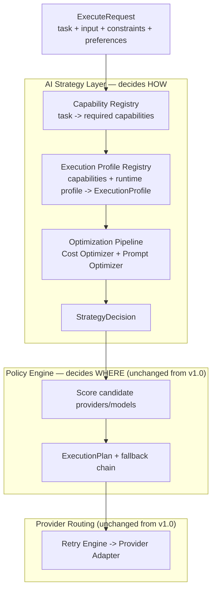

This is the concrete realization of the requested separation:

```
Execution Strategy  →  Policy Engine  →  Provider Routing
   (Section 30)         (Section 13,        (Sections 12, 18,
                          unchanged)          unchanged)
```

### 30.3 Interface

```typescript
// packages/strategy-layer/src/strategy-layer.ts

export interface AIStrategyLayer {
  buildStrategy(req: ExecuteRequest, ctx: TenantContext): Promise<StrategyDecision>;
}

export interface StrategyDecision {
  requiredCapabilities: CapabilitySet; // from Capability Registry, Section 32
  executionProfile: ResolvedExecutionProfile; // from Execution Profile Registry, Section 31
  optimizations: {
    cost: CostOptimizationResult; // Section 33
    prompt: OptimizedPrompt; // Section 34
  };
  cacheHit?: CachedResult; // short-circuits Policy Engine entirely if present
}
```

If `cacheHit` is present, the Orchestrator returns it directly and never invokes the Policy Engine at all for that request — the cheapest possible execution is simply not executing (Section 33.4).

### 30.4 Responsibilities Recap

Per the request, the AI Strategy Layer's responsibilities are exactly:

- Execution profile selection (Section 31)
- Model capability matching (Section 32 — resolving _what a task needs_, distinct from the Policy Engine's job of finding _which model has it_)
- Reasoning depth determination (part of Cost Optimization, Section 33.2)
- Latency optimization (part of Execution Profile defaults + Cost Optimizer streaming/caching decisions)
- Cost optimization (Section 33)
- Context optimization (Prompt Optimization Layer, Section 34)

---

## 31. Execution Profiles

### 31.1 Concept

An **Execution Profile** is the config-driven bundle of inference behavior that a task type resolves to, so that neither the calling application nor, notably, the Policy Engine's callers ever hand-configure `temperature`/`top_p`/`top_k`/timeouts/retry policy directly. This directly answers the requirement: _"Applications should never configure inference parameters directly. Instead they should request an execution profile."_ In practice the application still just sends `task` (Section 10.3 is unchanged) — the Strategy Layer resolves `task` to a profile automatically. Advanced tenants may optionally hint a profile override via `preferences.executionProfileOverride` (new optional field, additive to `ExecuteRequest.preferences`), but this remains an override of an internal concept, never a raw parameter list.

### 31.2 Schema

```typescript
// packages/strategy-layer/src/execution-profile-registry.ts

export type ExecutionProfileId =
  | "extraction"
  | "classification"
  | "summarization"
  | "json_generation"
  | "reasoning"
  | "composition"
  | "coding"
  | "translation"
  | "vision"
  | "embedding"
  | "agent" // future, disabled until a capability-matching adapter exists
  | (string & {}); // extensible, config-registered

export interface ExecutionProfile {
  id: ExecutionProfileId;
  preferredModelClasses: string[]; // ordered preference, consumed by Policy Engine scoring (Section 13.3)
  inference: {
    temperature: number;
    topP?: number;
    topK?: number;
    maxOutputTokens: number;
  };
  timeoutMs: number;
  retryPolicy: RetryPolicy; // Section 18.1 type, reused as-is
  streaming: { defaultEnabled: boolean; chunking?: "token" | "sentence" };
  structuredOutput: { defaultEnabled: boolean };
  caching: { defaultEnabled: boolean; ttlSeconds?: number; keyStrategy: "exact" | "semantic" };
}

export interface ResolvedExecutionProfile extends ExecutionProfile {
  /** Set by the Strategy Layer after applying Runtime Profile (Section 37) adjustments. */
  adjustedBy?: { runtimeProfileId: string; fieldsOverridden: string[] };
}
```

### 31.3 Illustrative Seed Profiles

| Profile         | temperature | streaming default | structured output default | caching default  | notes                                          |
| --------------- | ----------- | ----------------- | ------------------------- | ---------------- | ---------------------------------------------- |
| extraction      | 0.0         | off               | on                        | on (exact-match) | deterministic, cache-friendly                  |
| classification  | 0.0         | off               | on                        | on (exact-match) | short output, cheap                            |
| summarization   | 0.3         | on                | off                       | off              | long input, medium output                      |
| json_generation | 0.0         | off               | on (required)             | on (exact-match) | never routed to a non-JSON-mode model          |
| reasoning       | 0.4         | on                | off                       | off              | routed only to `complex-reasoning` model class |
| composition     | 0.8         | on                | off                       | off              | creative writing, high temperature             |
| coding          | 0.2         | on                | off                       | off              | precise, deterministic-leaning                 |
| translation     | 0.2         | off               | off                       | on (semantic)    | benefits from semantic cache reuse             |

Like the Model Registry (Section 14), this table is seed data, not compiled logic — an operator can add a new profile or retune an existing one via config, with cache-invalidation propagation identical to Section 14.2.

### 31.4 Execution Profile Flow

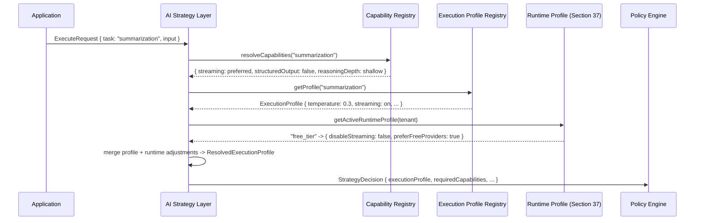

The application never sees or sets `temperature: 0.3` — it only ever said `task: "summarization"`.

---

## 32. Capability Registry & Capability Resolution

### 32.1 Why Task → Capabilities → Models, Not Task → Models Directly

In v1.0, the Policy Engine mapped `task` more or less straight to candidate models via the Model Registry's `modelClass` field (Section 14). That is workable, but it means every task type's routing is only as stable as the current generation of model classes. v1.1 inserts an explicit, independent middle layer: the **Capability Registry**, which maps a task type to the _abstract capabilities it requires_ — independent of any specific model or provider. The Model Registry (Section 14, unchanged) still maps _models_ to capabilities they _have_. Matching happens where these two independently-evolving registries meet.

```
Task  →  Capabilities Required  →  Execution Profile  →  Candidate Models  →  Selected Provider
```

This is the resilience mechanism the refinement calls for: if an entirely new generation of models arrives with different class names, only the **Model Registry** needs updating (as in v1.0, Section 14.2 — config, no redeploy). The **Capability Registry** and **Execution Profiles**, which encode business-stable facts like "summarization needs shallow reasoning and no structured output," don't need to change at all.

### 32.2 Schema

```typescript
// packages/strategy-layer/src/capability-registry.ts

export interface CapabilitySet {
  structuredOutput: boolean;
  toolCalling: boolean;
  reasoningDepth: "shallow" | "moderate" | "deep";
  streamingPreferred: boolean;
  minContextTokens: number;
  visionInput?: boolean; // future
  audioInput?: boolean; // future
}

export interface CapabilityRegistry {
  resolveCapabilities(task: TaskType, req?: ExecuteRequest): Promise<CapabilitySet>;
  registerMapping(task: TaskType, capabilities: CapabilitySet): Promise<void>; // config-driven, no redeploy
}
```

`resolveCapabilities` also folds in explicit request-level constraints (e.g., `constraints.requiredSchema` forces `structuredOutput: true` regardless of the task's default), so the Capability Registry is the single place "what does this exact request need" gets decided — the Policy Engine (Section 13.2's "Candidate Query" step) now queries the Model Registry using this resolved `CapabilitySet` instead of inferring capability needs itself.

### 32.3 Capability Resolution Flow

```mermaid
graph LR
    A[Task: e.g. json_generation] --> B[Capability Registry]
    B --> C["Capabilities Required:<br/>structuredOutput=true<br/>reasoningDepth=shallow<br/>streaming=false"]
    C --> D[Execution Profile Registry]
    D --> E["Execution Profile:<br/>json_generation profile<br/>temperature=0.0"]
    E --> F["Model Registry query<br/>(Section 14, unchanged)"]
    F --> G["Candidate Models:<br/>groq/fast-extraction,<br/>nvidia-nim/fast-extraction"]
    G --> H["Policy Engine scoring<br/>(Section 13, unchanged)"]
    H --> I[Selected Provider + Model]
```

This is precisely the flow requested, now made concrete with the exact packages/interfaces that implement each arrow.

---

## 33. Cost Optimization Engine

### 33.1 Position in the Pipeline

The Cost Optimization Engine is a stage of the Strategy Layer's Optimization Pipeline (Section 30.2), running after Execution Profile resolution and before the Policy Engine. It never talks to a provider directly — it only adjusts the `StrategyDecision` that the Policy Engine subsequently routes.

### 33.2 Interface & Decisions

```typescript
// packages/strategy-layer/src/cost-optimizer.ts

export interface CostOptimizer {
  optimize(ctx: OptimizationContext): Promise<CostOptimizationResult>;
}

export interface OptimizationContext {
  task: TaskType;
  capabilities: CapabilitySet;
  profile: ResolvedExecutionProfile;
  promptTokenEstimate: number;
  runtimeProfile: RuntimeProfile; // Section 37
  cache: CacheClient; // read-only lookup handle
}

export interface CostOptimizationResult {
  recommendedModelClassDowngrade?: string; // e.g. force "fast-extraction" over "complex-reasoning" if task doesn't need depth
  reasoningRequired: boolean; // did the task actually need deep reasoning, or was that a default assumption?
  disableStreaming?: boolean; // e.g. short, non-interactive outputs don't benefit from streaming overhead
  cacheHit?: CachedResult; // exact or semantic match found — short-circuits everything downstream
  preferFreeTierProviders: boolean; // from Runtime Profile + workspace budget state
  estimatedCostUsd: number;
  estimatedSavingsUsd: number; // vs. the naive/default profile execution
}
```

The Cost Optimizer answers, concretely, every question posed in the refinement request:

| Question                              | How it's answered                                                                                                                                                                                                                                                             |
| ------------------------------------- | ----------------------------------------------------------------------------------------------------------------------------------------------------------------------------------------------------------------------------------------------------------------------------- |
| Can this request use a smaller model? | `recommendedModelClassDowngrade`, computed from `capabilities.reasoningDepth` vs. the profile's default preferred class — if the task's _actual_ resolved capability need is shallower than the profile's default assumption, downgrade.                                      |
| Does this task require reasoning?     | `reasoningRequired`, derived from `CapabilitySet.reasoningDepth !== "shallow"` combined with input-size/complexity heuristics (e.g., short factual extraction rarely needs `deep`).                                                                                           |
| Can prompt length be reduced?         | Delegated to the Prompt Optimization Layer (Section 34); the Cost Optimizer reads back `estimatedTokens` post-optimization to refine `estimatedCostUsd`.                                                                                                                      |
| Can cached responses be reused?       | `cacheHit`, via the same cache client used by the request-level cache (Section 22), extended here to support semantic-similarity lookups for `caching.keyStrategy === "semantic"` profiles.                                                                                   |
| Should streaming be disabled?         | `disableStreaming`, e.g. for short, deterministic outputs where streaming overhead exceeds its latency benefit.                                                                                                                                                               |
| Can multiple requests be batched?     | Not implemented in v1.1 (see Section 27 V2 note on batching — flagged here as a recognized future extension point, deliberately not built prematurely per the "don't increase complexity unnecessarily" directive).                                                           |
| Can we downgrade providers?           | Expressed as a `recommendedModelClassDowngrade` plus `preferFreeTierProviders`, both consumed as _soft_ signals by Policy Engine scoring (Section 13.3's `w_cost` term) — never a hard override, so quality-sensitive Routing Rules (Section 13.4) still win when configured. |
| Can we use free-tier providers first? | `preferFreeTierProviders`, driven primarily by the active Runtime Profile (Section 37) — e.g. `free_tier` and `development` runtime profiles set this `true` by default.                                                                                                      |

### 33.3 Optimization Pipeline Diagram

```mermaid
graph TB
    IN[ResolvedExecutionProfile + CapabilitySet + raw prompt]
    IN --> CACHE{Cache lookup<br/>exact or semantic}
    CACHE -- hit --> SHORT[Return CachedResult<br/>skip Policy Engine + provider call entirely]
    CACHE -- miss --> PROMPT[Prompt Optimization Layer<br/>Section 34]
    PROMPT --> COST[Cost Optimizer<br/>Section 33.2]
    COST --> DECIDE{Downgrade viable<br/>without violating<br/>required capabilities?}
    DECIDE -- yes --> ADJUST[Adjust preferredModelClasses,<br/>disableStreaming if applicable]
    DECIDE -- no --> KEEP[Keep profile as resolved]
    ADJUST --> OUT[StrategyDecision]
    KEEP --> OUT
```

Critically, `DECIDE` never overrides a **hard** capability requirement (e.g., it will not downgrade away from a model that supports structured output if `requiredSchema` was set) — cost optimization only operates within the space of candidates that already satisfy the Capability Registry's resolved requirements (Section 32.2), preserving correctness over savings.

### 33.4 Cache Short-Circuit

When `CostOptimizationResult.cacheHit` is present, the Orchestrator returns it directly without ever invoking the Policy Engine, Credential Resolver, or any Provider Adapter — the cheapest, fastest, and most reliable execution path is the one that makes no provider call at all. This is the same response-cache concept introduced in Section 22, now formalized as an explicit, inspectable decision inside the Optimization Pipeline rather than an implicit middleware-layer side effect only.

---

## 34. Prompt Optimization Layer

### 34.1 Position & Provider Independence

The Prompt Optimization Layer runs inside the Optimization Pipeline (Section 33.3), immediately before the Cost Optimizer reads back a final token estimate. It operates purely on the normalized `ChatMessage[]` shape (Section 10.3/12.1) — it never sees a provider-specific request body, so it is exactly as provider-independent as every other Strategy Layer component, and it runs identically regardless of which provider the Policy Engine eventually selects.

### 34.2 Interface

```typescript
// packages/strategy-layer/src/prompt-optimizer/prompt-optimizer.ts

export interface TokenBudget {
  maxInputTokens: number;
  reservedForOutput: number;
}

export interface OptimizedPrompt {
  messages: ChatMessage[];
  estimatedTokens: number;
  transformationsApplied: PromptTransformationId[];
}

export type PromptTransformationId =
  | "compressed"
  | "context_trimmed"
  | "duplicates_removed"
  | "system_prompt_deduped"
  | "normalized"
  | "long_context_windowed";

export interface PromptOptimizer {
  optimize(
    messages: ChatMessage[],
    budget: TokenBudget,
    profile: ResolvedExecutionProfile,
  ): Promise<OptimizedPrompt>;
}

export interface PromptTransformer {
  id: PromptTransformationId;
  apply(messages: ChatMessage[], ctx: { budget: TokenBudget }): ChatMessage[];
}
```

### 34.3 Transformer Pipeline

The Prompt Optimizer is itself a small ordered pipeline of independently-testable `PromptTransformer` implementations, matching the refinement's requested responsibility list one-to-one:

| Transformer             | Responsibility                                                                                                                                                                                                                                  |
| ----------------------- | ----------------------------------------------------------------------------------------------------------------------------------------------------------------------------------------------------------------------------------------------- |
| `normalized`            | Whitespace/encoding normalization, consistent role formatting — always runs first so every later transformer sees a canonical shape.                                                                                                            |
| `system_prompt_deduped` | Detects a repeated/boilerplate system prompt across a multi-turn `messages` array (or across requests, via a short-lived system-prompt cache keyed by hash) and reuses it instead of re-sending/re-tokenizing identical instructions.           |
| `duplicates_removed`    | Strips duplicated content blocks within a single request (e.g., accidentally repeated context chunks from an upstream RAG layer — AI Gateway doesn't own RAG per Section "Philosophy," but it can defensively dedupe whatever content arrives). |
| `context_trimmed`       | Drops or summarizes lowest-relevance context when `estimatedTokens` exceeds `budget.maxInputTokens`, prioritizing the most recent turns and any explicitly marked "must keep" content.                                                          |
| `long_context_windowed` | For very large inputs, applies a sliding-window or hierarchical-summarization strategy rather than a hard truncation, configurable per Execution Profile.                                                                                       |
| `compressed`            | Lossy-but-safe compression of verbose input phrasing where the task's `CapabilitySet` tolerates it (never applied to profiles like `coding` or `json_generation` where exact wording may matter).                                               |

### 34.4 Token Estimation & Budgeting

```typescript
export function estimateTokens(messages: ChatMessage[]): number {
  /* provider-agnostic tokenizer approximation */
}
```

A provider-agnostic estimator (not a provider's exact tokenizer, since the eventual model isn't chosen yet at this pipeline stage) is used for budgeting decisions; the Provider Adapter layer (Section 12) still performs provider-exact token accounting from the real response `usage` object for billing/telemetry (Section 21.2) — the two are allowed to differ slightly, since the estimator only needs to be good enough to drive trimming decisions, not to be billing-accurate.

### 34.5 Output

The `OptimizedPrompt` becomes part of the `StrategyDecision` (Section 30.3) that the Policy Engine and, ultimately, the Provider Adapter's `NormalizedInvocation.messages` (Section 12.1) are built from — so prompt optimization happens exactly once, upstream of provider selection, and every provider benefits from it identically.

---

## 35. Model Lifecycle Management

### 35.1 Lifecycle States

`ModelDescriptor` (Section 14.1) gains a lifecycle field:

```typescript
export type ModelLifecycleState =
  "experimental" | "preview" | "recommended" | "stable" | "deprecated" | "disabled";

export interface ModelDescriptor {
  // ...all v1.0 fields unchanged (Section 14.1)...
  lifecycle: {
    state: ModelLifecycleState;
    replacementModelId?: string; // set when state is "deprecated", points to successor
    sunsetDate?: string; // ISO date after which "deprecated" auto-transitions to "disabled"
    trafficShiftPercent?: number; // for gradual migration, 0-100
  };
}
```

### 35.2 Model Selection Lifecycle Diagram

```mermaid
stateDiagram-v2
    [*] --> Experimental: New model added to registry
    Experimental --> Preview: Passes conformance + initial quality bar
    Preview --> Recommended: Sustained health metrics meet threshold (Section 21)
    Recommended --> Stable: Extended production track record
    Stable --> Deprecated: Provider announces sunset / replacement available
    Deprecated --> Disabled: sunsetDate elapsed, or trafficShiftPercent reaches 100%
    Disabled --> [*]
    Deprecated --> Stable: rollback if replacementModelId underperforms
```

### 35.3 Policy Engine Interaction (Section 13, extended not replaced)

Lifecycle state feeds into `ModelScorer` (Section 13.3) as an additional weighted term and, for `disabled`, as a hard exclusion filter at the Candidate Query step (Section 13.2):

- `experimental` — excluded from candidate queries by default; included only if the active Runtime Profile explicitly allows it (Section 37 — e.g., a `development` runtime profile might opt in for early testing).
- `preview` / `recommended` / `stable` — all eligible; scored normally, with `stable` receiving a small positive weight reflecting track record.
- `deprecated` — still eligible but scored down proportionally to `trafficShiftPercent`, so traffic migrates to `replacementModelId` gradually rather than as a step function, avoiding a thundering-herd shift the moment a model is marked deprecated.
- `disabled` — hard-excluded, identical to a model simply being removed from the registry.

### 35.4 Automatic Migration Guarantee

Because routing always goes through capability matching (Section 32) and profile-driven inference parameters (Section 31) rather than an application-specified model string, a provider retiring `model-v1` in favor of `model-v2` requires **zero application changes** — an operator sets `lifecycle.state = "deprecated"`, `replacementModelId = "model-v2"`, and a `sunsetDate`; the registry cache invalidation mechanism (Section 14.2) propagates this to every gateway instance within seconds, and `trafficShiftPercent` (adjustable live, also config-driven) lets the migration be as gradual or as immediate as the operator wants. This is the direct fulfillment of "the gateway should automatically migrate workloads as models evolve."

---

## 36. Intelligent Learning (Extension Points)

### 36.1 Design Stance

No machine learning is implemented in v1.1. Per the refinement's explicit instruction, this section defines **extension points only** — interfaces that a future, optional, pluggable component can implement, with a static/no-op default so the system's behavior today is fully deterministic and auditable (consistent with Principle P4: everything is an adapter or a plugin).

### 36.2 Interfaces

```typescript
// packages/strategy-layer/src/learning/learning-signal-collector.ts

export interface ExecutionOutcome {
  requestId: string;
  providerId: string;
  modelId: string;
  modelClass: string;
  task: TaskType;
  latencyMs: number;
  success: boolean;
  failureReason?: FailureReason;
  costUsd: number;
  /** Optional, only if the calling application chooses to report it back — never inferred or scraped. */
  userFeedbackSignal?: "positive" | "negative" | "neutral";
}

export interface LearningSignalCollector {
  record(outcome: ExecutionOutcome): void; // fire-and-forget, never blocks the response path (Section 22)
}

export interface AdaptiveRankingStrategy {
  /** Optional replacement for (or supplement to) the static scoring weights in Section 13.3. */
  adjustWeights(base: ScoringWeights, history: ExecutionOutcome[]): ScoringWeights;
}

/** Default, shipped implementation: does nothing. */
export class NoopLearningSignalCollector implements LearningSignalCollector {
  record(): void {
    /* intentionally empty */
  }
}
```

### 36.3 How This Plugs In Without Changing the Policy Engine

`AdaptiveRankingStrategy` is registered the same way any `RoutingRule` or scoring strategy is (Section 13.4, Principle P4) — the `ModelScorer` calls `adjustWeights` (if a non-default strategy is configured) immediately before applying its weighted formula (Section 13.3). With the default `NoopLearningSignalCollector` and no `AdaptiveRankingStrategy` configured, v1.1's routing behavior is byte-for-byte identical to v1.0/Section 13 — this section adds a socket, not a behavior change.

### 36.4 Data This Enables Later (Not Built Now)

The `ExecutionOutcome` stream — already partially available today as telemetry (Section 21.2 metrics) — is deliberately shaped so that a future learned ranking model, an anomaly-based auto-tuning of Circuit Breaker thresholds (Section 18.2), or a workspace-specific personalized routing preference could all be built as `AdaptiveRankingStrategy` or `LearningSignalCollector` implementations without touching `orchestrator`, `policy-engine`, or any provider adapter — consistent with the V2 "Adaptive Intelligence" direction already recorded in Section 27, which this section now gives a concrete interface to build toward.

---

## 37. Runtime Profiles

### 37.1 Distinction from Execution Profiles

An **Execution Profile** (Section 31) describes how a given _task type_ should run. A **Runtime Profile** is orthogonal: it describes how the _entire gateway deployment/tenant_ should behave, overlaying adjustments on top of whatever Execution Profile is resolved. The same `task: "summarization"` request behaves differently under a `free_tier` Runtime Profile than under an `enterprise` one, without the application changing anything.

### 37.2 Schema

```typescript
// packages/runtime-profiles/src/runtime-profile.ts

export type RuntimeProfileId =
  "development" | "free_tier" | "production" | "enterprise" | "offline" | "high_availability";

export interface RuntimeProfile {
  id: RuntimeProfileId;
  provider: {
    preferFreeTier: boolean;
    allowedLifecycleStates: ModelLifecycleState[]; // e.g. enterprise excludes "experimental"
    maxProvidersInFailoverChain: number;
  };
  reliability: {
    retryAggressiveness: "conservative" | "standard" | "aggressive";
    failoverAggressiveness: "conservative" | "standard" | "aggressive";
  };
  cost: {
    tokenUsageCeilingPerRequest?: number;
    dailyBudgetUsd?: number;
  };
  telemetry: {
    verbosity: "minimal" | "standard" | "verbose";
  };
  caching: {
    aggressiveness: "off" | "standard" | "aggressive";
  };
}
```

### 37.3 Illustrative Presets

| Runtime Profile       | Provider preference                                                   | Retries                            | Failover                                     | Lifecycle states allowed      | Caching                     |
| --------------------- | --------------------------------------------------------------------- | ---------------------------------- | -------------------------------------------- | ----------------------------- | --------------------------- |
| **development**       | Free tier preferred                                                   | Conservative                       | Conservative                                 | All, including `experimental` | Aggressive (fast iteration) |
| **free_tier**         | Free tier only where possible                                         | Conservative (minimize token burn) | Conservative                                 | `preview`+                    | Aggressive                  |
| **production**        | Balanced (Policy Engine default weights, Section 13.3)                | Standard                           | Standard                                     | `recommended`+                | Standard                    |
| **enterprise**        | Quality-first regardless of cost                                      | Aggressive                         | Aggressive, wide failover chain              | `stable` only                 | Standard                    |
| **offline**           | N/A — routes to on-prem/self-hosted-compatible adapters only (future) | Conservative                       | Disabled (no network-dependent failover)     | `stable` only                 | Aggressive                  |
| **high_availability** | Maximizes provider diversity in fallback chain                        | Aggressive                         | Maximally aggressive, largest fallback chain | `recommended`+                | Standard                    |

### 37.4 Where Runtime Profiles Apply

A Runtime Profile is selected per tenant (organization/workspace, via `GatewayConfig`, Section 10.6 — extended with an optional `runtimeProfileId` field) or, for self-hosted deployments, per environment/deployment as a whole. It is read by:

- The **Execution Profile Registry** (Section 31.4), to adjust `streaming`, `caching`, and `timeoutMs` defaults.
- The **Cost Optimizer** (Section 33.2), to set `preferFreeTierProviders` and cost ceilings.
- The **Policy Engine's Candidate Query** (Section 13.2), to filter by `allowedLifecycleStates` (Section 35.3).
- The **Retry Engine / Circuit Breaker** (Section 18), to adjust `RetryPolicy.maxAttempts`/backoff and breaker thresholds per `reliability.retryAggressiveness`/`failoverAggressiveness`.

No component outside `runtime-profiles` and the four read sites above needs to know Runtime Profiles exist — this keeps the blast radius of this feature small, per the refinement's explicit instruction not to increase implementation complexity unnecessarily.

---

## 38. Updated Request Lifecycle & Roadmap Addendum

### 38.1 Fully Expanded Request Lifecycle (supersedes only the diagram in Section 17, not its surrounding text)

```mermaid
graph TD
    A[Request received at API layer] --> B{Auth valid?}
    B -- no --> Z1[401/403 GatewayError]
    B -- yes --> C{Rate limit ok?}
    C -- no --> Z2[429 RATE_LIMITED]
    C -- yes --> D{Cacheable + cache hit?<br/>outer middleware cache}
    D -- yes --> Z3[Return cached ExecuteResponse]
    D -- no --> E[Orchestrator: start trace]
    E --> S1["AI Strategy Layer (v1.1):<br/>Capability Registry resolves capabilities"]
    S1 --> S2["Execution Profile Registry resolves profile<br/>+ Runtime Profile adjustments"]
    S2 --> S3["Optimization Pipeline:<br/>Prompt Optimizer -> Cost Optimizer"]
    S3 --> S4{Cost Optimizer found<br/>a cache hit?}
    S4 -- yes --> Z3
    S4 -- no --> F[Policy Engine: build ExecutionPlan<br/>from StrategyDecision, Section 13.5]
    F --> G[Credential Resolver: resolve scoped credential]
    G --> H{Credential found?}
    H -- no --> Z4[CREDENTIAL_NOT_FOUND]
    H -- yes --> I[Retry Engine wraps Provider Adapter call]
    I --> J{Success?}
    J -- yes --> K[Record telemetry incl. LearningSignalCollector, cache if applicable]
    K --> L[Return ExecuteResponse]
    J -- no, retryable --> M{Retries remaining?}
    M -- yes --> I
    M -- no --> N{Fallback plan available?}
    N -- yes --> O[Switch provider, reset retry budget]
    O --> I
    N -- no --> Z5[ALL_PROVIDERS_UNAVAILABLE]
    J -- no, non-retryable --> Z6[Typed GatewayError]
```

Everything from `F` onward is byte-for-byte the same as Section 17's original diagram — the only insertion is `S1`–`S4` between trace-start and Policy Engine invocation, matching Section 13.5's description exactly.

### 38.2 Roadmap Addendum (extends Section 26, does not renumber it)

These milestones assume Milestones 0–7 (Section 26) are complete; they can proceed in parallel with late-stage Milestone 7 work since they touch a disjoint set of packages (`strategy-layer`, `runtime-profiles`) plus additive fields on `ModelDescriptor` and `ExecuteRequest.preferences`.

**Milestone 8 — Execution Profiles & Strategy Layer Skeleton**

- **Objectives:** Stand up `strategy-layer` package with a pass-through implementation (resolves a profile but changes nothing yet) to prove the Orchestrator → Strategy Layer → Policy Engine wiring without behavior change.
- **Deliverables:** `ExecutionProfileRegistry` with seed profiles (Section 31.3); `StrategyDecision` flowing into the existing Policy Engine unchanged (Section 13.5).
- **Acceptance criteria:** A/B test shows identical routing outcomes pre/post-integration when the pass-through implementation is active — proves non-regression before adding real optimization logic.
- **Risks:** Introducing a new layer always risks latency regression — mitigated by the Section 4 performance benchmark suite gating this milestone's merge.

**Milestone 9 — Capability Registry & Model Lifecycle**

- **Objectives:** Decouple task→model mapping via the Capability Registry (Section 32); add lifecycle states to the Model Registry (Section 35).
- **Deliverables:** `CapabilityRegistry` with seed mappings; `ModelDescriptor.lifecycle` field; Policy Engine candidate filtering by lifecycle state (Section 35.3).
- **Acceptance criteria:** Marking a model `deprecated` with a `replacementModelId` measurably shifts traffic per `trafficShiftPercent` without any application-level change, verified end-to-end.
- **Risks:** Migration logic bugs could strand traffic on a disabled model — mitigated by defaulting `trafficShiftPercent` to 0 (no shift) unless explicitly set, and disabling only after `sunsetDate`.

**Milestone 10 — Cost & Prompt Optimization**

- **Objectives:** Implement real (non-pass-through) `CostOptimizer` and `PromptOptimizer` logic.
- **Deliverables:** Model-downgrade recommendations, streaming-disable heuristics, semantic cache lookups, full prompt transformer pipeline (Section 34.3).
- **Acceptance criteria:** Measured cost reduction on a representative traffic replay, with zero regressions on tasks whose `CapabilitySet` requires strict capabilities (e.g., no downgrade ever breaks a `json_generation` request's schema compliance).
- **Risks:** Over-aggressive prompt compression could degrade output quality — mitigated by profile-level opt-out (Section 34.3's `compressed` transformer explicitly excluded for `coding`/`json_generation`).

**Milestone 11 — Runtime Profiles & Learning Extension Points**

- **Objectives:** Ship `runtime-profiles` package and its four read-site integrations (Section 37.4); ship the `LearningSignalCollector`/`AdaptiveRankingStrategy` interfaces with no-op defaults (Section 36).
- **Deliverables:** Tenant-configurable Runtime Profile selection; `ExecutionOutcome` telemetry stream wired to a (no-op) `LearningSignalCollector`.
- **Acceptance criteria:** Switching a workspace from `production` to `enterprise` measurably changes provider preference and retry aggressiveness with no code deploy; confirmed no-op learning collector has zero measurable effect on routing.
- **Risks:** Runtime Profile misconfiguration could unexpectedly restrict available models (e.g., `enterprise`'s `stable`-only filter) — mitigated by a dry-run/preview mode in the admin API before a Runtime Profile change takes effect tenant-wide.

---

## 39. Architecture Decision Records — v1.1 Additions

### ADR-008: Strategy Layer Is a Separate Package From Policy Engine, Not an Extension of It

- **Context:** The refinement could have been implemented by adding more fields/logic to the existing Policy Engine.
- **Decision:** Introduce `strategy-layer` as a new package whose only coupling to `policy-engine` is a one-way data handoff (`StrategyDecision` in, nothing back) — see Section 30.1 and the dependency rule in Section 9.
- **Consequences:** The v1.0 Policy Engine test suite (Section 24) required zero changes; the Strategy Layer can be tested, versioned, and evolved (including future learned ranking, Section 36) entirely independently.
- **Alternatives considered:** Extending `ModelScorer` with profile/capability/cost logic directly — rejected because it would conflate "how" and "where" decisions in one module and make the Policy Engine's existing unit tests fragile to unrelated changes.

### ADR-009: Capability Registry Is Independent of the Model Registry

- **Context:** Task capability _requirements_ and model capability _offerings_ could be conflated into one registry.
- **Decision:** Keep them as two registries that meet only at the Policy Engine's candidate-matching step (Section 32.3); the Capability Registry never references a specific `providerId`/`modelId`.
- **Consequences:** A wholesale change in available models (new provider, new model generation) requires zero Capability Registry changes; a change in business requirements for a task (e.g., "extraction now also needs tool calling") requires zero Model Registry changes.
- **Alternatives considered:** A single merged registry keyed by task — rejected because it would need updating every time either models _or_ task requirements changed, doubling churn and coupling two independently-evolving concerns.

### ADR-010: Execution Profiles Are Config Data, Resolved Automatically, With Only an Optional Advanced Override

- **Context:** The refinement explicitly requires applications never configure inference parameters directly, while still allowing enterprise flexibility.
- **Decision:** `task` alone drives profile resolution by default; `preferences.executionProfileOverride` is the only caller-facing knob, and it selects a _profile ID_, never a raw parameter (Section 31.1).
- **Consequences:** The overwhelming majority of callers never need to know profiles exist at all; advanced tenants get an escape hatch without reopening the raw-parameter door the whole architecture exists to close.
- **Alternatives considered:** Allowing raw `temperature`/`top_p` passthrough for "power users" — rejected as it would directly contradict the core v1.0/v1.1 vision (Sections 2, 29) and reintroduce provider/model coupling through the back door.

### ADR-011: Model Lifecycle State Is a Soft Scoring Signal Plus a Hard Filter, Not a Hard Cutover

- **Context:** Deprecating a model abruptly risks a thundering-herd shift of all its traffic to a replacement at once.
- **Decision:** `deprecated` models remain routable but scored down proportionally to `trafficShiftPercent` (Section 35.3); only `disabled` is a hard exclusion.
- **Consequences:** Migrations can be gradual and reversible (rollback path in Section 35.2's state diagram); adds one more tunable (`trafficShiftPercent`) that operators must understand.
- **Alternatives considered:** Immediate hard cutover on deprecation — rejected as too risky for production traffic, especially given Section 18's reliability goals around avoiding correlated failure spikes.

### ADR-012: Runtime Profiles Are Orthogonal to Execution Profiles, Not a Variant of Them

- **Context:** "Different behavior per environment/tenant tier" could have been folded into Execution Profiles (e.g., an "enterprise-summarization" profile per tier).
- **Decision:** Keep Runtime Profiles as a separate, orthogonal dimension (Section 37.1) that _adjusts_ whatever Execution Profile is resolved, rather than multiplying the number of Execution Profiles by the number of tiers.
- **Consequences:** Adding a new Runtime Profile (e.g., a future `regulated_industry` profile) never requires duplicating all eleven-plus Execution Profiles; adding a new Execution Profile never requires re-specifying it per Runtime Profile.
- **Alternatives considered:** A single combined `(task, tier)` profile matrix — rejected as combinatorially wasteful and harder to keep consistent as either dimension grows.

---

# Part III — v1.2 Refinement: Final Architecture Validation

> This part adds nothing to the runtime behavior of Parts I–II by default. It exists to answer one question before implementation begins in earnest: **is AI Gateway actually a reusable, independent platform, or does it quietly assume one kind of consumer?** Sections 40–46 validate this by example (Section 40), extend the architecture only where a real gap was found — multi-step pipelines (Section 41), non-text capabilities (Section 42), and authoritative budget governance (Section 43) — and close with a five-year outlook and a self-critical review (Sections 44–46). Every extension here is additive and opt-in, consistent with every prior part.

## 40. Example Consumer Applications

These are hypothetical, illustrative application categories — no real product is referenced. Each demonstrates the same architectural test: **what does the application own, and what does it hand to AI Gateway?** If every category below can be satisfied using only the public contract from Section 10 (`task`, `input`, `constraints`, `preferences`, `tenant`) — with zero application-specific packages, fields, or provider knowledge — the boundary in Section 2/29's vision holds.

### 40.1 Knowledge Platform

A product that lets users query a large internal knowledge base conversationally.

| Stays inside the application                                           | Delegated to AI Gateway                                                                                   |
| ---------------------------------------------------------------------- | --------------------------------------------------------------------------------------------------------- |
| Document ingestion, chunking strategy, vector index, retrieval ranking | `task: "summarization"` / `"reasoning"` over retrieved chunks                                             |
| Knowledge graph construction, source-of-truth management               | `task: "entity_extraction"` for graph population                                                          |
| Which retrieved chunks to include in context (a business/RAG decision) | Prompt token budgeting once chunks are chosen (Section 34)                                                |
| Answer provenance/citation UI                                          | Structured JSON generation for citation objects (`task: "json_generation"`, `constraints.requiredSchema`) |

The application never learns which model answered a query, only that it did — and cheaply, thanks to Section 33's optimizer, since many knowledge queries are `extraction`-class rather than `reasoning`-class.

### 40.2 Content Generation Platform

A product that helps teams produce marketing copy, blog drafts, and social posts.

| Stays inside the application                           | Delegated to AI Gateway                                                                                       |
| ------------------------------------------------------ | ------------------------------------------------------------------------------------------------------------- |
| Brand voice guidelines, tone rules, approval workflows | `task: "composition"` / `"marketing_content"` execution                                                       |
| Content calendar, publishing integrations, versioning  | Streaming output for long-form drafts (Execution Profile default, Section 31.3)                               |
| Human review/editing UI                                | Cost-optimized routing so high-volume, low-stakes drafts use cheaper model classes automatically (Section 33) |

Brand voice is explicitly out of scope for AI Gateway (Section "Philosophy," Part I) — it lives entirely in the application's prompt construction before the request is sent, and in how the application uses the returned draft.

### 40.3 AI Coding Assistant

A product embedded in an IDE that answers questions about a codebase and proposes changes.

| Stays inside the application                                             | Delegated to AI Gateway                                                                                     |
| ------------------------------------------------------------------------ | ----------------------------------------------------------------------------------------------------------- |
| Codebase indexing, symbol resolution, diff generation, patch application | `task: "code_generation"` / `"reasoning"` execution                                                         |
| Static analysis, security scanning, test execution                       | Execution Profile tuned for low temperature / high determinism (Section 31.3's `coding` profile)            |
| IDE integration, inline UI                                               | Structured tool-call outputs if the assistant exposes function-calling actions (Section 10.3's `toolCalls`) |

Notably, `coding`'s Execution Profile explicitly excludes the Prompt Optimizer's lossy `compressed` transformer (Section 34.3) — validating that the profile system already protects precision-sensitive applications without the application having to opt out manually.

### 40.4 Customer Support Platform

A product that triages tickets and drafts agent responses.

| Stays inside the application                                      | Delegated to AI Gateway                                    |
| ----------------------------------------------------------------- | ---------------------------------------------------------- |
| Ticketing/CRM integration, escalation rules, agent handoff, SLAs  | `task: "classification"` for ticket intent/urgency         |
| Support policy, refund rules, what an agent is allowed to promise | `task: "summarization"` of long threads for agent context  |
| Knowledge base content                                            | `task: "composition"` for drafted (human-reviewed) replies |

This category stresses multi-step usage — classify, then summarize, then draft — which is exactly what Section 41's pipelines formalize.

### 40.5 Research Assistant

A product that helps a user investigate a topic across many sources.

| Stays inside the application                                             | Delegated to AI Gateway                                                                                   |
| ------------------------------------------------------------------------ | --------------------------------------------------------------------------------------------------------- |
| Source selection strategy, proprietary corpus search, provenance display | `task: "reasoning"` for synthesis across sources                                                          |
| Fact-checking workflow, citation formatting rules                        | `task: "entity_extraction"` / `"summarization"` per source                                                |
| (Future) live web lookups                                                | (Future) `web_search` capability (Section 42) once that domain is added — no contract change needed today |

### 40.6 Document Intelligence Platform

A product that ingests scanned/uploaded documents (invoices, contracts, forms) and extracts structured data.

| Stays inside the application                                  | Delegated to AI Gateway                                                                |
| ------------------------------------------------------------- | -------------------------------------------------------------------------------------- |
| Document storage, retention/compliance rules, human-review UI | `task: "json_generation"` with `constraints.requiredSchema` for structured extraction  |
| Ingestion pipeline (upload, format detection, queuing)        | (Future) `ocr` capability (Section 42) for scanned documents once that domain is added |
| Workflow routing based on extracted fields                    | Multi-step pipeline: OCR → extraction → classification → structured JSON (Section 41)  |

### 40.7 What This Validates

Across six structurally different application categories — synchronous Q&A, long-form generation, code-aware tooling, multi-step business workflows, open-ended research, and document processing — **none required a new public contract field, a new package outside the Strategy Layer/Policy Engine's existing extensibility points, or any application-specific code inside AI Gateway itself.** Every delegated responsibility routes through the same `task` vocabulary (Section 10.3), the same Execution Profiles (Section 31), and the same Capability Registry (Section 32). The two genuine gaps this exercise surfaces — multi-step orchestration and non-text capabilities — are addressed in Sections 41 and 42, not by weakening this boundary but by extending it in the same additive style as every prior refinement.

---

## 41. Multi-Step Execution Pipelines

### 41.1 Design Stance: A Thin Layer, Not a New Engine

The temptation with "add pipeline support" is to build a second execution engine alongside the Orchestrator. This spec deliberately does not do that. A **Pipeline** is nothing more than an ordered sequence of ordinary `ExecuteRequest`s, where each step's input may reference a prior step's output. Every step still goes through the _exact same_ path as a standalone request — Strategy Layer (Section 30) → Policy Engine (Section 13) → Retry/Failover (Section 18) → Provider Adapter (Section 12) — with its own independently-resolved Execution Profile, Capability Requirements, and Cost Optimization. This directly satisfies the requirement that each step _independently_ benefit from these systems, and that simple single-request execution (Section 17) remains completely untouched and uncomplicated by the existence of pipelines.

### 41.2 Contracts

```typescript
// packages/pipeline-orchestrator/src/pipeline.ts
// New package; depends only on core-contracts and the same public Orchestrator entrypoint
// a standalone caller would use — it has no privileged internal access.

export interface PipelineStep {
  id: string;
  task: TaskType;
  /** Pulls input from prior step outputs; plain data mapping, no scripting/execution engine. */
  buildInput: (ctx: PipelineContext) => ExecuteRequest["input"];
  constraints?: ExecuteRequest["constraints"];
  preferences?: ExecuteRequest["preferences"];
  /** If false (default true), a failure here fails the whole pipeline; if true, pipeline continues. */
  required?: boolean;
}

export interface ExecutionPipeline {
  id: string;
  steps: PipelineStep[];
  maxSteps?: number; // guard, default platform-wide cap (Section 45.3)
}

export interface PipelineContext {
  outputs: Record<string, ExecuteResponse>; // keyed by step id, populated as steps complete
}

export interface PipelineResult {
  pipelineId: string;
  stepResults: Record<string, ExecuteResponse | GatewayError>;
  totalCostUsd: number; // sum of every step's usage.estimatedCostUsd (Section 10.4)
  totalLatencyMs: number;
}
```

### 41.3 Public Endpoint (additive, Section 10.2)

```
POST /v1/execute/pipeline    { steps: [...] }  →  PipelineResult
```

This is a new endpoint, not a change to `/v1/execute` — a caller who never uses pipelines never encounters this type at all.

### 41.4 Multi-Step Execution Pipeline Diagram

```mermaid
graph TB
    DOC[Document] --> S1["Step 1: extraction<br/>own Execution Profile + Capability Registry lookup<br/>own Policy Engine routing + Cost Optimization"]
    S1 --> S2["Step 2: summarization<br/>own Execution Profile + Capability Registry lookup<br/>own Policy Engine routing + Cost Optimization"]
    S2 --> S3["Step 3: entity_extraction<br/>own Execution Profile + Capability Registry lookup<br/>own Policy Engine routing + Cost Optimization"]
    S3 --> S4["Step 4: json_generation<br/>own Execution Profile + Capability Registry lookup<br/>own Policy Engine routing + Cost Optimization"]
    S4 --> OUT[Structured JSON Result]

    PO[Pipeline Orchestrator] -.sequences, does not re-implement.-> S1
    PO -.-> S2
    PO -.-> S3
    PO -.-> S4
```

Each `Sn` box is, internally, a completely ordinary invocation of the diagram in Section 38.1 — the Pipeline Orchestrator's only job is sequencing and context-passing between otherwise-independent single-step executions.

### 41.5 Execution Semantics

- **Sequential by default.** Steps execute in array order; a step's `buildInput` can only reference `ctx.outputs` for steps that have already completed.
- **Independent optimization per step.** Step 1 (`extraction`) might route to a small free-tier model (Section 33), while Step 3 (`entity_extraction` requiring deeper structure) routes elsewhere — the Cost Optimizer and Policy Engine make this decision fresh for every step, exactly as they would for four unrelated standalone requests.
- **Failure handling reuses Section 19 unchanged.** A non-`required` step that fails contributes a `GatewayError` to `stepResults` and the pipeline continues; a `required` step's failure (the default) aborts remaining steps and returns immediately, with all prior successful `stepResults` still populated.
- **Cost aggregation reuses Section 21.5 unchanged.** `totalCostUsd` is simply the sum of each step's already-recorded `usage.estimatedCostUsd` — no new cost-accounting mechanism, and this total is exactly what Budget Governance (Section 43) reads.
- **Parallelism is explicitly out of scope for v1.2.** Steps without a data dependency _could_ run concurrently, but that requires a DAG rather than an array and is deliberately deferred (see Section 44's "Workflow execution" discussion) to avoid the exact kind of premature complexity the refinement asks this pass to avoid.

### 41.6 Why This Doesn't Complicate Simple Request Execution

`packages/pipeline-orchestrator` is a new, optional package that calls the existing public Orchestrator interface the same way any external caller does. It introduces no new field on `ExecuteRequest`/`ExecuteResponse` (Section 10.3/10.4), no change to the Strategy Layer, Policy Engine, or any provider adapter, and no new middleware on the `/v1/execute` path. An application that never calls `/v1/execute/pipeline` cannot observe that this package exists.

---

## 42. Unified AI Capability Architecture

### 42.1 The Insight, Not a Rewrite

`ProviderAdapter` (Section 12.1) was defined narrowly for text-generation. Rather than inventing a parallel system for OCR, speech, vision, embeddings, web search, document parsing, and video analysis, this section shows that `ProviderAdapter` is already a single instance of a more general pattern — one that requires zero changes to any existing adapter (Groq, NVIDIA NIM) to recognize.

```typescript
// packages/providers/provider-sdk/src/capability-adapter.ts  (new, generalizes provider-adapter.ts)

export type CapabilityDomain =
  | "text-generation" // existing: Section 12's ProviderAdapter
  | "embedding"
  | "vision"
  | "image-understanding"
  | "speech-to-text"
  | "text-to-speech"
  | "ocr"
  | "document-parsing"
  | "web-search"
  | "video-analysis"
  | (string & {}); // open, like TaskType and CapabilityDomain's siblings

export interface CapabilityAdapter<TInput, TOutput> {
  readonly id: string;
  readonly domain: CapabilityDomain;
  invoke(input: TInput, cred: ScopedCredential): Promise<TOutput>;
  healthCheck(cred: ScopedCredential): Promise<ProviderHealthSnapshot>;
  estimateCost(input: TInput): CostEstimate;
}

/** Section 12's ProviderAdapter is exactly this, specialized: */
export type ProviderAdapter = CapabilityAdapter<NormalizedInvocation, NormalizedResult> & {
  readonly domain: "text-generation";
  invokeStream(req: NormalizedInvocation, cred: ScopedCredential): AsyncIterable<NormalizedChunk>;
};
```

`ProviderAdapter` gains a `domain: "text-generation"` literal and nothing else changes — Groq's and NVIDIA NIM's existing adapter code (Milestones 1 and 4, Section 26) compiles and runs unmodified. No streaming method is required by the base `CapabilityAdapter`, since most non-text domains (OCR, embeddings, translation-of-image) don't need it; `ProviderAdapter` adds it back as a domain-specific extension, exactly the way `text-generation` already needed things (JSON mode, tool calling) that, say, `embedding` never will.

### 42.2 What Generalizes Automatically vs. What a New Domain Would Add

| Layer                                                        | Generalizes automatically, zero change                                                           | New domain adds                                                                                                                                                                                       |
| ------------------------------------------------------------ | ------------------------------------------------------------------------------------------------ | ----------------------------------------------------------------------------------------------------------------------------------------------------------------------------------------------------- |
| Credential Resolver (Section 15/16)                          | ✅ — scoped to `provider`, not to domain                                                         | Nothing; a speech provider's BYOK key resolves identically                                                                                                                                            |
| Retry Engine / Circuit Breaker / Health Monitor (Section 18) | ✅ — operate on `(providerId, modelClass)`, domain-agnostic                                      | Nothing                                                                                                                                                                                               |
| Telemetry (Section 21)                                       | ✅ — labels are `providerId`/`task`, not text-specific                                           | A `domain` label, purely additive to existing metrics                                                                                                                                                 |
| Model Registry (Section 14)                                  | ✅ — `ModelDescriptor` is already generic metadata                                               | A `domain` field on `ModelDescriptor`, additive                                                                                                                                                       |
| Capability Registry (Section 32)                             | ✅ — `CapabilitySet` already models arbitrary required traits                                    | A domain-specific capability shape (e.g., `{ languagesSupported }` for speech) alongside the existing text-oriented fields                                                                            |
| Execution Profile Registry (Section 31)                      | ✅ — `vision`, `embedding`, `agent` are already reserved-but-disabled profile IDs (Section 31.2) | Enabling those IDs plus new ones (`ocr`, `speech_transcription`, `web_search`)                                                                                                                        |
| Public API (Section 10)                                      | ✅ — `TaskType` is already `string & {}`, open                                                   | New task types like `"ocr_extraction"`; `ExecuteRequest.input` gains an optional binary/URL field for non-text payloads (additive)                                                                    |
| Provider Adapter layer (Section 12)                          | ⚠️ partial                                                                                       | A new `CapabilityAdapter<TInput,TOutput>` implementation per domain — this is the one place genuinely new code is required, by design (Principle P1: only the adapter layer knows a provider's shape) |

Everything in the "zero change" rows was already domain-agnostic in v1.0/v1.1 because none of them ever inspected the _content_ of a request — they operated on `providerId`, `task`, cost, and health, none of which are text-generation-specific concepts.

### 42.3 Unified Capability Architecture Diagram

```mermaid
graph TB
    subgraph "Capability Domains (one adapter family each)"
        TXT["text-generation<br/>(Groq, NVIDIA NIM — built)"]
        EMB["embedding<br/>(future)"]
        VIS["vision / image-understanding<br/>(future)"]
        SPEECH["speech-to-text / text-to-speech<br/>(future)"]
        OCR["ocr<br/>(future)"]
        DOCP["document-parsing<br/>(future)"]
        SEARCH["web-search<br/>(future)"]
        VIDEO["video-analysis<br/>(future)"]
    end

    TXT --> CR[Capability Registry]
    EMB -.-> CR
    VIS -.-> CR
    SPEECH -.-> CR
    OCR -.-> CR
    DOCP -.-> CR
    SEARCH -.-> CR
    VIDEO -.-> CR

    CR --> MR[Model Registry<br/>domain-tagged entries]
    MR --> PE[Policy Engine<br/>unchanged routing logic]
    PE --> CRED[Credential Resolver<br/>unchanged]
    PE --> REL["Retry / Circuit Breaker / Health Monitor<br/>unchanged"]
    PE --> TEL[Telemetry<br/>unchanged, +domain label]
```

Solid arrows are shipped (Milestones 1–7); dashed arrows are the future domains this architecture is validated to support without redesign.

### 42.4 Explicitly Not Implemented

Per the refinement's instruction, no OCR, speech, vision, embedding, web-search, document-parsing, or video-analysis adapter is built in v1.2. Section 42.1's `CapabilityAdapter<TInput, TOutput>` interface and Section 42.2's table are the entire deliverable: proof that adding any one of these domains later is an adapter-layer-only change (Section 42.2's ⚠️ row), following the same "copy `_template`, implement, run conformance tests, register" process already established in Section 12.4 for text-generation providers — generalized, not reinvented.

---

## 43. Budget & Cost Governance

### 43.1 Distinction from the Cost Optimizer (Section 33)

The Cost Optimizer (Section 33) is **advisory and opportunistic** — it looks for savings on a single request (a smaller model would do, streaming isn't needed, a cache hit exists) without any authority to say no. Budget Governance is **authoritative and cumulative** — it tracks spend over time against tenant-configured limits and can force a downgrade, force a provider switch, or outright block a request when a hard limit is reached. The two compose: the Cost Optimizer runs first and produces its best-effort savings; Budget Governance then checks the _resulting_ plan against the tenant's budget state and can tighten it further, but never loosens it.

### 43.2 New Package and Interfaces

```typescript
// packages/budget-governance/src/budget-policy.ts  (new package)

export interface BudgetPolicy {
  tenant: { organizationId: string; workspaceId?: string };
  dailyBudgetUsd?: number;
  monthlyBudgetUsd?: number;
  perProviderSpendCapUsd?: Partial<Record<string, number>>;
  thresholds: BudgetThresholdAction[]; // ordered, evaluated low-to-high
}

export interface BudgetThresholdAction {
  atPercentOfBudget: number; // e.g. 80, 100
  action: "alert" | "downgrade_model" | "switch_provider" | "block";
}

export interface BudgetLedger {
  recordSpend(tenant: BudgetPolicy["tenant"], providerId: string, costUsd: number): Promise<void>;
  getSpend(
    tenant: BudgetPolicy["tenant"],
    window: "day" | "month",
    providerId?: string,
  ): Promise<number>;
}

export interface BudgetEnforcer {
  evaluate(
    tenant: BudgetPolicy["tenant"],
    plannedCostUsd: number,
    providerId: string,
  ): Promise<BudgetDecision>;
}

export interface BudgetDecision {
  allowed: boolean;
  forcedModelClassDowngrade?: string; // reuses the same field shape as CostOptimizationResult, Section 33.2
  forcedProviderExclusion?: string[];
  alertsTriggered: BudgetThresholdAction[];
  reason?: "BUDGET_EXCEEDED" | "APPROACHING_LIMIT";
}
```

`BudgetDecision.forcedModelClassDowngrade`/`forcedProviderExclusion` deliberately reuse the exact shapes the Policy Engine already knows how to apply from Routing Rules (Section 13.4) — Budget Governance does not invent a second "how to constrain candidates" mechanism, it produces input to the one that already exists.

### 43.3 Where This Sits in the Pipeline

```mermaid
graph LR
    A[Cost Optimizer<br/>Section 33 — advisory] --> B[Budget Enforcer<br/>Section 43 — authoritative]
    B --> C{allowed?}
    C -- "yes, unconstrained" --> D[Policy Engine: normal candidate scoring]
    C -- "yes, with forced downgrade/exclusion" --> E["Policy Engine: candidate set filtered<br/>(same mechanism as Routing Rules veto, Section 13.4)"]
    C -- "no (BUDGET_EXCEEDED)" --> F["GatewayError: BUDGET_EXCEEDED<br/>(new, non-retryable — extends Section 19.1's table)"]
    D --> G[ExecutionPlan]
    E --> G
```

The Budget Enforcer runs as the last step of the Optimization Pipeline (Section 33.3), immediately before the `StrategyDecision` is handed to the Policy Engine (Section 13.5) — so it sees the _already cost-optimized_ planned spend, not the naive pre-optimization estimate, avoiding false-positive budget blocks on requests the Cost Optimizer would have made affordable anyway.

### 43.4 Ledger Storage

`BudgetLedger` writes are financially-adjacent and durability-sensitive in a way that rate-limit counters and health state (Section 23.1's shared Redis) are not — a lost rate-limit counter self-heals within seconds, but a lost budget-ledger write could let a tenant exceed a hard cap unnoticed. Section 45.2 discusses this explicitly as one of the two concrete recommendations from the self-review: `BudgetLedger` should be backed by the durable Config/Credential DB (Section 23, `Postgres` in the reference deployment) with Redis used only as a fast-read cache in front of it, rather than Redis being the source of truth the way it is for ephemeral health/rate-limit state.

### 43.5 Applications Remain Unaware — Verified Against the Contract

Nothing in `ExecuteRequest`/`ExecuteResponse` (Section 10.3/10.4) changes. A request affected by a forced downgrade simply returns a normal `ExecuteResponse` with `execution.modelClass` reflecting the (cheaper) model actually used — exactly the same field an application already ignores today unless it chooses to inspect it (Section 40's applications never do). A hard-blocked request returns a `GatewayError` with code `BUDGET_EXCEEDED` — structurally identical to any other typed error (Section 19), non-retryable, and distinguishable from `ALL_PROVIDERS_UNAVAILABLE` so an application (or its on-call operator) can tell "we're out of budget" apart from "providers are down" without any special-case parsing.

### 43.6 Alerts

`alert`-type threshold actions emit a `gateway_budget_alert_total` metric (extends Section 21.2's catalogue additively) tagged with `tenant`, `percentOfBudget`, and `window` — consumed by whatever OTel-compatible alerting the operator already has wired up (Section 21.3), not a new notification channel invented for this feature.

---

## 44. Platform Evolution (Next Five Years)

For each direction, the claim is specific: the architecture already has the exact seam this evolution would use, made in an earlier part of this document, before this evolution was in view.

| Evolution direction                                                        | Seam already in place                                                                                                                                                                                                                                            | Section    |
| -------------------------------------------------------------------------- | ---------------------------------------------------------------------------------------------------------------------------------------------------------------------------------------------------------------------------------------------------------------- | ---------- |
| **Additional providers** (OpenAI, Anthropic, Gemini, Bedrock, etc.)        | `ProviderAdapter` interface + conformance test suite + `_template` package; adding one is copy-implement-test-register with zero core changes                                                                                                                    | 12.4       |
| **Multimodal AI** (vision, speech, embeddings)                             | `CapabilityAdapter<TInput,TOutput>` generalization; `TaskType` and `ExecutionProfileId` are already open string unions with `vision`/`embedding` reserved                                                                                                        | 42         |
| **Local inference** (self-hosted open-weight models)                       | `CapabilityAdapter.invoke()` has no assumption of a network call — a local-runtime adapter (e.g., wrapping a local inference server) implements the identical interface; cost/latency profile is just different metadata in the Model Registry                   | 12.1, 14.1 |
| **Edge inference** (on-device / near-device execution)                     | Same as local inference, plus Runtime Profiles (`offline`, Section 37.3) already model a mode with no network-dependent failover — an edge deployment is an `offline`-like Runtime Profile paired with a local-inference `CapabilityAdapter`                     | 37, 42     |
| **Workflow execution** (branching, conditional, parallel multi-step logic) | Multi-Step Pipelines (Section 41) already establish the substrate — a Pipeline with conditional edges is a superset of the linear-array `ExecutionPipeline`, and Section 41.5 explicitly names DAG support as the deferred next increment, not an unforeseen one | 41.5       |
| **Adaptive/learned routing**                                               | `AdaptiveRankingStrategy` and `LearningSignalCollector` interfaces exist today as no-op-by-default plugins (Section 36) — the `ExecutionOutcome` telemetry stream they consume is already emitted                                                                | 36         |
| **New capability types** beyond the eight named in Section 42              | `CapabilityDomain` is `(string & {})`-open, identical in spirit to `TaskType` (Section 10.3) and `ModelLifecycleState`'s config-driven registry pattern (Section 14.2) — a new domain is a registry entry plus one new adapter, not a schema migration           | 42.1       |

### 44.1 Why "No Fundamental Redesign" Is a Credible Claim, Not Optimism

Every one of these seams was already load-bearing for something shipped in Milestones 0–7 (Section 26) or Milestones 8–11 (Section 38.2) — none was speculatively added _for_ this section. `ProviderAdapter` had to be provider-agnostic to support Groq and NVIDIA NIM simultaneously (Milestone 4); `TaskType`/`CapabilityDomain` had to be open string unions to support config-driven task registration without redeploys (Principle P7); Runtime Profiles had to model an `offline` mode for genuinely disconnected self-hosted deployments, independent of any edge-computing use case. Platform evolution here means _exercising already-general interfaces along a new axis_, which is a fundamentally lower-risk claim than "we designed for the future and hope it holds."

### 44.2 What Would Still Require Genuine New Design Work

In the interest of an honest five-year view, not everything is free:

- A **learned** `AdaptiveRankingStrategy` implementation (as opposed to the interface, which exists) is real ML engineering work, not architecture.
- **DAG-based workflow execution** (Section 41.5) needs a scheduler and cycle-detection logic that a linear pipeline array does not.
- **Edge inference** at real scale needs a model-distribution/update mechanism that is entirely outside AI Gateway's scope (AI Gateway would consume a local model as a `CapabilityAdapter`, but does not own getting that model onto the edge device).

These are called out explicitly so that "the architecture supports this" is not overstated as "this is already built."

---

## 45. Architectural Validation (Self-Review)

This is a self-critical review, not a justification exercise. Where a real risk exists, it's named as one; where a prior decision already mitigates it, that's stated plainly rather than re-litigated.

### 45.1 Potential Coupling

| Risk                                                                    | Assessment                                                                                                                                                                                                                                                                                                                                                                                                                                                                                                                               |
| ----------------------------------------------------------------------- | ---------------------------------------------------------------------------------------------------------------------------------------------------------------------------------------------------------------------------------------------------------------------------------------------------------------------------------------------------------------------------------------------------------------------------------------------------------------------------------------------------------------------------------------- |
| Strategy Layer → Policy Engine handoff                                  | **Low risk, validated.** One-way data (`StrategyDecision` in, nothing back), enforced by the package dependency rule (Section 9, ADR-008). No action needed.                                                                                                                                                                                                                                                                                                                                                                             |
| Budget Enforcer reusing the Routing Rules veto mechanism (Section 13.4) | **Minor, real coupling point.** Two independent sources (Routing Rules and Budget Governance) can now both attempt to constrain the Policy Engine's candidate set. The architecture does not currently specify an explicit precedence when both fire on the same request. **Recommendation (ADR-013, Section 46):** define and document an explicit evaluation order (Budget Governance's hard `block` short-circuits before any Routing Rule is evaluated; forced downgrades/exclusions from both sources are unioned, not overridden). |
| Capability Registry ↔ Model Registry meeting point (Section 32.3)       | **Low risk, validated.** Deliberately kept as two independent registries per ADR-009; the coupling is confined to one query at candidate-matching time.                                                                                                                                                                                                                                                                                                                                                                                  |

### 45.2 Potential Bottlenecks

| Risk                                                                                                                            | Assessment                                                                                                                                                                                                                                                                                                                                                                                                                                                                                                                          |
| ------------------------------------------------------------------------------------------------------------------------------- | ----------------------------------------------------------------------------------------------------------------------------------------------------------------------------------------------------------------------------------------------------------------------------------------------------------------------------------------------------------------------------------------------------------------------------------------------------------------------------------------------------------------------------------- |
| Shared Redis now backs rate limits, health state, registry-cache invalidation, _and_ (proposed in Section 43) the Budget Ledger | **Real risk if unaddressed.** Budget Ledger writes are durability-sensitive in a way ephemeral rate-limit/health state is not — losing a rate-limit counter self-heals in seconds; losing a budget-ledger write could silently let a tenant exceed a hard cap. **Recommendation (ADR-013, Section 46):** back `BudgetLedger` with the durable Config/Credential DB (already Postgres in the reference deployment, Section 25.2), with Redis used only as a read-through cache in front of it — not as the ledger's source of truth. |
| Prompt Optimizer + Cost Optimizer running on every request, even trivially short ones                                           | **Low risk, already mitigated.** Transformers apply conditionally against `TokenBudget` (Section 34.3) — a short prompt under budget triggers no compression/trimming work beyond a cheap token estimate. No action needed, but worth stating explicitly rather than assuming.                                                                                                                                                                                                                                                      |

### 45.3 Scaling Risks

| Risk                                                                                                                   | Assessment                                                                                                                                                                                                                                                                                                                                                                                                                                                                                      |
| ---------------------------------------------------------------------------------------------------------------------- | ----------------------------------------------------------------------------------------------------------------------------------------------------------------------------------------------------------------------------------------------------------------------------------------------------------------------------------------------------------------------------------------------------------------------------------------------------------------------------------------------- |
| Two additional config-driven registries (Capability Registry, Execution Profile Registry) alongside the Model Registry | **Low risk, validated.** Identical caching/invalidation pattern as Section 14.2 (in-memory cache + pub/sub invalidation) — this is proven infrastructure reused three times, not three new mechanisms.                                                                                                                                                                                                                                                                                          |
| Unbounded pipeline length (Section 41)                                                                                 | **Real risk if unaddressed.** Nothing currently stops a caller from submitting a 500-step pipeline, amplifying per-step orchestration overhead and making a single `/v1/execute/pipeline` call behave like a sustained load-test. **Recommendation (ADR-014, Section 46):** enforce `ExecutionPipeline.maxSteps` (already declared optionally in Section 41.2) as a mandatory, platform-configured hard cap with a sane default (e.g., 20), rejected at the API layer before any step executes. |

### 45.4 Operational Risks

| Risk                                                                                                                                                 | Assessment                                                                                                                                                                                                                                                                                                                                                                                                                                                    |
| ---------------------------------------------------------------------------------------------------------------------------------------------------- | ------------------------------------------------------------------------------------------------------------------------------------------------------------------------------------------------------------------------------------------------------------------------------------------------------------------------------------------------------------------------------------------------------------------------------------------------------------- |
| Budget-driven hard blocks (`BUDGET_EXCEEDED`) look, to an on-call engineer, superficially similar to a provider outage (`ALL_PROVIDERS_UNAVAILABLE`) | **Real risk if unaddressed** — these are different classes of problem (a business-policy decision vs. a technical failure) requiring different responses, and conflating them in dashboards wastes incident-response time. **Recommendation (ADR-015, Section 46):** emit `BUDGET_EXCEEDED` events to a distinct metric/alert category from provider-health metrics (Section 21.2), never co-mingled with `gateway_failovers_total` or circuit-breaker state. |
| Runtime Profile misconfiguration (e.g., accidentally restricting a workspace to `stable`-only models)                                                | **Already mitigated.** Milestone 11 (Section 38.2) already specifies a dry-run/preview mode before a Runtime Profile change takes effect tenant-wide. No further action needed.                                                                                                                                                                                                                                                                               |

### 45.5 Complexity Trade-offs

The package count has grown from ~13 (v1.0) to ~15 conceptual packages across v1.1/v1.2 (`strategy-layer`, `runtime-profiles`, `pipeline-orchestrator`, `budget-governance`, plus the `capability-adapter` generalization inside `provider-sdk`). This growth is judged acceptable, not merely tolerated, for one consistent reason repeated at every layer of this document: **every addition is optional and orthogonal to the simple path.** A deployment that never configures a Budget Policy never invokes `budget-governance`. A caller that never hits `/v1/execute/pipeline` never touches `pipeline-orchestrator`. A deployment with only text-generation adapters never instantiates a second `CapabilityDomain`. This is the direct, cumulative payoff of the "opt-in escape hatch" pattern established as early as ADR-010 — complexity is additive to the package graph, not multiplicative to the cost of understanding or operating the common case.

### 45.6 Future Extensibility

Validated, no change recommended: `TaskType`, `CapabilityDomain`, `ModelLifecycleState`-driven migration, and `ExecutionProfileId` are all either open string unions or config-registered enums (Sections 10.3, 14.2, 31.2, 35.1, 42.1) — every extension mechanism exercised in Sections 40–44 was a _reuse_ of one of these four patterns, not a new one. That repetition is itself the evidence of a stable extensibility model rather than four unrelated ad hoc mechanisms.

### 45.7 Verdict

AI Gateway validates as an independent, reusable execution platform: six structurally different application categories (Section 40) require zero application-specific code inside the platform; multi-step and non-text-generation use cases are supported by additive, opt-in extensions rather than redesign (Sections 41–42); and a five-year evolution path (Section 44) reuses interfaces already load-bearing for shipped functionality. Three concrete, small, non-breaking improvements are recommended before implementation of the v1.2 features begins (Section 46); everything else reviewed above is explicitly judged sufficient as designed.

---

## 46. Architecture Decision Records — v1.2 Additions

### ADR-013: Budget Ledger Is Durably Stored, Separate From Ephemeral Rate-Limit/Health State; Budget Enforcement Precedence Is Explicit

- **Context:** Section 45.1/45.2's self-review identified two related risks: (a) Budget Governance and Routing Rules can both attempt to constrain the same Policy Engine candidate set with no defined precedence, and (b) the Budget Ledger was implicitly going to share Redis with genuinely ephemeral state (rate limits, health), which tolerates loss in a way financial-adjacent budget data should not.
- **Decision:** `BudgetLedger` (Section 43.2) is backed by the durable Config/Credential DB (Section 23.1's Postgres), with Redis used only as a read-through cache — never the source of truth. Precedence is fixed: a Budget Enforcer `block` decision short-circuits before Routing Rules are evaluated; forced downgrades/exclusions from Budget Governance and Routing Rules are unioned (both applied), never one silently overriding the other.
- **Consequences:** One additional durability guarantee to operate (DB writes on the budget-check path, not just Redis reads); fully deterministic, documented behavior when multiple constraint sources fire on one request.
- **Alternatives considered:** Leaving the Budget Ledger in Redis alongside rate limits — rejected once the durability mismatch was made explicit in review; leaving precedence undefined and "whichever runs last wins" — rejected as non-deterministic and untestable.

### ADR-014: Pipelines Enforce a Mandatory, Platform-Configured `maxSteps` Cap

- **Context:** Section 45.3 identified that an unbounded `ExecutionPipeline` (Section 41.2) lets a single API call amplify into unbounded per-step orchestration and provider-call load, effectively an accidental load-test vector with no application-level throttle.
- **Decision:** `maxSteps` (already an optional field in Section 41.2) becomes a mandatory, platform-configured hard cap enforced at the API layer (Section 10.2's `/v1/execute/pipeline`) before any step executes — a pipeline exceeding it is rejected with a typed `GatewayError` (`INVALID_TASK`-class, non-retryable) rather than partially executing.
- **Consequences:** A rare legitimate long pipeline must be split by the caller into multiple pipeline calls; the common case (a handful of steps, per Section 41's own worked examples) is entirely unaffected.
- **Alternatives considered:** No cap, relying on the existing per-tenant rate limiter (Section 20.4) to catch runaway usage indirectly — rejected because rate limiting operates on request _count_, not on the amplification factor a single oversized pipeline request represents.

### ADR-015: Budget-Related Failures Are Telemetrically Distinct From Provider-Health Failures

- **Context:** Section 45.4 identified that `BUDGET_EXCEEDED` (a business-policy outcome, Section 43.5) and `ALL_PROVIDERS_UNAVAILABLE` (a technical failure, Section 19.1) could be conflated in dashboards/alerts if both simply increment generic error counters, wasting on-call time distinguishing "we chose to stop spending" from "the providers are actually down."
- **Decision:** Budget-related events (`gateway_budget_alert_total`, `BUDGET_EXCEEDED` occurrences) are emitted to a distinct metric namespace from provider-health/failover metrics (Section 21.2), never co-mingled with `gateway_failovers_total` or circuit-breaker state gauges.
- **Consequences:** A small addition to the metrics catalogue (Section 21.2, additive); dashboards and alert rules must be authored to treat the two namespaces separately, which is a one-time documentation/runbook cost, not a code complexity cost.
- **Alternatives considered:** Reusing existing error-rate metrics and relying on the `reason` field for post-hoc filtering — rejected because it pushes the distinction into every consumer's query logic instead of into the emission point once, which is more error-prone at 2 AM during an actual incident.

---

_End of specification (v1.2)._
