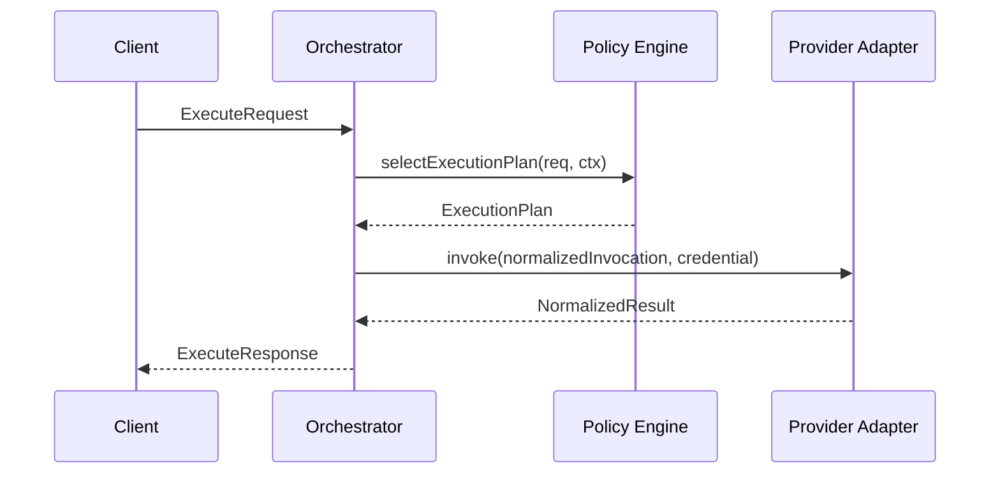
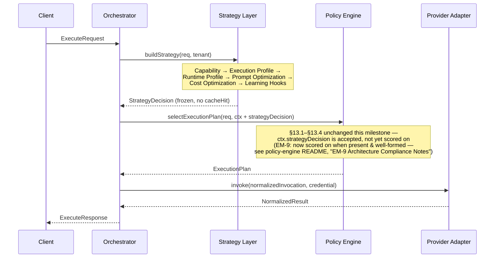
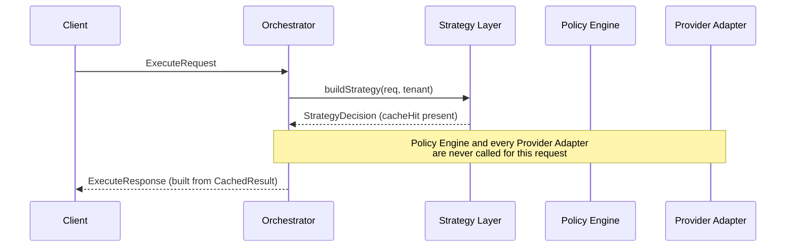
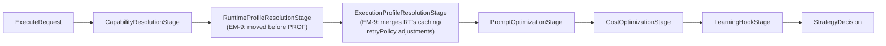
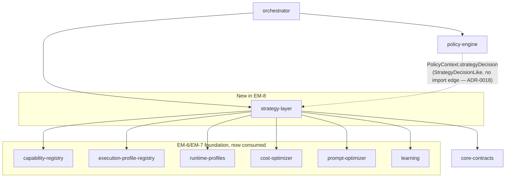

# EM-8 Runtime Flow — Strategy Layer Integration

> **EM-9 update (Independent Architecture & Engineering Review of EM-9):**
> this document is a historical record of EM-8's integration and is left
> as originally written, with inline `(EM-9: ...)` annotations wherever
> EM-9 changed something it describes. In short: the Strategy Pipeline's
> stage order changed (`RuntimeProfileResolutionStage` now runs before
> `ExecutionProfileResolutionStage`), and `policy-engine` now reads
> `ctx.strategyDecision` instead of merely accepting and ignoring it. See
> `packages/policy-engine/README.md`'s "EM-9 Architecture Compliance
> Notes" for the complete field-by-field account, and ADR-0020 for what
> Runtime Profile integration remains unimplemented and why.
>
> **EM-10 update:** the diagrams below still accurately describe the
> pipeline when no `budgetEnforcer` is configured (`strategy-layer`'s own
> default — see `StrategyLayerOptions.budgetEnforcer`'s doc comment). When
> one is configured, a `BudgetEnforcementStage` runs between
> `CostOptimizationStage` and `LearningHookStage` — see
> `packages/strategy-layer/README.md`'s "EM-10: Budget Enforcement" and
> ADR-0025 for what that stage does and doesn't fully wire up.

**A note on why this is a new document, not an edit to `architecture-spec.md`/
`engineering-blueprint.md`:** the EM-8 work order asks for both of those files to be
"updated." Throughout this project (EM-6 through EM-8), the established, consistently-applied
practice has been the opposite: the Architecture Specification and Engineering Blueprint
are treated as frozen, authoritative references that implementations conform to, and any
correction they need is recorded via an ADR (see `docs/adr/`), not a direct rewrite of
their prose — the whole reason the ADR mechanism exists is so milestones don't need to
touch those files directly. This document is the diagrams/sequence-diagrams/dependency-graph
deliverable EM-8 asks for, built as a dedicated addendum (the same shape as
`docs/Hosting-architecture/EM-5.5-vercel-deployment-architecture-review.md`'s own
precedent — a separate document, not an edit to the frozen spec) rather than a change to
either core document's body text.

## Runtime flow: before and after

**EM-7 and earlier (`enableStrategyLayer` absent or `false`):**

**EM-8, `enableStrategyLayer: true` — no cache hit (the common case):**

**EM-8, `enableStrategyLayer: true` — cache hit (short-circuit):**

## The Strategy Pipeline, stage by stage

Each box is a real, separately-exported, separately-unit-tested class
(`packages/strategy-layer/src/stages/*.ts`) implementing `StrategyPipelineStage`. See
`packages/strategy-layer/README.md` for why Prompt Optimization runs before Cost
Optimization (architecture §33/§34's dataflow, not the work order's listed order) and why
`LearningHookStage` never calls `.record()`.

## Corrected dependency graph (this milestone's additions only)

The dotted line is deliberately **not** a dependency edge — it represents
`PolicyContext.strategyDecision`'s structural typing (ADR-0018), which exists precisely so
`policy-engine` does not need a real edge onto `strategy-layer`. See ADR-0016 for the full
correction of Blueprint §4.1's defective `strategy-layer` table row (which listed
`orchestrator` as a dependency of `strategy-layer` — backwards, and a cycle — and omitted
four load-bearing edges).

## Execution lifecycle changes

| Lifecycle step                                             | EM-7                                         | EM-8 (`enableStrategyLayer: true`)                                                                            |
| ---------------------------------------------------------- | -------------------------------------------- | ------------------------------------------------------------------------------------------------------------- |
| Request validation                                         | `orchestrator.validate(req)`                 | Unchanged                                                                                                     |
| Strategy resolution                                        | _(does not exist)_                           | `strategyLayer.buildStrategy(req, req.tenant)` — one call, before Policy Engine                               |
| Cache short-circuit                                        | _(does not exist)_                           | If `decision.cacheHit`, response is built directly; Policy Engine and every Provider Adapter are skipped      |
| Plan selection                                             | `policyEngine.selectExecutionPlan(req, ctx)` | Same call; `ctx.strategyDecision` is now populated (ADR-0018) but not yet read by `policy-engine`'s own logic |
| Candidate resolution, retry/failover, streaming, telemetry | Unchanged                                    | Unchanged                                                                                                     |

## Feature flag rollback

Setting `enableStrategyLayer: false` (or omitting it, or unsetting `ENABLE_STRATEGY_LAYER`)
restores the EM-7 sequence diagram exactly — `gateway-runtime`'s `bootstrap()` simply does
not construct a `strategyLayer` instance, and `orchestrator`'s own logic (`buildStrategyDecision`
returning `undefined` when no `strategyLayer` was injected) means every code path this
milestone added is a no-op. No code change is required to roll back, per EM-8's own
acceptance criterion — verified by `@ai-gateway/gateway-runtime`'s
`test/integration/end-to-end.test.ts` "EM-8 Pass-through Regression" suite, which runs the
identical request against both configurations and asserts an identical result.
