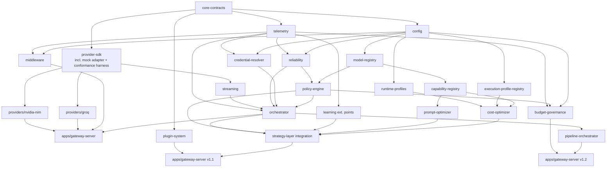

# AI Gateway — Engineering Implementation Blueprint

**Document status:** v1.0
**Companion to:** _AI Gateway — Universal AI Execution Platform: Architecture & Implementation Specification_ (v1.2, Parts I–III, 46 sections)
**Role of this document:** The architecture is treated as approved and frozen. Nothing here introduces a new component, interface, or concept that isn't already specified in the architecture document — every section below cites the architecture section it operationalizes. This document answers a different question: **in what order, by whom, and with what safeguards should a team actually build it?**
**Audience:** Engineering leads, tech leads, individual contributors joining the AI Gateway build

> **Repository location note (added during PG-2 documentation stabilization):**
> This document is the canonical Engineering Blueprint for AI Gateway and now lives at
> `docs/architecture/engineering-blueprint.md`, alongside its companion,
> `docs/architecture/architecture-spec.md` (the Architecture Specification). Every "Blueprint
> §N" reference found elsewhere in this repository refers to a section number in this
> document; section numbering is unchanged from the original. **This document's EM-0 through
> EM-11 milestone sequence (Section 7) is the authoritative, actually-implemented build order**
> for AI Gateway — see the note at the Architecture Specification's §26 for how that section's
> earlier, differently-scoped Milestone 0–7 roadmap relates to this one.

---

## Table of Contents

1. Executive Summary
2. Engineering Philosophy
3. Repository Bootstrap Guide
4. Package Dependency Graph
5. Package Implementation Order
6. Interface-First Development Strategy
7. Engineering Milestones
8. Package-by-Package Implementation Guide
9. Testing Strategy
10. CI/CD Strategy
11. Development Workflow
12. Code Quality Standards
13. Technical Debt Prevention Guide
14. Performance Roadmap
15. Security Implementation Plan
16. Documentation Strategy
17. Risk Register
18. Engineering Checklists
19. Repository Bootstrap Checklist
20. Recommended Team Structure
21. Estimated Engineering Timeline
22. Final Readiness Assessment

---

## 1. Executive Summary

The AI Gateway architecture (v1.2) is complete: provider abstraction, the AI Strategy Layer, the Policy Engine, BYOK, reliability, observability, multi-step pipelines, capability extensibility, and budget governance are all specified with interfaces, diagrams, and ADRs. What remains is purely an execution problem — sequencing roughly twenty packages so that a team can build continuously, release early and often, and never find itself blocked waiting on a teammate's unfinished work.

This blueprint converts the architecture into that execution plan. It defines: the exact order packages should be scaffolded and implemented (Sections 3–6); twelve engineering milestones, each of which produces a running, demoable gateway (Section 7); a package-by-package implementation guide covering responsibilities, APIs, and testing for every package (Section 8); testing, CI/CD, and workflow practices tuned to a monorepo with many independently-versioned packages (Sections 9–12); a technical-debt prevention guide naming the specific mistakes this architecture is most likely to invite (Section 13); sequencing guidance for performance and security work so neither is done too early or too late (Sections 14–15); and the operational scaffolding — checklists, a risk register, a team structure, and a timeline estimate — needed to actually kick the project off (Sections 16–22).

Nothing in this document simplifies, redesigns, or reinterprets the architecture. Where the architecture specified an interface, this document specifies who builds it and when.

---

## 2. Engineering Philosophy

Six practices govern how AI Gateway gets built, chosen specifically to serve the architecture's own goals (minimize risk, minimize rework, ship incrementally, keep every milestone testable):

1. **Interfaces are committed before implementations.** Every package in Section 8 has its public interface merged and code-reviewed as a standalone "interface PR" before any concrete logic is written against it. This is the mechanism, not just the intent, behind Section 6's dependency-inversion strategy — it's what lets Section 5's parallel "waves" actually be built in parallel without engineers blocking on each other.

2. **Mock-first, real-second.** The Mock Provider Adapter and the shared conformance test harness (architecture §12.4, §24) are built _before_ the Groq and NVIDIA NIM adapters. This means the Orchestrator, Policy Engine, and every layer above the adapter boundary can be fully built and tested against a fast, deterministic, network-free fake — real provider quirks never block core platform development.

3. **Thin vertical slice before deep horizontal layers.** The first engineering milestone (Section 7, EM-0/EM-1) deliberately produces an end-to-end request path — even a trivial, unoptimized one — rather than fully building any single layer in isolation. This surfaces integration problems (wrong assumption in a contract, a missing field) in week two, not month four.

4. **Every milestone ships something runnable.** "Merged to main" is not the bar; "a person can start the server and make a real request" is. This is what "avoid big-bang implementation" (a stated goal) means operationally.

5. **Contracts are the expensive thing to change; internals are cheap.** `core-contracts` (architecture §9, §10) is versioned and stabilized earliest and changed least. Internal package implementations (a caching strategy, a scoring formula's weights) can and should be revised freely without an ADR; a change to `ExecuteRequest`, `GatewayError`, or any exported interface requires the same ADR discipline already established in architecture §28/§39/§46.

6. **Boring technology by default.** TypeScript, Node.js, Redis, Postgres, OpenTelemetry — all already implied by the architecture's deployment model (§25) — are the defaults everywhere a choice is needed in this blueprint (test runner, CI provider, package manager). Novel tooling is a cost the project doesn't need to pay twice.

---

## 3. Repository Bootstrap Guide

### 3.1 Monorepo Tooling

**Choice:** pnpm workspaces + Turborepo.

**Why:** The architecture's package graph (§9) is deep and has a real topological order (Section 4 below) — Turborepo's task pipeline (`build`, `lint`, `test`, `typecheck`) is defined as a dependency graph that mirrors the package graph directly, so `turbo run build` builds packages in the correct order automatically and caches unaffected packages. pnpm's strict, non-hoisted `node_modules` layout catches accidental cross-package imports of transitive dependencies early — a small but real assist to enforcing architecture Principle P1 (provider SDKs isolated to `packages/providers/*`). Nx is an acceptable substitute with equivalent guarantees; Turborepo is recommended here for its lower configuration surface, which matters more early in the project than Nx's richer generator tooling.

### 3.2 Repository Structure

Mirrors architecture §9 exactly — `apps/`, `packages/`, `examples/`, `tools/`, `docs/adr/` — with no deviation. See Section 4 for the dependency graph and Section 19 for the exact scaffolding order.

### 3.3 Package Initialization Order (Tooling, Not Features)

Before any feature code is written, every package directory is scaffolded with a minimal `package.json`, a `tsconfig.json` extending the shared base config, an empty `src/index.ts`, and a placeholder test file — in the same topological order used for feature implementation (Section 5). Scaffolding a package "empty but wired in" before its features exist means the build graph, CI pipeline, and dependency-boundary lint rule are all correct from commit one, rather than being retrofitted once packages already have code that violates them.

### 3.4 Shared Configuration

| Concern                | Choice                                                                                                              | Why                                                                                                                                                                                                       |
| ---------------------- | ------------------------------------------------------------------------------------------------------------------- | --------------------------------------------------------------------------------------------------------------------------------------------------------------------------------------------------------- |
| Base TypeScript config | `strict: true`, ES2022 target, NodeNext module resolution, shared via a root `tsconfig.base.json`                   | Strict mode catches null/undefined bugs at the exact boundary layers (Provider Adapter error translation, Credential Resolver) where architecture §19/§20 requires precision                              |
| Linting                | ESLint + `typescript-eslint` + a custom dependency-boundary rule (dependency-cruiser or `eslint-plugin-boundaries`) | The boundary rule is the automated enforcement of ADR-003 (architecture §28): CI fails if, e.g., `policy-engine` imports anything from `packages/providers/groq`                                          |
| Formatting             | Prettier, enforced via `lint-staged` pre-commit hook **and** a CI check                                             | Pre-commit alone is advisory (skippable); a CI check makes it a hard gate, consistent with "keep architecture clean" as a stated goal                                                                     |
| Test runner            | Vitest                                                                                                              | Native ESM/TypeScript support with no transpile step, fast watch mode, first-class monorepo workspace support — matters given the project will accumulate dozens of packages with independent test suites |
| Package versioning     | Changesets                                                                                                          | Supports independent semver per package (architecture §9 explicitly calls out `core-contracts` as independently publishable) without a manual changelog process                                           |

### 3.5 Build Pipeline

A root `turbo.json` defines `build`, `lint`, `typecheck`, and `test` tasks with `dependsOn: ["^build"]` so a package only builds after its dependencies do — this is the literal implementation of the dependency graph in Section 4. Remote build caching (Turborepo's own remote cache, or a self-hosted equivalent) is enabled from day one so CI time grows with _changed_ packages, not total package count, which matters once the platform reaches its full ~19-package scope (Section 4).

### 3.6 CI/CD (Bootstrap-Level; full strategy in Section 10)

Every PR: install → lint → typecheck → `turbo run test --filter=...[origin/main]` (affected packages only) → build. Nightly on `main`: full test suite including conformance, chaos, and load tests (Section 9) that are too slow for per-PR execution. Full detail, including release and deploy pipelines, is in Section 10.

### 3.7 Release Strategy

Pre-1.0, every package ships as `0.x.y`. `core-contracts` is the first package promoted to `1.0.0`, gated on Engineering Milestone EM-0's acceptance criteria (Section 7) — because it is the one package external SDK consumers and every internal package alike depend on, its contract stability is worth signaling explicitly and early, ahead of the rest of the platform.

---

## 4. Package Dependency Graph

### 4.1 Dependency Table

| Package                        | Direct dependencies                                                                               | Architecture reference    |
| ------------------------------ | ------------------------------------------------------------------------------------------------- | ------------------------- |
| `core-contracts`               | _(none)_                                                                                          | §10, §11                  |
| `config`                       | `core-contracts`                                                                                  | §10.6                     |
| `telemetry`                    | `core-contracts`                                                                                  | §21                       |
| `provider-sdk`                 | `core-contracts`                                                                                  | §12                       |
| `reliability`                  | `core-contracts`, `config`, `telemetry`                                                           | §18                       |
| `model-registry`               | `core-contracts`, `config`                                                                        | §14                       |
| `credential-resolver`          | `core-contracts`, `config`, `telemetry`                                                           | §15, §16                  |
| `policy-engine`                | `model-registry`, `reliability`, `core-contracts`                                                 | §13                       |
| `providers/groq`               | `provider-sdk`, `core-contracts`                                                                  | §12.3                     |
| `providers/nvidia-nim`         | `provider-sdk`, `core-contracts`                                                                  | §12.3                     |
| `streaming`                    | `provider-sdk`, `core-contracts`                                                                  | §12.1 (streaming variant) |
| `orchestrator`                 | `policy-engine`, `credential-resolver`, `reliability`, `streaming`, `telemetry`, `core-contracts` | §17                       |
| `middleware`                   | `config`, `telemetry`, `core-contracts`                                                           | §20.5                     |
| `apps/gateway-server` (v1.0)   | `orchestrator`, `middleware`, `providers/groq`, `providers/nvidia-nim`                            | §25                       |
| `capability-registry`          | `model-registry`, `core-contracts`                                                                | §32                       |
| `execution-profile-registry`   | `config`, `core-contracts`                                                                        | §31                       |
| `runtime-profiles`             | `config`                                                                                          | §37                       |
| `cost-optimizer`               | `capability-registry`, `execution-profile-registry`, `runtime-profiles`                           | §33                       |
| `prompt-optimizer`             | `capability-registry`, `core-contracts`                                                           | §34                       |
| `learning` (ext. points)       | `telemetry`, `policy-engine`                                                                      | §36                       |
| `plugin-system`                | `core-contracts`                                                                                  | §11                       |
| `strategy-layer` (integration) | `cost-optimizer`, `prompt-optimizer`, `learning`, `policy-engine`, `orchestrator`                 | §30                       |
| `pipeline-orchestrator`        | `orchestrator`'s public interface, `core-contracts`                                               | §41                       |
| `budget-governance`            | `config`, `telemetry`, `policy-engine` (Routing Rules interface)                                  | §43                       |

No cycles exist in this graph by construction — this is itself an acceptance criterion for Engineering Milestone EM-0 (Section 7): a `dependency-cruiser` or Turborepo graph check that fails CI if one is ever introduced.

---

## 5. Package Implementation Order

Packages are grouped into **waves**. Every package in a wave depends only on packages in strictly earlier waves, so — once interfaces are frozen per Section 6 — every package within a wave can be assigned to a different engineer or sub-team and built fully in parallel.

| Wave  | Packages                                                                         | Can start once...                                                                                                                                 |
| ----- | -------------------------------------------------------------------------------- | ------------------------------------------------------------------------------------------------------------------------------------------------- |
| **0** | `core-contracts`                                                                 | Immediately (day 1)                                                                                                                               |
| **1** | `config`, `telemetry`, `provider-sdk` (incl. Mock Adapter + conformance harness) | Wave 0 interfaces merged                                                                                                                          |
| **2** | `reliability`, `model-registry`, `credential-resolver`                           | Wave 1 merged                                                                                                                                     |
| **3** | `policy-engine`, `providers/groq`, `providers/nvidia-nim`, `streaming`           | Wave 2 merged                                                                                                                                     |
| **4** | `orchestrator`, `middleware`                                                     | Wave 3 merged                                                                                                                                     |
| **5** | `apps/gateway-server` (v1.0 MVP)                                                 | Wave 4 merged — **first fully working release**                                                                                                   |
| **6** | `capability-registry`, `execution-profile-registry`, `runtime-profiles`          | Wave 5 stable (can start earlier in parallel with Wave 5 hardening, since these have no dependency on `orchestrator`)                             |
| **7** | `cost-optimizer`, `prompt-optimizer`, `learning` (ext. points), `plugin-system`  | Wave 6 merged                                                                                                                                     |
| **8** | `strategy-layer` integration (wiring Waves 6–7 into `orchestrator`)              | Wave 7 merged                                                                                                                                     |
| **9** | `pipeline-orchestrator`, `budget-governance`                                     | Wave 8 merged (both depend on the stabilized public Orchestrator interface, not on each other — they can build fully in parallel with each other) |

Wave 6 is deliberately called out as startable in parallel with late Wave 5 work: none of `capability-registry`, `execution-profile-registry`, or `runtime-profiles` depend on `orchestrator`, only on `model-registry`/`config` (Wave 2). A team with spare capacity during Wave 5's integration/hardening phase can pull Wave 6 forward without violating the dependency graph.

---

## 6. Interface-First Development Strategy

### 6.1 Interfaces That Must Be Frozen Before Implementation

| Interface                                               | Defined in (architecture) | Consumed by                                | Implemented by                                         |
| ------------------------------------------------------- | ------------------------- | ------------------------------------------ | ------------------------------------------------------ |
| `ProviderAdapter` / `CapabilityAdapter<T,O>`            | §12.1, §42.1              | `orchestrator`, `policy-engine`            | `providers/groq`, `providers/nvidia-nim`, Mock Adapter |
| `PolicyEngine`                                          | §13, §11                  | `orchestrator`                             | `policy-engine`                                        |
| `ModelRegistry`                                         | §14, §11                  | `policy-engine`                            | `model-registry`                                       |
| `CredentialResolver` / `ScopeResolver` / `SecretSource` | §15, §16, §11             | `orchestrator`                             | `credential-resolver`                                  |
| `RetryEngine` / `HealthMonitor`                         | §18, §11                  | `orchestrator`, `policy-engine`            | `reliability`                                          |
| `StreamManager`                                         | §12.1 (streaming), §11    | `orchestrator`                             | `streaming`                                            |
| `Telemetry`                                             | §21, §11                  | every package                              | `telemetry`                                            |
| `GatewayPlugin`                                         | §11                       | `orchestrator` (plugin host)               | `plugin-system`, third-party plugins                   |
| `AIStrategyLayer`                                       | §30.3                     | `orchestrator`                             | `strategy-layer` integration                           |
| `CapabilityRegistry`                                    | §32.2                     | `strategy-layer`                           | `capability-registry`                                  |
| `ExecutionProfileRegistry` (implicit interface)         | §31.2                     | `strategy-layer`                           | `execution-profile-registry`                           |
| `CostOptimizer`                                         | §33.2                     | `strategy-layer`                           | `cost-optimizer`                                       |
| `PromptOptimizer`                                       | §34.2                     | `strategy-layer`                           | `prompt-optimizer`                                     |
| `LearningSignalCollector` / `AdaptiveRankingStrategy`   | §36.2                     | `policy-engine` (optional), `orchestrator` | `learning` (no-op default)                             |
| `BudgetEnforcer` / `BudgetLedger`                       | §43.2                     | `strategy-layer` (Optimization Pipeline)   | `budget-governance`                                    |
| `PipelineStep` / `ExecutionPipeline`                    | §41.2                     | `apps/gateway-server` (pipeline endpoint)  | `pipeline-orchestrator`                                |

### 6.2 Why Interface-First, Concretely

Every package listed as a "consumer" above is buildable and testable the moment the interface it consumes is merged — regardless of whether the "implemented by" package exists yet. Concretely: `orchestrator` (Wave 4) can be fully built and unit-tested against the Mock Adapter (an implementation of `ProviderAdapter` that ships as part of `provider-sdk` in Wave 1) _before_ `providers/groq` or `providers/nvidia-nim` (Wave 3, built in parallel) are finished. This is the mechanism that makes Section 5's wave-based parallelization real rather than aspirational — without frozen interfaces, "parallel waves" would just be an invitation for two engineers to build incompatible assumptions into the same seam.

### 6.3 Process for Freezing an Interface

1. The interface (types, method signatures, error contract) is proposed as a standalone PR containing only the interface file, its TSDoc, and a companion test file with type-level assertions (no implementation).
2. Review focuses exclusively on the contract: is it the minimal shape needed, does it hide the right implementation details, does every error path return a `GatewayError`-compatible shape (architecture §19).
3. Once merged, the interface is treated as stable for the remainder of that Engineering Milestone (Section 7) — changes require the same lightweight ADR discipline as any architecture-level contract change (architecture §28/§39/§46's format is reused directly: Context / Decision / Consequences / Alternatives).
4. Only after merge does implementation work begin, and it begins in parallel across every consumer/implementer pairing that the interface unblocks.

### 6.4 Dependency Inversion Strategy

High-level modules (`orchestrator`, `policy-engine`, the Strategy Layer) depend only on interfaces declared in low-dependency packages (`core-contracts`, `provider-sdk`, and each package's own exported contract). Concrete, detail-heavy implementations — the Groq adapter's HTTP client, a Redis-backed `HealthMonitor`, a Postgres-backed `CredentialResolver` — depend on those same interfaces too, never the other way around. The **only** file in the entire codebase permitted to import concrete implementations of every interface simultaneously is `apps/gateway-server/src/bootstrap.ts` (named in architecture §9), which performs dependency injection exactly once, at process start. This single-composition-root pattern is what makes the dependency-boundary lint rule (Section 3.4) meaningfully enforceable: every other file's legal import set is small and mechanically checkable.

---

## 7. Engineering Milestones

Twelve milestones (EM-0 through EM-11), mapped 1:1 to the architecture's own roadmap (Milestones 0–7, architecture §26; Milestones 8–11, architecture §38.2), now decomposed to engineering-actionable detail. Every milestone ends with a running server a stakeholder can actually call.

### EM-0 — Contracts, Tooling, and Repository Skeleton

- **Objectives:** Stand up the monorepo (Section 3), freeze `core-contracts`, prove the dependency graph has no cycles.
- **Packages implemented:** `core-contracts` (full), empty scaffolds for every Wave 1–4 package (Section 3.3).
- **Features delivered:** A CI pipeline that lints, typechecks, tests, and builds an (empty) monorepo; a schema-validated `ExecuteRequest`/`ExecuteResponse`/`GatewayError`.
- **Tests required:** Contract/schema validation tests only (100% of `core-contracts` exported types covered by a "does this parse" test).
- **Deliverables:** Green CI on `main`; `core-contracts` published as `1.0.0`.
- **Risks:** Over-designing the contract before real constraints are known — mitigated by treating it as amendable via ADR (Section 6.3), not frozen forever.
- **Acceptance criteria:** A hand-written JSON fixture validates against every exported schema; dependency graph check passes with zero cycles.
- **Demonstrable outcome:** `npx turbo run build` succeeds on a clean checkout in under 60 seconds.

### EM-1 — Mock Adapter, Provider SDK, and the First End-to-End Slice

- **Objectives:** Prove the full request path — even fake — works, before any real provider integration begins (Philosophy #3, Section 2).
- **Packages implemented:** `provider-sdk` (interface + Mock Adapter + conformance harness skeleton), `telemetry`, `config`.
- **Features delivered:** A trivial `orchestrator` stub that calls the Mock Adapter directly (no Policy Engine yet) and returns a canned response through a bare HTTP endpoint.
- **Tests required:** Mock Adapter passes its own conformance harness (proving the harness itself works); one integration test hitting the bare endpoint.
- **Deliverables:** `provider-sdk` interface frozen (Section 6.1); conformance harness usable by every future adapter.
- **Risks:** Building the conformance harness too speculatively before a second real adapter exists to validate it against — mitigated by deferring edge-case scenarios (malformed streaming chunks, etc.) to EM-4 once Groq/NIM are in flight.
- **Acceptance criteria:** `POST /debug/execute` (a temporary, non-public route) returns a Mock Adapter response end-to-end.
- **Demonstrable outcome:** A live demo of a request entering an HTTP server and a (fake) LLM response coming back out — the vertical slice.

### EM-2 — Reliability, Model Registry, Credential Resolver (Parallel Wave 2)

- **Objectives:** Build the three Wave 2 packages in parallel, each against Wave 1 interfaces only.
- **Packages implemented:** `reliability` (Retry Engine, Circuit Breaker, Timeout Manager, Health Monitor), `model-registry` (DB-backed + in-memory cache), `credential-resolver` (env + DB secret sources only — Vault/cloud secret managers deferred, Section 15).
- **Features delivered:** Configurable retry/backoff; a queryable, config-driven model registry with seed data for one placeholder provider; env-var and DB-backed credential resolution with audit logging.
- **Tests required:** Property-based tests for Retry Engine/Circuit Breaker (architecture §24); unit tests for registry cache invalidation; cross-tenant isolation tests for Credential Resolver (architecture §16.3) — written now, even though only one real tenant scope exists yet, since isolation logic is easiest to get right before scale.
- **Deliverables:** All three packages independently releasable at `0.1.0`.
- **Risks:** Isolation-test gaps in Credential Resolver are high-severity by nature (architecture §26 Milestone 3's risk note) — mitigated by making the isolation test suite a merge gate, not a follow-up task.
- **Acceptance criteria:** 90%+ line coverage on all three packages; isolation tests demonstrably fail if a tenant filter is (deliberately, in a test branch) removed, proving the tests are real.
- **Demonstrable outcome:** A CLI script that resolves a credential end-to-end from an env var and reports the audit-log entry produced.

### EM-3 — Policy Engine, Real Provider Adapters, Streaming (Parallel Wave 3)

- **Objectives:** Replace the EM-1 stub orchestrator's direct Mock Adapter call with real routing; bring the first two real providers online.
- **Packages implemented:** `policy-engine` (scoring against Mock Adapter + one seeded real model class), `providers/groq`, `providers/nvidia-nim`, `streaming`.
- **Features delivered:** Task-to-model scoring and ranking (no cost/capability sophistication yet — static weights); working non-streaming Groq calls; working non-streaming NVIDIA NIM calls; SSE streaming transport.
- **Tests required:** Adapter conformance suite run against both real adapters (using recorded HTTP fixtures, not live calls, in CI); Policy Engine unit tests against registry fixtures; streaming chunk-ordering tests.
- **Deliverables:** Groq and NVIDIA NIM adapters passing 100% of the shared conformance suite (architecture §12.4).
- **Risks:** Real provider APIs behaving unexpectedly relative to the `ProviderAdapter` contract — mitigated by running this milestone's adapter work concurrently with EM-2 rather than after it, so any contract gap surfaces while `credential-resolver`/`reliability` are still easy to adjust.
- **Acceptance criteria:** A real (non-mocked, manually-triggered) call to Groq succeeds end-to-end through Policy Engine routing.
- **Demonstrable outcome:** The same `/debug/execute` route from EM-1 now returns a real Groq completion.

### EM-4 — Orchestrator, Middleware, and Integration Hardening (Wave 4)

- **Objectives:** Assemble Waves 1–3 into the real `orchestrator`, replacing the EM-1 stub; add the middleware pipeline.
- **Packages implemented:** `orchestrator` (full request lifecycle, architecture §17), `middleware` (auth, rate limiting, response caching).
- **Features delivered:** The full non-streaming and streaming request lifecycle (architecture §17/§8.1–8.2), including retry-then-failover between Groq and NVIDIA NIM.
- **Tests required:** End-to-end integration tests against both the Mock Adapter and recorded-fixture real adapters; a chaos test injecting Groq failures to verify automatic failover (architecture §26 Milestone 4's acceptance criterion, pulled forward here since both adapters already exist).
- **Deliverables:** The full request lifecycle diagram (architecture §17) is now literally true of the running system, not just the design.
- **Risks:** Middleware-layer caching interacting badly with per-tenant isolation — mitigated by the cache-key-includes-tenant-scope default already specified (architecture §20.4), tested explicitly here.
- **Acceptance criteria:** Chaos test shows failover completing within the configured deadline budget with zero client-visible errors for failover-eligible traffic.
- **Demonstrable outcome:** Killing the Groq adapter's network access mid-demo and watching traffic shift to NVIDIA NIM live.

### EM-5 — v1.0 MVP: `apps/gateway-server` Ships

- **Objectives:** Package everything from EM-0–EM-4 into a deployable server; this is the first release a real (non-engineering) stakeholder can use.
- **Packages implemented:** `apps/gateway-server` (bootstrap wiring, Section 6.4; REST + streaming routes).
- **Features delivered:** A publicly-callable (within whatever environment it's deployed to) `/v1/execute` and `/v1/execute/stream`, fully matching architecture §10.
- **Tests required:** Full regression suite from EM-0–EM-4; a load test establishing the P50/P99 gateway-overhead baseline against architecture §4's targets.
- **Deliverables:** v1.0 MVP tagged release; a minimal example client (`examples/minimal-node-client`, architecture §9).
- **Risks:** Discovering the performance baseline misses architecture §4's target — addressed per Section 14's sequencing (optimization work is explicitly _not_ front-loaded before this milestone, so a miss here is expected to inform Section 14's post-MVP work, not treated as a milestone failure).
- **Acceptance criteria:** External example client completes a real request against a deployed instance.
- **Demonstrable outcome:** A working AI Gateway v1.0 — this is the "architecture is real" milestone.

### EM-6 — Capability Registry, Execution Profile Registry, Runtime Profiles (Parallel Wave 6)

- **Objectives:** Lay the v1.1 foundation without yet touching `orchestrator`.
- **Packages implemented:** `capability-registry`, `execution-profile-registry`, `runtime-profiles`.
- **Features delivered:** Task → capability mapping (queryable, not yet wired into routing); seed Execution Profiles (architecture §31.3); seed Runtime Profiles (architecture §37.3) — all buildable and unit-testable in isolation since none depend on `orchestrator`.
- **Tests required:** Unit tests per registry against fixtures; no integration tests yet (nothing consumes these outputs until EM-8).
- **Deliverables:** Three packages at `0.1.0`, ready for integration.
- **Risks:** Low — this wave is intentionally decoupled and low-risk by design (Section 5's parallelization note).
- **Acceptance criteria:** Each registry's seed data round-trips correctly through its query interface.
- **Demonstrable outcome:** A CLI script resolving `task: "summarization"` to a capability set and an execution profile, printed side by side — no live traffic affected yet.

### EM-7 — Cost Optimizer, Prompt Optimizer, Learning Extension Points, Plugin System (Wave 7)

- **Objectives:** Build the remaining Strategy Layer sub-components and the plugin host, still without wiring into `orchestrator`.
- **Packages implemented:** `cost-optimizer`, `prompt-optimizer`, `learning` (no-op default), `plugin-system`.
- **Features delivered:** Model-downgrade recommendation logic; the prompt transformer pipeline (architecture §34.3); the no-op `LearningSignalCollector`; a plugin host capable of loading a trivial example plugin.
- **Tests required:** Unit tests per transformer (architecture §34.3's six named transformers, each independently testable); a test proving the no-op learning collector has zero effect on scoring output (architecture §36.3's guarantee, verified here rather than assumed).
- **Deliverables:** All four packages at `0.1.0`.
- **Risks:** Over-aggressive prompt compression — mitigated by the profile-level opt-out already specified (architecture §34.3) and tested explicitly for the `coding`/`json_generation` profiles.
- **Acceptance criteria:** Prompt Optimizer measurably reduces token count on a fixture with redundant content, without altering fixtures marked "must preserve exactly."
- **Demonstrable outcome:** A before/after token count on a sample prompt run through the optimizer.

### EM-8 — Strategy Layer Integration

- **Objectives:** Wire Waves 6–7 into `orchestrator`, inserting the AI Strategy Layer between request entry and the Policy Engine (architecture §30, §13.5) — the one milestone in the v1.1 track that touches already-shipped code.
- **Packages implemented:** `strategy-layer` (the integration package — orchestration of `capability-registry` → `execution-profile-registry` → optimization pipeline → `StrategyDecision`).
- **Features delivered:** The full v1.1 request lifecycle (architecture §38.1's expanded diagram) becomes literally true.
- **Tests required:** A/B regression test — replaying EM-5's load-test traffic through the new Strategy Layer with a pass-through configuration and asserting byte-for-byte identical routing outcomes (architecture §38.2 Milestone 8's own acceptance criterion, reused here verbatim since it's an engineering, not architectural, concern).
- **Deliverables:** v1.1 feature-complete on a staging environment, behind a feature flag (Section 10.4) until sign-off.
- **Risks:** Latency regression from the new layer — mitigated by gating this milestone's merge on the Section 3.6/EM-5 performance benchmark suite showing no regression beyond an agreed budget (e.g., +5ms P50).
- **Acceptance criteria:** Feature-flagged A/B test in staging shows no unexpected routing changes and no latency regression beyond budget.
- **Demonstrable outcome:** Flipping the feature flag live in staging and showing cost/latency dashboards before and after.

### EM-9 — v1.1 Release: Real Optimization Goes Live

- **Objectives:** Turn on real (non-pass-through) cost/prompt optimization and Runtime Profiles in production.
- **Packages implemented:** _(no new packages — configuration and feature-flag rollout only)_.
- **Features delivered:** Model-downgrade recommendations and prompt transformations actually affecting production routing; tenant-configurable Runtime Profiles.
- **Tests required:** Cost-reduction measurement on a production traffic replay; confirmation that strict-capability tasks (e.g., `json_generation`) are never downgraded out of schema compliance.
- **Deliverables:** v1.1 tagged release.
- **Risks:** Runtime Profile misconfiguration — mitigated by the dry-run/preview mode already specified (architecture §38.2 Milestone 11), built here rather than deferred, since it's a prerequisite for safely flipping this milestone's flags at all.
- **Acceptance criteria:** Measured cost reduction on replayed traffic with zero capability-compliance regressions.
- **Demonstrable outcome:** A live cost dashboard showing the before/after of the v1.0 → v1.1 transition.

### EM-10 — Pipeline Orchestrator & Budget Governance (Parallel Wave 9)

- **Objectives:** Build the two v1.2 packages in parallel; both depend only on the now-stable public Orchestrator interface and `policy-engine`.
- **Packages implemented:** `pipeline-orchestrator`, `budget-governance`.
- **Features delivered:** `/v1/execute/pipeline` (architecture §41.3), with the `maxSteps` cap (architecture ADR-014) enforced from day one, not retrofitted; Budget Policy/Ledger/Enforcer (architecture §43), with the durable-ledger decision (ADR-013) and distinct telemetry namespace (ADR-015) implemented as specified, not as follow-ups.
- **Tests required:** Multi-step pipeline integration test replicating architecture §41.4's worked example (extract → summarize → entity extraction → structured JSON); Budget Enforcer tests for each `BudgetThresholdAction` type (alert/downgrade/switch/block); a specific test asserting `BUDGET_EXCEEDED` and `ALL_PROVIDERS_UNAVAILABLE` never share a metric label (ADR-015's guarantee, verified rather than assumed).
- **Deliverables:** Both packages at `0.1.0`, behind feature flags.
- **Risks:** Budget Enforcer false-positive blocks — mitigated by shipping with a "shadow mode" (log what _would_ have been blocked, block nothing) for the first release, promoted to enforcing mode only after a burn-in period.
- **Acceptance criteria:** Pipeline example from architecture §41.4 executes correctly end-to-end; Budget Enforcer in shadow mode produces plausible (manually spot-checked) decisions against real traffic for at least one full billing cycle before enforcement is enabled.
- **Demonstrable outcome:** A live four-step document-intelligence pipeline demo (architecture §40.6's worked example), plus a budget dashboard showing shadow-mode decisions.

### EM-11 — v1.2 Release & Platform Hardening

- **Objectives:** Promote Budget Governance out of shadow mode; close out any deferred conformance/chaos/load-test gaps from earlier milestones; finalize documentation.
- **Packages implemented:** _(no new packages — hardening, docs, and flag promotion only)_.
- **Features delivered:** Full v1.2 scope live and enforcing.
- **Tests required:** Full regression + chaos + load suite (Section 9) run against the complete v1.2 system.
- **Deliverables:** v1.2 tagged release; complete package documentation (Section 16); updated onboarding guide.
- **Risks:** Cumulative complexity across 19 packages making onboarding hard for new engineers — mitigated by the dependency-graph-based onboarding path specified in Section 16.5.
- **Acceptance criteria:** Every checklist item in Section 18 is checked for every package in Section 8.
- **Demonstrable outcome:** A new engineer, using only this document and the architecture spec, correctly explains the request lifecycle for a budget-constrained, multi-step, streaming request without reading source code.

---

## 8. Package-by-Package Implementation Guide

Each entry below covers Responsibilities, Public APIs, Internal Architecture, Extension Points, Configuration, Dependencies, Testing Strategy, Example Usage, and Future Evolution — described in prose and interaction terms, not code, per this document's scope.

### 8.1 `core-contracts`

| Field                 | Detail                                                                                                                                                                                 |
| --------------------- | -------------------------------------------------------------------------------------------------------------------------------------------------------------------------------------- |
| Responsibilities      | Defines the entire public vocabulary of the platform: `ExecuteRequest`, `ExecuteResponse`, `StreamChunk`, `GatewayError` and its error codes, `ChatMessage`, `TaskType`. Nothing else. |
| Public APIs           | The types themselves, plus lightweight runtime schema validators (one per exported type) so every package boundary can validate at runtime, not just at compile time.                  |
| Internal architecture | Deliberately flat — a handful of type files and their validators, no logic, no classes.                                                                                                |
| Extension points      | `TaskType` and `GatewayErrorCode` are open unions; new task types and error codes are additive, never require touching an existing consumer.                                           |
| Configuration         | None — this package is configuration-free by design.                                                                                                                                   |
| Dependencies          | None (architecture §9's explicit zero-dependency requirement).                                                                                                                         |
| Testing strategy      | Schema round-trip tests only: construct a fixture, validate it, assert acceptance/rejection at each boundary condition (missing required field, wrong enum value).                     |
| Example usage         | Every other package imports `ExecuteRequest`/`GatewayError` types directly; no package re-declares or duplicates these shapes locally.                                                 |
| Future evolution      | New fields are added as optional; breaking changes (removing/renaming a field) require an ADR and a major version bump, coordinated across every consuming package via Changesets.     |

### 8.2 `config`

| Field                 | Detail                                                                                                                                                                                       |
| --------------------- | -------------------------------------------------------------------------------------------------------------------------------------------------------------------------------------------- |
| Responsibilities      | Loads, validates, and hot-reloads `GatewayConfig` (architecture §10.6) from whatever source is configured (file, env, DB row) for a given deployment.                                        |
| Public APIs           | A `loadConfig()`/`watchConfig()` pair returning a schema-validated, typed configuration object; a change-notification callback for hot-reload consumers (Runtime Profiles, routing weights). |
| Internal architecture | A thin loader plus a `zod`-style (or equivalent) schema validator; no business logic interprets the config values — that's every consuming package's job.                                    |
| Extension points      | New config sections (e.g., a future package's own settings) are additive schema extensions, validated the same way.                                                                          |
| Configuration         | Ironically self-referential: `config`'s own behavior (which source to load from) is set via a small number of environment variables, documented once and never duplicated elsewhere.         |
| Dependencies          | `core-contracts` only.                                                                                                                                                                       |
| Testing strategy      | Schema validation tests for valid/invalid configs; a hot-reload test asserting a change notification fires exactly once per actual change.                                                   |
| Example usage         | `policy-engine` reads `routing.defaultStrategy` and scoring weight overrides from this package at startup and on hot-reload; it never parses a config file itself.                           |
| Future evolution      | A future admin UI (architecture §25.4) would write to whatever source `config` reads from, requiring no change to `config` itself.                                                           |

### 8.3 `telemetry`

| Field                 | Detail                                                                                                                                                                                                                            |
| --------------------- | --------------------------------------------------------------------------------------------------------------------------------------------------------------------------------------------------------------------------------- |
| Responsibilities      | Wraps OpenTelemetry (tracing, metrics) and structured logging behind one small interface every other package uses uniformly (architecture §21).                                                                                   |
| Public APIs           | `startSpan`, `recordMetric`, `log` (architecture §11's `Telemetry` interface, unchanged here).                                                                                                                                    |
| Internal architecture | A thin adapter over the OTel SDK; log lines are emitted as single-line JSON matching the fixed core schema (architecture §21.4).                                                                                                  |
| Extension points      | Exporters (Jaeger, Tempo, Honeycomb, Datadog, etc.) are swappable via OTel's own exporter configuration, never via code changes in this package.                                                                                  |
| Configuration         | OTel endpoint, sampling rate, log level — sourced from `config`.                                                                                                                                                                  |
| Dependencies          | `core-contracts` only.                                                                                                                                                                                                            |
| Testing strategy      | Unit tests asserting every span closes with a status, every metric call includes required labels, and log lines conform to the fixed schema; no assertions on exporter behavior (that's OTel's own tested responsibility).        |
| Example usage         | `orchestrator` opens one root span per request and child spans per stage (architecture §21.1's diagram); every package below it only ever calls `recordMetric`/`log`, never manages spans directly except at its own entry point. |
| Future evolution      | Cost/failure analytics dashboards (architecture §21.5) are built entirely downstream of what this package already emits — no new instrumentation needed as new dashboards are added.                                              |

### 8.4 `provider-sdk`

| Field                 | Detail                                                                                                                                                                                                     |
| --------------------- | ---------------------------------------------------------------------------------------------------------------------------------------------------------------------------------------------------------- |
| Responsibilities      | Defines `ProviderAdapter`/`CapabilityAdapter<T,O>` (architecture §12.1, §42.1); ships the Mock Adapter and the shared conformance test harness every real adapter must pass.                               |
| Public APIs           | The adapter interfaces; a `MockAdapter` class configurable to simulate success, specific error codes, timeouts, and malformed streaming; a `runConformanceSuite(adapter)` test-harness entrypoint.         |
| Internal architecture | Interfaces plus one reference (mock) implementation; no real HTTP logic lives here.                                                                                                                        |
| Extension points      | The `_template` starting-point package (architecture §9) lives conceptually alongside this one — copying it is how a new domain/provider begins.                                                           |
| Configuration         | None at the SDK level; individual adapters configure their own endpoints/timeouts.                                                                                                                         |
| Dependencies          | `core-contracts` only.                                                                                                                                                                                     |
| Testing strategy      | The conformance suite itself is the test artifact this package delivers; it is exercised against the Mock Adapter first (to prove the suite works) and later against every real adapter (Section 8.5–8.6). |
| Example usage         | `orchestrator`'s early tests (EM-1) depend only on the Mock Adapter, never on Groq/NVIDIA NIM credentials, keeping the core test suite fast and offline-runnable.                                          |
| Future evolution      | Section 42's `CapabilityAdapter<TInput,TOutput>` generalization lives here; a future OCR/speech/vision adapter package depends on this package exactly the way `providers/groq` does today.                |

### 8.5 `reliability`

| Field                 | Detail                                                                                                                                                                                                                  |
| --------------------- | ----------------------------------------------------------------------------------------------------------------------------------------------------------------------------------------------------------------------- |
| Responsibilities      | Retry Engine, Circuit Breaker, Timeout Manager, Health Monitor (architecture §18).                                                                                                                                      |
| Public APIs           | `RetryEngine.execute()`, `HealthMonitor.reportSuccess/reportFailure/getHealth/getHealthiestAlternative` (architecture §11).                                                                                             |
| Internal architecture | Circuit Breaker state machine per `(providerId, modelClass)` (architecture §18.2); Health Monitor backed by the shared Redis store (architecture §23.1) for cross-instance visibility.                                  |
| Extension points      | Backoff policy is a swappable strategy (`exponential`/`linear`/`none`, architecture §18.1); a future `AdaptiveRankingStrategy` (architecture §36) can read Health Monitor state without this package knowing it exists. |
| Configuration         | `maxAttempts`, backoff parameters, circuit-breaker thresholds — from `config`, overridable per Runtime Profile (architecture §37.4) once that package exists.                                                           |
| Dependencies          | `core-contracts`, `config`, `telemetry`.                                                                                                                                                                                |
| Testing strategy      | Property-based tests injecting failure sequences and asserting exact retry counts/backoff timing/circuit-state transitions (architecture §24).                                                                          |
| Example usage         | `policy-engine` calls `HealthMonitor.getHealthiestAlternative()` during fallback-plan assembly (architecture §13.2); `orchestrator` wraps every provider call in `RetryEngine.execute()`.                               |
| Future evolution      | Runtime Profile-driven retry/failover aggressiveness (architecture §37.4) is a configuration-value change to this package, not a code change.                                                                           |

### 8.6 `model-registry`

| Field                 | Detail                                                                                                                                                                      |
| --------------------- | --------------------------------------------------------------------------------------------------------------------------------------------------------------------------- |
| Responsibilities      | Stores and serves `ModelDescriptor` records, including lifecycle state (architecture §14, §35).                                                                             |
| Public APIs           | `queryModels`, `getModel`, `upsertModel` (architecture §11).                                                                                                                |
| Internal architecture | DB-backed store with an in-memory, TTL-cached read layer invalidated via Redis pub/sub on writes (architecture §14.2).                                                      |
| Extension points      | `ModelDescriptor.lifecycle` and (future) `.domain` fields (architecture §35.1, §42.2) are additive schema fields, not new query paths.                                      |
| Configuration         | Cache TTL, store connection details — from `config`.                                                                                                                        |
| Dependencies          | `core-contracts`, `config`.                                                                                                                                                 |
| Testing strategy      | Cache invalidation tests (write → pub/sub event → other instance's cache updates within TTL); lifecycle-state filtering tests (architecture §35.3).                         |
| Example usage         | `policy-engine`'s Candidate Query step (architecture §13.2) is the primary caller; `capability-registry` (Wave 6) queries it read-only for capability/lifecycle metadata.   |
| Future evolution      | A `domain`-tagged entry set (architecture §42.2) requires no schema migration beyond one additive field, since entries are already config-driven data, not compiled tables. |

### 8.7 `credential-resolver`

| Field                 | Detail                                                                                                                                                                                                |
| --------------------- | ----------------------------------------------------------------------------------------------------------------------------------------------------------------------------------------------------- |
| Responsibilities      | Layered BYOK resolution across user/project/workspace/organization/platform scopes (architecture §15, §16).                                                                                           |
| Public APIs           | `CredentialResolver.resolve()`; `ScopeResolver`/`SecretSource` extension interfaces (architecture §11).                                                                                               |
| Internal architecture | An ordered `ResolutionChain` of `ScopeResolver`s, short-circuiting on first hit; secrets fetched just-in-time from a `SecretSource` and discarded after single use (architecture §15.2).              |
| Extension points      | New `SecretSource` implementations (Vault, AWS/Azure/GCP secret managers) plug in without touching the resolution chain (architecture §15.3) — deferred to post-MVP per Section 15 of this blueprint. |
| Configuration         | Credential scope priority order (architecture §10.6's `credentialPriority`) — from `config`.                                                                                                          |
| Dependencies          | `core-contracts`, `config`, `telemetry` (for audit logging).                                                                                                                                          |
| Testing strategy      | Cross-tenant isolation tests (attempt to resolve Tenant A's key from a Tenant B context, assert failure) as a hard merge gate (architecture §24, this blueprint's EM-2).                              |
| Example usage         | `orchestrator` calls `resolve()` once per request, immediately before the provider call, never caching the raw secret itself.                                                                         |
| Future evolution      | Enterprise Vault/cloud-secret-manager integrations (architecture §15.3) are new `SecretSource` packages, not changes to this package's core.                                                          |

### 8.8 `policy-engine`

| Field                 | Detail                                                                                                                                                                                                                    |
| --------------------- | ------------------------------------------------------------------------------------------------------------------------------------------------------------------------------------------------------------------------- |
| Responsibilities      | Candidate query, scoring, ranking, and `ExecutionPlan` assembly including fallback chains (architecture §13).                                                                                                             |
| Public APIs           | `PolicyEngine.selectExecutionPlan()` (architecture §11); as of EM-8, this consumes a `StrategyDecision` rather than a raw request (architecture §13.5) — a change to the _caller_, not to this package's own logic.       |
| Internal architecture | `ModelScorer` (weighted formula, architecture §13.3) plus a `RoutingRules` engine for hard overrides (architecture §13.4).                                                                                                |
| Extension points      | `AdaptiveRankingStrategy` (architecture §36) can be registered to adjust scoring weights; `RoutingRule` and (later) Budget Enforcer decisions (architecture §43.2) both plug into the same candidate-filtering mechanism. |
| Configuration         | Scoring weights, per-task overrides — from `config`.                                                                                                                                                                      |
| Dependencies          | `model-registry`, `reliability`, `core-contracts`.                                                                                                                                                                        |
| Testing strategy      | Pure-function unit tests over the scoring/ranking pipeline with synthetic registry fixtures — no network, fully deterministic (architecture §24).                                                                         |
| Example usage         | `orchestrator` calls this once per request (or once per pipeline step, architecture §41.5) to obtain an `ExecutionPlan`.                                                                                                  |
| Future evolution      | This package's public behavior is explicitly designed (ADR-008, architecture §39) to never need to change as the Strategy Layer, Budget Governance, or Learning extension points evolve above it.                         |

### 8.9 `providers/groq` and `providers/nvidia-nim`

| Field                 | Detail                                                                                                                                                                                                                                             |
| --------------------- | -------------------------------------------------------------------------------------------------------------------------------------------------------------------------------------------------------------------------------------------------- |
| Responsibilities      | Translate the normalized invocation shape to/from each provider's native API (architecture §12.1, §12.3).                                                                                                                                          |
| Public APIs           | One `ProviderAdapter` implementation each; no additional public surface.                                                                                                                                                                           |
| Internal architecture | Groq: OpenAI-compatible chat completions client plus a proactive, adapter-level token-bucket rate limiter (architecture §12.3). NVIDIA NIM: hosted NIM endpoint client, positioned as failover/diversity target with lower default routing weight. |
| Extension points      | None beyond the `ProviderAdapter` interface itself — by design (ADR-003, architecture §28), all provider-specific logic is contained here and nowhere else.                                                                                        |
| Configuration         | API base URL, timeout, and (via `credential-resolver`) API key — never hardcoded.                                                                                                                                                                  |
| Dependencies          | `provider-sdk`, `core-contracts`.                                                                                                                                                                                                                  |
| Testing strategy      | 100% pass rate on the shared conformance suite (Section 8.4), plus adapter-specific unit tests against recorded HTTP fixtures (no live network calls in CI).                                                                                       |
| Example usage         | `policy-engine` never calls these directly — only `orchestrator`'s Retry Engine invokes the adapter selected by the `ExecutionPlan`.                                                                                                               |
| Future evolution      | OpenAI, Anthropic, Gemini, Bedrock, etc. (architecture §12's "Future Providers" list) are new packages built by copying `packages/providers/_template`, following this exact same table.                                                           |

### 8.10 `streaming`

| Field                 | Detail                                                                                                                                                                               |
| --------------------- | ------------------------------------------------------------------------------------------------------------------------------------------------------------------------------------ |
| Responsibilities      | Unified streaming abstraction over SSE (and, later, WebSocket) transports, plus cancellation propagation (architecture §12.1's streaming variant, §8.2).                             |
| Public APIs           | `StreamManager.openStream()`, `.cancel()` (architecture §11).                                                                                                                        |
| Internal architecture | Wraps a provider adapter's `invokeStream()` async iterable, forwarding chunks to the transport layer and propagating an `AbortSignal` on client disconnect.                          |
| Extension points      | New transports (WebSocket) implement the same internal transport contract without touching `StreamManager`'s public API.                                                             |
| Configuration         | Chunking behavior (token vs. sentence, architecture §31.2) — supplied per-request via the resolved Execution Profile once that exists (EM-8); a fixed default beforehand.            |
| Dependencies          | `provider-sdk`, `core-contracts`.                                                                                                                                                    |
| Testing strategy      | Chunk-ordering tests; cancellation tests asserting the adapter's `abort()` is actually called on client disconnect, not just that the client-facing stream stops (architecture §24). |
| Example usage         | `orchestrator` opens a stream via this package for `/v1/execute/stream` requests exactly as diagrammed in architecture §8.2.                                                         |
| Future evolution      | Non-text streaming (e.g., partial OCR results) would reuse this package's transport layer against a different `CapabilityAdapter`'s stream method (architecture §42).                |

### 8.11 `orchestrator`

| Field                 | Detail                                                                                                                                                                                                        |
| --------------------- | ------------------------------------------------------------------------------------------------------------------------------------------------------------------------------------------------------------- |
| Responsibilities      | The full request lifecycle: trace start, Strategy Layer (from EM-8 onward) → Policy Engine → Credential Resolver → Retry Engine → response, per architecture §17/§38.1.                                       |
| Public APIs           | A single `execute(request): Promise<ExecuteResponse>` plus a streaming counterpart — this is the one package `apps/gateway-server` calls directly.                                                            |
| Internal architecture | A sequencing function, not a class hierarchy — most of the "intelligence" lives in the packages it calls, by design (this package should stay thin).                                                          |
| Extension points      | `GatewayPlugin.onRequest`/`.onResponse` hooks (architecture §11) wrap the outer request/response without this package needing to know what any given plugin does.                                             |
| Configuration         | None directly — every tunable it needs comes from the packages it orchestrates.                                                                                                                               |
| Dependencies          | `policy-engine`, `credential-resolver`, `reliability`, `streaming`, `telemetry`, `core-contracts` (plus `strategy-layer` from EM-8).                                                                          |
| Testing strategy      | End-to-end integration tests covering every terminal node in architecture §17/§38.1's lifecycle diagram, including cache hits, failover, and cancellation.                                                    |
| Example usage         | `apps/gateway-server`'s route handlers are thin wrappers that parse HTTP, call `orchestrator.execute()`, and serialize the result — no business logic in the server app itself.                               |
| Future evolution      | `pipeline-orchestrator` (EM-10) calls this package's public interface the same way an external caller would — proof that this package's API is genuinely stable and reusable, not just internally convenient. |

### 8.12 `middleware`

| Field                 | Detail                                                                                                                                |
| --------------------- | ------------------------------------------------------------------------------------------------------------------------------------- |
| Responsibilities      | Auth, rate limiting, request-level response caching (architecture §17's steps B–D).                                                   |
| Public APIs           | A composable pipeline function each concern plugs into (architecture §11's `pipeline.ts`).                                            |
| Internal architecture | Ordered middleware chain: auth → rate limit → cache-check, each able to short-circuit before reaching `orchestrator`.                 |
| Extension points      | New cross-cutting concerns (e.g., a future request-shaping plugin) add a new middleware stage without touching existing ones.         |
| Configuration         | Rate limit thresholds, cache TTL/eligibility rules — from `config`.                                                                   |
| Dependencies          | `config`, `telemetry`, `core-contracts`.                                                                                              |
| Testing strategy      | Isolation tests per middleware stage; a specific test asserting cache keys include full tenant scope by default (architecture §20.4). |
| Example usage         | `apps/gateway-server` wires this pipeline in front of every route.                                                                    |
| Future evolution      | RBAC (architecture §20.5) is an additional check inside the existing auth stage, not a new pipeline.                                  |

### 8.13 `apps/gateway-server`

| Field                 | Detail                                                                                                                                                                        |
| --------------------- | ----------------------------------------------------------------------------------------------------------------------------------------------------------------------------- |
| Responsibilities      | The one deployable artifact: HTTP/streaming route handlers, dependency-injection bootstrap (Section 6.4), process lifecycle.                                                  |
| Public APIs           | The REST contract itself (architecture §10.2) — this package has no _internal_ consumers, it is the composition root.                                                         |
| Internal architecture | `bootstrap.ts` wires every concrete implementation to every interface exactly once; route handlers are thin.                                                                  |
| Extension points      | This is the only package allowed to depend on every other package — by design, nothing should ever need to extend it, only reconfigure it.                                    |
| Configuration         | Full `GatewayConfig`, environment-specific secret-source wiring (architecture §25.4).                                                                                         |
| Dependencies          | `orchestrator`, `middleware`, every provider adapter package, (from EM-8) `strategy-layer`, (from EM-10) `pipeline-orchestrator` and `budget-governance`.                     |
| Testing strategy      | Smoke tests confirming the server starts, health-checks pass, and a real request round-trips; deployment-model tests per architecture §25 (single-process, containerized).    |
| Example usage         | `examples/minimal-node-client` and `examples/streaming-client` (architecture §9) exercise this package as an external caller would.                                           |
| Future evolution      | Serverless/edge deployment variants (architecture §25.3) are alternate entrypoints into the same `orchestrator`/`middleware` packages, not a rewrite of this package's logic. |

---

### 8.14 `capability-registry`

| Field                 | Detail                                                                                                                                           |
| --------------------- | ------------------------------------------------------------------------------------------------------------------------------------------------ |
| Responsibilities      | Maps `TaskType` to a required `CapabilitySet`, independent of any model or provider (architecture §32).                                          |
| Public APIs           | `resolveCapabilities()`, `registerMapping()` (architecture §32.2).                                                                               |
| Internal architecture | Config-driven mapping table, same cache/invalidation pattern as `model-registry` (architecture §14.2, reused).                                   |
| Extension points      | New task types (including future non-text ones, architecture §42.2) register a mapping without any code change.                                  |
| Configuration         | Seed task→capability mappings — from `config`.                                                                                                   |
| Dependencies          | `model-registry` (read-only, for cross-checking capability vocabulary), `core-contracts`.                                                        |
| Testing strategy      | Unit tests asserting request-level constraints (e.g., `requiredSchema`) correctly override a task's default capability set (architecture §32.2). |
| Example usage         | `strategy-layer` calls this first in the Execution Strategy pipeline (architecture §30.2).                                                       |
| Future evolution      | This package is the single place a new `CapabilityDomain` (OCR, speech, etc.) gets its first mapping entry (architecture §42.2).                 |

### 8.15 `execution-profile-registry`

| Field                 | Detail                                                                                                                                                                            |
| --------------------- | --------------------------------------------------------------------------------------------------------------------------------------------------------------------------------- |
| Responsibilities      | Resolves a `TaskType` to a full `ExecutionProfile` (inference parameters, retry policy, streaming/caching defaults) (architecture §31).                                           |
| Public APIs           | A profile lookup function plus an upsert function for config-driven updates (architecture §31.2, same pattern as `model-registry.upsertModel`).                                   |
| Internal architecture | Seed profile table (architecture §31.3) with the same cache/invalidation infrastructure reused a third time.                                                                      |
| Extension points      | `preferences.executionProfileOverride` (architecture §31.1) is handled by this package accepting an explicit profile ID lookup in addition to task-driven resolution.             |
| Configuration         | Seed profiles — from `config`.                                                                                                                                                    |
| Dependencies          | `config`, `core-contracts`.                                                                                                                                                       |
| Testing strategy      | Unit tests per seed profile confirming correct defaults; a test confirming an explicit override resolves to the requested profile, not the task's default.                        |
| Example usage         | `strategy-layer` calls this after Capability Registry resolution (architecture §30.2, §31.4).                                                                                     |
| Future evolution      | Reserved-but-disabled profile IDs (`vision`, `embedding`, `agent`, architecture §31.2) are enabled here first when a corresponding `CapabilityAdapter` exists (architecture §42). |

### 8.16 `runtime-profiles`

| Field                 | Detail                                                                                                                                                                |
| --------------------- | --------------------------------------------------------------------------------------------------------------------------------------------------------------------- |
| Responsibilities      | Tenant/deployment-level behavior overlay (development/free-tier/production/enterprise/offline/HA) (architecture §37).                                                 |
| Public APIs           | `getActiveRuntimeProfile(tenant)` returning a `RuntimeProfile` (architecture §37.2).                                                                                  |
| Internal architecture | A small preset table, config-overridable per tenant.                                                                                                                  |
| Extension points      | New presets (e.g., a future "regulated industry" profile, architecture §44) are additive table entries.                                                               |
| Configuration         | Which Runtime Profile is active per tenant — from `config`, admin-API-writable (architecture §25.4).                                                                  |
| Dependencies          | `config` only.                                                                                                                                                        |
| Testing strategy      | Unit tests per preset confirming each of the four documented read sites (architecture §37.4) receives the correct adjusted value.                                     |
| Example usage         | `cost-optimizer`, `policy-engine` (lifecycle-state filtering), and `reliability` (retry/failover aggressiveness) all read this package's output.                      |
| Future evolution      | A dry-run/preview mode (this blueprint's EM-9 acceptance criterion, architecture §38.2 Milestone 11) is an additive read-only evaluation mode on this same interface. |

### 8.17 `cost-optimizer` and `prompt-optimizer`

| Field                 | Detail                                                                                                                                                                                                                                         |
| --------------------- | ---------------------------------------------------------------------------------------------------------------------------------------------------------------------------------------------------------------------------------------------- |
| Responsibilities      | `cost-optimizer`: model-downgrade, streaming-disable, cache-lookup, free-tier-preference decisions (architecture §33). `prompt-optimizer`: the six-transformer pipeline reducing/reshaping prompt content (architecture §34).                  |
| Public APIs           | `CostOptimizer.optimize()`, `PromptOptimizer.optimize()` (architecture §33.2, §34.2).                                                                                                                                                          |
| Internal architecture | `cost-optimizer` is a decision function over registry/runtime-profile inputs; `prompt-optimizer` is an ordered, independently-testable transformer pipeline (architecture §34.3).                                                              |
| Extension points      | New `PromptTransformer` implementations register into the pipeline without changing existing ones; `cost-optimizer`'s downgrade logic is a pure function, easily extended with new heuristics.                                                 |
| Configuration         | Cost-weighting parameters, transformer enable/disable per Execution Profile — from `config`.                                                                                                                                                   |
| Dependencies          | `cost-optimizer`: `capability-registry`, `execution-profile-registry`, `runtime-profiles`. `prompt-optimizer`: `capability-registry`, `core-contracts`.                                                                                        |
| Testing strategy      | `cost-optimizer`: tests confirming downgrades never violate a hard capability requirement (architecture §33.3). `prompt-optimizer`: per-transformer unit tests plus profile-level opt-out tests (`coding`/`json_generation` never compressed). |
| Example usage         | Both run inside the Optimization Pipeline (architecture §33.3), called by `strategy-layer`, never directly by `orchestrator`.                                                                                                                  |
| Future evolution      | Request batching (explicitly deferred, architecture §33.2) would be a new `cost-optimizer` decision type added later without restructuring the package.                                                                                        |

### 8.18 `learning` (extension points) and `plugin-system`

| Field                 | Detail                                                                                                                                                                                                                                     |
| --------------------- | ------------------------------------------------------------------------------------------------------------------------------------------------------------------------------------------------------------------------------------------ |
| Responsibilities      | `learning`: no-op-by-default `LearningSignalCollector`/`AdaptiveRankingStrategy` sockets (architecture §36). `plugin-system`: generic `GatewayPlugin` host (architecture §11).                                                             |
| Public APIs           | `LearningSignalCollector.record()`, `AdaptiveRankingStrategy.adjustWeights()`; `GatewayPlugin.onRequest/onResponse/onProviderRegistered`.                                                                                                  |
| Internal architecture | Both are thin registration/invocation hosts; neither contains meaningful logic in v1.1/v1.2 by design.                                                                                                                                     |
| Extension points      | This entire package pair _is_ an extension point — a future learned ranking strategy or a third-party plugin is the concrete thing that eventually fills these sockets.                                                                    |
| Configuration         | Which (if any) non-default implementation is active — from `config`.                                                                                                                                                                       |
| Dependencies          | `learning`: `telemetry`, `policy-engine`. `plugin-system`: `core-contracts`.                                                                                                                                                               |
| Testing strategy      | A test proving the default no-op configuration produces zero observable effect on routing (architecture §36.3) — this is the single most important test in this package pair, since it's the guarantee the rest of the platform relies on. |
| Example usage         | `orchestrator` calls plugin hooks around every request; `policy-engine`'s `ModelScorer` calls `adjustWeights()` only if a non-default strategy is configured.                                                                              |
| Future evolution      | This is precisely where architecture §27's V2 "Adaptive Intelligence" and §36.4's future learned-ranking work would land — with zero change required to `orchestrator` or `policy-engine`.                                                 |

### 8.19 `pipeline-orchestrator` and `budget-governance`

| Field                 | Detail                                                                                                                                                                                                                                                                                                                |
| --------------------- | --------------------------------------------------------------------------------------------------------------------------------------------------------------------------------------------------------------------------------------------------------------------------------------------------------------------- |
| Responsibilities      | `pipeline-orchestrator`: sequences ordinary single-step `orchestrator.execute()` calls with context-passing between steps (architecture §41). `budget-governance`: authoritative, cumulative spend tracking and enforcement (architecture §43).                                                                       |
| Public APIs           | `pipeline-orchestrator`: a pipeline-execution function accepting an `ExecutionPipeline` and returning a `PipelineResult` (architecture §41.2). `budget-governance`: `BudgetLedger.recordSpend/getSpend`, `BudgetEnforcer.evaluate()` (architecture §43.2).                                                            |
| Internal architecture | `pipeline-orchestrator` has no execution logic of its own — it calls the existing public `orchestrator` interface once per step, exactly as an external caller would (architecture §41.6). `budget-governance` splits a fast Redis read-cache in front of a durable Postgres ledger (architecture ADR-013, §46).      |
| Extension points      | `pipeline-orchestrator`: a future DAG/branching mode is a superset of today's linear-array model (architecture §41.5, §44.1). `budget-governance`: new `BudgetThresholdAction` types are additive to the existing ordered-action model.                                                                               |
| Configuration         | `pipeline-orchestrator`: platform-wide `maxSteps` cap (architecture ADR-014). `budget-governance`: per-tenant `BudgetPolicy` records — from `config`/DB.                                                                                                                                                              |
| Dependencies          | `pipeline-orchestrator`: `orchestrator`'s public interface, `core-contracts`. `budget-governance`: `config`, `telemetry`, `policy-engine` (for the Routing-Rules-compatible candidate-filtering mechanism).                                                                                                           |
| Testing strategy      | `pipeline-orchestrator`: the architecture §41.4 four-step worked example as an integration test, plus a test confirming a pipeline exceeding `maxSteps` is rejected before any step executes (ADR-014). `budget-governance`: tests per `BudgetThresholdAction`, plus the ADR-015 telemetry-namespace-separation test. |
| Example usage         | `pipeline-orchestrator` is called by a new `/v1/execute/pipeline` route in `apps/gateway-server`; `budget-governance`'s `BudgetEnforcer` is called as the last stage of the Optimization Pipeline (architecture §43.3), before `strategy-layer` hands off to `policy-engine`.                                         |
| Future evolution      | `pipeline-orchestrator`: DAG-based workflow execution (architecture §44's "Workflow execution" row). `budget-governance`: predictive/pacing-based budget enforcement (architecture §27 V2's "cost-aware autoscaling of routing").                                                                                     |

---

## 9. Testing Strategy

This expands architecture §24 into engineering process: what runs when, at what coverage bar, and gating which milestone.

| Test type                        | Covers                                                                                   | Runs                                                                                                    | Coverage target                                                                                                                              |
| -------------------------------- | ---------------------------------------------------------------------------------------- | ------------------------------------------------------------------------------------------------------- | -------------------------------------------------------------------------------------------------------------------------------------------- |
| **Unit tests**                   | Every package's internal logic (scoring formulas, transformers, cache invalidation)      | Every PR                                                                                                | 90%+ line coverage for `policy-engine`, `reliability`, `strategy-layer` sub-packages; 100% of exported-type round-trips for `core-contracts` |
| **Integration tests**            | Cross-package flows (Section 8's "Example usage" rows made executable)                   | Every PR (fast subset), nightly (full subset)                                                           | One test per lifecycle diagram node (architecture §17, §38.1)                                                                                |
| **Contract tests**               | `ExecuteRequest`/`ExecuteResponse`/`GatewayError` backward compatibility across releases | Every PR touching `core-contracts`; also nightly against the latest published version                   | 100% of exported types                                                                                                                       |
| **Mock providers**               | Fast, offline, deterministic stand-in for real adapters (Section 8.4)                    | Every PR (default test target for `orchestrator`/`policy-engine`)                                       | Used as the default in all non-adapter-specific tests                                                                                        |
| **Performance tests**            | Gateway-overhead latency excluding provider inference time (architecture §4, §22)        | Nightly, and as a required gate on EM-5 and EM-8                                                        | P50 < 15ms, P99 < 60ms against the Mock Adapter                                                                                              |
| **Load tests**                   | Horizontal scaling behavior, shared-state contention (architecture §23)                  | Weekly, and as a required gate on EM-5                                                                  | No cross-tenant interference under simulated multi-tenant load                                                                               |
| **Failure testing**              | Typed error propagation, adapter boundary translation (architecture §19)                 | Every PR touching an adapter                                                                            | Every `GatewayErrorCode` has at least one triggering test                                                                                    |
| **Chaos testing**                | Automatic failover, circuit breaker behavior under injected failure (architecture §18)   | Nightly, and as a required gate on EM-4                                                                 | Failover completes within deadline budget on every injected scenario                                                                         |
| **Streaming tests**              | Chunk ordering, cancellation propagation (architecture §8.2, §24)                        | Every PR touching `streaming`                                                                           | Cancellation-to-abort latency measured and asserted under a threshold                                                                        |
| **Retry testing**                | Exact retry counts/backoff timing per policy (architecture §18.1)                        | Every PR touching `reliability`                                                                         | Property-based, covering the full policy parameter space                                                                                     |
| **Credential testing**           | Cross-tenant isolation, rotation without downtime (architecture §16)                     | Every PR touching `credential-resolver`; mandatory security review gate before enforcement (Section 15) | 100% of isolation scenarios named in architecture §16.3                                                                                      |
| **Provider conformance testing** | Every adapter behaves identically under the shared harness (architecture §12.4)          | Every PR touching any adapter package; mandatory before an adapter's first release                      | 100% pass rate, no exceptions                                                                                                                |

Every Engineering Milestone in Section 7 names which of these gate its acceptance criteria explicitly, rather than leaving "testing" as an undifferentiated checkbox.

---

## 10. CI/CD Strategy

### 10.1 Pull Request Pipeline

Install → lint → typecheck → affected-package unit/integration tests (Turborepo's `--filter=...[origin/main]`) → build. Adapter-conformance and chaos/load suites are excluded from the per-PR pipeline (too slow) but required before merging any PR that touches an adapter or `reliability` package specifically (Section 9).

### 10.2 Merge-to-`main` Pipeline

Full affected-package suite (no filtering) → build → publish canary package versions via Changesets' snapshot mode → deploy to a staging environment automatically.

### 10.3 Nightly Pipeline

Full test suite across every package regardless of what changed that day: conformance, chaos, load, and performance benchmarks (Section 9). A regression here blocks the next day's releases until triaged, even if no PR-level test caught it.

### 10.4 Feature Flags

Milestones that change production _behavior_ rather than just adding code — Strategy Layer integration (EM-8), Budget Enforcer moving from shadow to enforcing mode (EM-10/EM-11), a new Runtime Profile becoming available to tenants — ship behind a feature flag, decoupling _deploy_ from _release_. This lets EM-8's A/B regression test (Section 7) and EM-10's shadow-mode burn-in (Section 7) happen against real production traffic without any tenant-visible risk until the flag is deliberately flipped.

### 10.5 Environment Promotion

`main` deploys automatically to staging on every merge (Section 10.2). Promotion from staging to production is a manual, checklist-gated action (Section 18's per-milestone checklist plus the specific milestone's acceptance criteria from Section 7) — never automatic, given the platform's multi-tenant blast radius.

### 10.6 Rollback

Every production deploy retains the immediately-prior container image/artifact; a rollback is a deploy of that artifact, not a `git revert` requiring a fresh build — this keeps rollback time independent of build time, which matters most exactly when something has already gone wrong.

---

## 11. Development Workflow

| Practice                       | Recommendation                                                                                                                    | Why                                                                                                                                                                               |
| ------------------------------ | --------------------------------------------------------------------------------------------------------------------------------- | --------------------------------------------------------------------------------------------------------------------------------------------------------------------------------- |
| **Branch strategy**            | Trunk-based development; short-lived feature branches (target: merged within 1–2 days)                                            | The wave-based parallelization in Section 5 only works if branches integrate frequently — long-lived branches reintroduce the "big bang" risk the whole plan is designed to avoid |
| **Pull request strategy**      | Interface PRs (Section 6.3) reviewed and merged separately from implementation PRs; PRs scoped to one package wherever possible   | Matches the interface-first philosophy directly; small, single-package PRs are reviewable by that package's code owner alone                                                      |
| **Feature flags**              | See Section 10.4                                                                                                                  | Decouples deploy from release for behavior-changing milestones                                                                                                                    |
| **Code ownership**             | A `CODEOWNERS` file mapping each `packages/*` directory to its owning engineer(s)/sub-team, mirroring Section 20's team structure | Package boundaries and review-ownership boundaries should be the same boundary, or reviews become a bottleneck or a rubber stamp                                                  |
| **Versioning**                 | Changesets, independent per-package semver; `core-contracts` held to the strictest compatibility bar (Section 3.7)                | Matches architecture §9's explicit design choice that `core-contracts` be independently publishable                                                                               |
| **Release cadence**            | Weekly canary releases from `main`; a stable release tagged at the end of each Engineering Milestone (Section 7)                  | Satisfies the "continuous releases" goal while still giving each milestone a clear, demoable checkpoint                                                                           |
| **Documentation requirements** | Every PR that adds or changes a public interface updates that package's README (template in Section 16.2) in the same PR          | Documentation written after the fact drifts from what was actually shipped; written in the same PR, it's reviewed alongside the code                                              |
| **Code review checklist**      | See below                                                                                                                         | Makes review quality consistent across reviewers rather than dependent on individual diligence                                                                                    |

### 11.1 Code Review Checklist

- Does this PR cross a package boundary that the dependency-boundary lint rule should already be catching — and if the lint rule allowed it, is that correct?
- Does any new/changed interface include a corresponding update to Section 6.1's table and, if it's a breaking change, an ADR?
- Does every new error path produce a `GatewayError` (or the package's typed local error) rather than letting a raw exception escape (architecture §19, ADR-006)?
- Are there tests for every new branch, matching the relevant row(s) in Section 9?
- Does this change introduce any of the eight anti-patterns named in Section 13?
- If this PR changes production behavior, is it behind a feature flag (Section 10.4)?

---

## 12. Code Quality Standards

- **Interface design:** small, single-purpose interfaces (architecture §11's own interfaces are the model to follow) — a new interface with more than 3–4 methods is a signal to reconsider its scope before merging.
- **Error handling:** every exported function that can fail returns or throws a `GatewayError`-shaped error by the time it crosses a package boundary; this is enforced by the adapter conformance suite for provider adapters (Section 8.9) and by targeted unit tests everywhere else (Section 9's Failure testing row).
- **Test coverage thresholds by package tier:**
  - _Contract tier_ (`core-contracts`): 100% of exported types exercised by a round-trip test.
  - _Core logic tier_ (`policy-engine`, `reliability`, `strategy-layer` sub-packages, `budget-governance`): 90%+ line coverage, enforced in CI.
  - _Adapter tier_ (`providers/*`): 100% conformance-suite pass rate is the primary bar; line coverage is secondary and not separately enforced.
  - _Thin/composition tier_ (`orchestrator`, `middleware`, `apps/gateway-server`): integration-test coverage of every lifecycle-diagram node (Section 9) rather than a line-coverage percentage, since these packages are intentionally light on branching logic.
- **Documentation-as-code:** every exported interface, type, and public function carries a TSDoc comment; API reference documentation (Section 16.3) is generated from these comments, never hand-maintained separately.
- **Dependency hygiene:** no new third-party dependency is added to `core-contracts` (zero-dependency by design, Section 8.1) or to `policy-engine`/`orchestrator` without an explicit justification in the PR description — these are the packages every other package transitively depends on, so their dependency footprint is everyone's footprint.
- **Naming conventions:** package names match their architecture-document package name exactly (Section 4's table); exported interface names match architecture §11's naming exactly — this document and the architecture spec should never require a "translation table" between what's designed and what's built.

---

## 13. Technical Debt Prevention Guide

Eight specific mistakes this architecture's shape makes _likely_, not generic advice — each is a failure mode this particular package graph and its many interfaces invite if engineers are moving quickly.

### 13.1 Provider Leakage

- **Why dangerous:** The entire value proposition (architecture §2, §29) collapses if a provider-specific type or assumption escapes `packages/providers/*`. Once it does, every consumer of that leak becomes coupled to that provider, silently.
- **How to detect:** The dependency-boundary lint rule (Section 3.4) catches import-level leakage automatically; a subtler form — a provider's _error message string_ or _rate-limit header format_ being pattern-matched somewhere outside the adapter — is only caught by code review and the conformance suite's requirement that all adapters behave identically under it (Section 8.9).
- **How to prevent:** Treat any PR that imports a provider SDK outside `packages/providers/*` as a hard CI failure, not a review comment; treat any PR that special-cases behavior "for Groq" or "for NVIDIA NIM" anywhere in `policy-engine` or `orchestrator` as an architecture violation requiring a redesign discussion, not a quick fix.

### 13.2 Business Logic Entering the Gateway

- **Why dangerous:** Architecture §"Philosophy" (Part I) is explicit that AI Gateway does not own RAG, prompt libraries, brand voice, or workflows. Business logic creeping in (e.g., a hardcoded "if task is 'summarization' for tenant X, use this specific prompt template") makes the platform stop being reusable across the very application categories validated in architecture §40.
- **How to detect:** Any PR that references a tenant ID, workspace name, or business concept by name inside `strategy-layer`, `policy-engine`, or `orchestrator` (as opposed to `tenant.organizationId` as an opaque scoping key) is a red flag.
- **How to prevent:** A standing review question (added to Section 11.1's checklist implicitly): "would this logic make sense inside a _different_ consuming application, per architecture §40?" If not, it doesn't belong in the gateway.

### 13.3 Circular Dependencies

- **Why dangerous:** The entire wave-based parallelization plan (Section 5) depends on the dependency graph (Section 4) being a true DAG; a cycle would mean two packages can't actually be built independently, silently invalidating a scheduling assumption the whole team is relying on.
- **How to detect:** Automated dependency-cruiser/Turborepo graph checks in CI (Section 3.6, EM-0's acceptance criterion) — this should never require a human to notice.
- **How to prevent:** Keep the "consumer depends on interface, never on concrete implementation" discipline (Section 6.4) strict; cycles almost always originate from a package reaching "sideways" for a concrete implementation instead of depending on an interface one layer down.

### 13.4 Premature Optimization

- **Why dangerous:** Given the number of optimization-shaped packages this architecture has (`cost-optimizer`, `prompt-optimizer`, caching at three layers), it's easy for an engineer to over-invest in one before the simple end-to-end path (EM-1) even works, which directly contradicts the "thin vertical slice first" philosophy (Section 2, #3).
- **How to detect:** A PR adding caching, compression, or scoring sophistication to a package before that package's milestone (Section 7) has shipped its baseline functionality.
- **How to prevent:** Section 14's performance roadmap explicitly sequences _when_ optimization work happens — treat any optimization PR that arrives ahead of its scheduled milestone as a scope-creep flag, not a bonus.

### 13.5 Over-Abstraction

- **Why dangerous:** An architecture with this many extension points (plugins, learning strategies, capability domains, secret sources) invites engineers to add a new abstraction "just in case" — e.g., an interface with only one implementation and no near-term second one.
- **How to detect:** Any new interface introduced (Section 6.3's process) that isn't already named in architecture §11 or this blueprint's Section 6.1 should require an explicit justification for why it needs to be an interface at all, rather than a concrete function.
- **How to prevent:** Default to a concrete implementation; promote it to an interface only when a second real implementation is actually being built (this is precisely why, e.g., `learning`'s interfaces exist now — a second implementation is a named future goal, architecture §36.4 — but a hypothetical "pluggable prompt tokenizer" interface with no second implementation in sight would not meet this bar).

### 13.6 Tight Coupling

- **Why dangerous:** Beyond the specific provider/orchestrator coupling already covered (13.1), general tight coupling between, e.g., `budget-governance` and `policy-engine`'s internal scoring implementation (rather than its public `RoutingRule`-compatible veto interface) would silently violate ADR-008's/ADR-013's separation-of-concerns decisions.
- **How to detect:** Code review question: does this package reach into another package's internals (importing from a deep path like `policy-engine/src/internal/scorer-weights.ts` rather than the package's public `index.ts` export)?
- **How to prevent:** Enforce (via the same dependency-boundary tooling, Section 3.4) that every cross-package import goes through a package's declared public entrypoint only — internal files are never importable from outside.

### 13.7 Hidden State

- **Why dangerous:** Architecture Principle P3 requires the Execution Core to be stateless; hidden in-process state (a module-level cache that isn't the documented Redis-backed one, a singleton that accumulates data across requests) breaks horizontal scaling (architecture §23) in ways that only surface under multi-instance load, often well after the responsible PR has merged.
- **How to detect:** A load test (Section 9) run against two or more gateway instances behind a load balancer, specifically checking for behavior that differs from a single-instance run — this is the most reliable detector, since hidden state often passes single-instance tests cleanly.
- **How to prevent:** Any new `let`/module-level mutable variable outside a package's Redis/DB-backed store client should be treated as a design smell requiring justification in review — the question to ask is "would this value be correct if a second gateway instance existed?"

### 13.8 Configuration Drift

- **Why dangerous:** With `config`, `model-registry`, `capability-registry`, `execution-profile-registry`, and `runtime-profiles` all being independently config-driven (Principle P7), it's possible for staging and production to silently diverge in ways that make a staging-validated milestone (Section 7's acceptance criteria) not actually representative of production behavior.
- **How to detect:** A scheduled (e.g., daily) diff job comparing each environment's live config/registry state against a checked-into-version-control baseline, alerting on unexplained drift.
- **How to prevent:** Treat all seed data (model registry entries, capability mappings, execution profiles, runtime profile presets) as version-controlled files that are the source of truth, with the database/config-store being a deployed _copy_ of that source, not a place operators edit directly outside of documented admin-API paths (architecture §25.4).

---

## 14. Performance Roadmap

Performance work is sequenced deliberately late relative to correctness work, per Philosophy #3 (Section 2) and the explicit "avoid premature optimization" goal.

### 14.1 Must-Have for MVP (EM-0 through EM-5)

- Correct, stateless request handling (architecture §17) — no caching, no connection pooling optimization beyond whatever a standard HTTP client library provides by default.
- A measured (not yet optimized) P50/P99 gateway-overhead baseline, established as EM-5's acceptance criterion (Section 7) — the number this milestone produces is the input to deciding what, if anything, Section 14.2 needs to prioritize first.
- Basic timeout/deadline propagation (architecture §18.4) — required for correctness (a hung request is a bug, not a performance nice-to-have), not deferred.

### 14.2 Post-MVP (EM-6 through EM-9)

- In-memory registry caching with pub/sub invalidation (architecture §14.2, §22) — introduced once `model-registry`, `capability-registry`, and `execution-profile-registry` all exist and their combined lookup cost is measurable, not before.
- Connection pooling/keep-alive to provider APIs (architecture §22) — introduced if and only if EM-5's baseline measurement shows connection setup cost is a meaningful fraction of overhead.
- Proactive, adapter-level rate limiting (architecture §12.3) — already built into the Groq adapter at EM-3 for correctness reasons (avoiding wasted round-trips), not as a performance optimization per se; called out here only to clarify it isn't _additional_ post-MVP work.
- Pre-computed fallback plans (architecture §18.3, ADR-005) — already part of `policy-engine`'s EM-3 design, not deferred, since it's cheap to build correctly from the start and expensive to retrofit into an already-shipped scoring pipeline.

### 14.3 Enterprise (EM-10 onward / V2 territory)

- Predictive rate-limit avoidance, semantic prompt/response caching (architecture §27 V2, §33.2's deferred "batching" item) — explicitly not built until a Runtime Profile or tenant actually demonstrates a need (e.g., an `enterprise` or `high_availability` tenant hitting a real scaling wall that Section 14.2's optimizations don't address).
- Learned/adaptive routing (architecture §36) — real ML engineering work, sequenced after the no-op extension points ship (EM-7) and only pursued once enough `ExecutionOutcome` telemetry has accumulated to make it worthwhile (architecture §36.4).

### 14.4 The Anti-Pattern to Avoid

Building any Section 14.2/14.3 item _before_ its corresponding milestone's baseline functionality ships and is measured is precisely the "premature optimization" failure mode named in Section 13.4 — the roadmap above exists specifically so that "should we optimize this now?" has a documented, milestone-anchored answer instead of being re-litigated ad hoc by whichever engineer is worried about performance that week.

---

## 15. Security Implementation Plan

Security work is sequenced to match the architecture's own layered credential model (§15–16, §20), building the simplest safe configuration first and adding sophistication only as real deployment needs demand it.

| Phase                                                       | Scope                                                                                | Milestone                                                                                                                                               | Why this order                                                                                                                                                                                                                                                               |
| ----------------------------------------------------------- | ------------------------------------------------------------------------------------ | ------------------------------------------------------------------------------------------------------------------------------------------------------- | ---------------------------------------------------------------------------------------------------------------------------------------------------------------------------------------------------------------------------------------------------------------------------- |
| **1. Platform credentials only**                            | Env-var-sourced platform-managed API keys; no BYOK yet                               | EM-2                                                                                                                                                    | The simplest possible correct implementation — gets the Credential Resolver's core resolution-chain logic proven before layering in multi-tenant BYOK complexity                                                                                                             |
| **2. BYOK (DB-backed)**                                     | Workspace/org/project/user-scoped keys, encrypted at rest, resolution-chain priority | EM-2 (isolation tests), enforced before any tenant-facing release                                                                                       | This is the highest-severity surface in the platform (architecture §26 Milestone 3's own risk note) — isolation tests are a merge gate, not a follow-up, and a dedicated security review is required before this phase is considered done, independent of normal code review |
| **3. Audit logging**                                        | Full credential lifecycle audit trail (architecture §15.4, §20.3)                    | EM-2, shipped alongside BYOK, not after                                                                                                                 | Audit logging retrofitted after a security incident is much less useful than audit logging that was live from BYOK's first release                                                                                                                                           |
| **4. RBAC**                                                 | Role-gated credential registration/revocation, usage visibility (architecture §20.5) | EM-4/EM-5 (alongside `middleware`'s auth stage)                                                                                                         | Needs `middleware`'s auth stage to exist first; not needed for a single-tenant EM-2/EM-3 development environment                                                                                                                                                             |
| **5. Secret rotation without downtime**                     | Overlap-window rotation (architecture §15.2 lifecycle diagram)                       | EM-5                                                                                                                                                    | Becomes necessary once real (non-development) credentials are in use in a staging/production environment                                                                                                                                                                     |
| **6. Vault / cloud secret manager `SecretSource` adapters** | Enterprise-grade secret storage integrations (architecture §15.3)                    | Deferred to Future Work (Section 17 of the architecture doc's own "Future Evolution," §44) unless a specific enterprise deployment requires one earlier | These are drop-in `SecretSource` implementations by design — building them before any deployment needs them is speculative work the architecture explicitly doesn't require up front                                                                                         |

### 15.1 Mandatory Gates (Not Optional Process)

- No BYOK code path merges without the cross-tenant isolation test suite (architecture §16.3) passing as a hard CI gate.
- No BYOK feature reaches a production-facing environment without a dedicated security review separate from normal PR review — this mirrors the architecture's own explicit risk callout (architecture §26 Milestone 3) and is treated identically here as an engineering process requirement, not a suggestion.
- Budget Governance's shadow-mode burn-in (Section 7, EM-10) is itself a security-adjacent gate in the sense that a false-positive hard-block is a tenant-facing incident — it is held to the same "no shortcuts" standard as the BYOK gates above.

---

## 16. Documentation Strategy

### 16.1 Document Types and Ownership

| Document type              | Location                                          | Owner                                  | Update trigger                                                                                                    |
| -------------------------- | ------------------------------------------------- | -------------------------------------- | ----------------------------------------------------------------------------------------------------------------- |
| Architecture specification | Root-level spec (this document's companion, v1.2) | Chief Architect role                   | Only on genuine architectural change, via the same ADR process already used throughout it                         |
| Engineering blueprint      | This document                                     | Chief Engineer role                    | When milestone sequencing, team structure, or process (not architecture) changes                                  |
| Package README             | `packages/*/README.md`                            | That package's code owner (Section 11) | Every PR touching that package's public API (Section 11's documentation requirement)                              |
| ADRs                       | `docs/adr/`                                       | Whoever proposes the decision          | Any interface change per Section 6.3's process                                                                    |
| Runbooks                   | `docs/runbooks/`                                  | On-call rotation owners                | As new operational failure modes are identified (e.g., after the first real circuit-breaker trip or budget alert) |
| API reference              | Generated, not hand-written                       | N/A (build artifact)                   | Automatically, from TSDoc comments (Section 12), on every release                                                 |
| Onboarding guide           | `docs/onboarding.md`                              | Section 20's team leads                | Each time a new package or wave is added to Section 4/5                                                           |

### 16.2 Package README Template

Every package README follows the same structure, deliberately mirroring Section 8's table so a reader never has to learn a second format: Purpose (one paragraph), Public API (list, linking to generated reference), Dependencies (linking to Section 4's table), Configuration (what it reads from `config` and why), Testing (how to run this package's tests in isolation), Example Usage (a short narrative of who calls this package and why).

### 16.3 API Reference Generation

Generated from TSDoc comments (Section 12) via a standard documentation generator, published alongside each release. This is a deliberate choice to avoid the most common documentation failure mode — a hand-maintained reference doc that quietly stops matching the code within a few releases.

### 16.4 Runbooks

At minimum, one runbook per operationally-significant failure mode named in this blueprint's own Risk Register (Section 17) and Technical Debt Guide (Section 13): "a provider's circuit breaker has tripped," "a tenant has hit `BUDGET_EXCEEDED`," "the Model Registry cache appears stale," "a conformance suite failure is blocking an adapter release." Each runbook names the relevant dashboard/metric (tying back to architecture §21.2's catalogue), the likely causes, and the remediation steps — written by the team that lived through building the relevant package, while the context is fresh, not reconstructed later.

### 16.5 Onboarding Path for New Engineers

A new engineer's first week follows Section 4/5's dependency graph, not the org chart: read the architecture spec's relevant sections for whichever package they'll own first, read that package's README (Section 16.2), then read the README of every package one wave earlier that it directly depends on (Section 4's table) — never more than that, since anything further upstream should already be fully abstracted behind a stable interface (Section 6) they don't need to understand internally to be productive.

---

## 17. Risk Register

| Risk                                                                                                                                                  | Likelihood                          | Impact                                   | Mitigation                                                                                                                                                                                     | Reference                               |
| ----------------------------------------------------------------------------------------------------------------------------------------------------- | ----------------------------------- | ---------------------------------------- | ---------------------------------------------------------------------------------------------------------------------------------------------------------------------------------------------- | --------------------------------------- |
| A real provider's API diverges from the assumed `ProviderAdapter` contract shape                                                                      | Medium                              | Medium                                   | Conformance suite built and exercised against Groq/NVIDIA NIM early (EM-3), concurrently with `reliability`/`credential-resolver` so contract gaps surface while adjustment is still cheap     | Section 7 (EM-3), architecture §12.4    |
| Shared Redis becomes a bottleneck or single point of failure as rate limits, health, registry cache, and (initially) budget ledger all contend for it | Medium                              | High                                     | Budget Ledger moved to durable Postgres with Redis as read-cache only (ADR-013); ongoing load testing (Section 9) specifically targets shared-state contention                                 | Section 8.19, architecture §46          |
| A BYOK isolation bug leaks one tenant's credential to another                                                                                         | Low (given mandatory gates)         | Critical                                 | Cross-tenant isolation test suite as a hard merge gate; mandatory dedicated security review before any production BYOK release (Section 15)                                                    | Section 15                              |
| Business logic (RAG, brand voice, workflow rules) gradually creeps into the gateway as feature requests accumulate                                    | Medium                              | High (erodes the core value proposition) | Standing review question in Section 11.1's checklist; Section 13.2's detection/prevention guidance                                                                                             | Section 13.2                            |
| Parallel teams building Wave-based packages (Section 5) drift from a frozen interface's original intent                                               | Low (given interface-first process) | Medium                                   | Interface PRs reviewed and merged separately before implementation begins (Section 6.3); any change requires an ADR, visible to every consuming team                                           | Section 6                               |
| Budget Governance produces false-positive blocks once enforcing                                                                                       | Medium                              | Medium (tenant-facing)                   | Shadow-mode burn-in for at least one full billing cycle before enforcement is enabled (Section 7, EM-10)                                                                                       | Section 7, architecture ADR-013/015     |
| An unbounded or misused multi-step pipeline amplifies load unexpectedly                                                                               | Low (given ADR-014)                 | Medium                                   | Mandatory `maxSteps` cap enforced at the API layer from the pipeline feature's first release, not retrofitted                                                                                  | Section 7 (EM-10), architecture ADR-014 |
| Timeline slip from underestimating real provider-adapter quirks                                                                                       | Medium                              | Medium (schedule)                        | Groq adapter work begins in EM-3, early enough that any major surprise still leaves room to adjust EM-4/EM-5's scope before the v1.0 MVP commitment                                            | Section 21                              |
| Cumulative package-count complexity makes onboarding new engineers slow as the platform grows toward its full ~19-package scope                       | Medium                              | Low–Medium                               | Dependency-graph-based onboarding path (Section 16.5); every addition remains optional/orthogonal to the simple path (architecture §45.5's own complexity-tradeoff justification, reused here) | Section 16.5                            |
| Configuration drift between staging and production undermines confidence that a milestone's staging sign-off predicts production behavior             | Medium                              | Medium                                   | Version-controlled seed data as source of truth; scheduled drift-detection job (Section 13.8)                                                                                                  | Section 13.8                            |

---

## 18. Engineering Checklists

### 18.1 Per-Package "Done" Checklist (Template)

Applied identically to every package in Section 8 — a package is not complete until every row below is checked:

- [ ] **Done criteria:** Public interface matches Section 6.1's frozen definition (or its own package-level equivalent for packages not listed there); all Section 7 milestone acceptance criteria referencing this package are met.
- [ ] **Testing complete:** Meets its Section 12 coverage-tier bar; all applicable Section 9 test types have at least one passing suite.
- [ ] **Documentation complete:** README follows the Section 16.2 template; every exported symbol has a TSDoc comment (Section 16.3).
- [ ] **Interfaces stable:** No interface change in the prior two weeks without a corresponding ADR (Section 6.3).
- [ ] **Performance validated:** Meets whatever Section 14 phase applies to it (MVP baseline measured, or post-MVP/enterprise optimization applied if scheduled).
- [ ] **Ready for integration:** Every package listed as a direct consumer in Section 4's table has confirmed it can build/test against this package's current published version.

### 18.2 Tracking Table (All Packages)

Use this as a live tracking board during implementation; each cell is filled in as the corresponding checklist item (Section 18.1) is satisfied.

| Package                      | Done | Tested | Documented | Interfaces stable | Perf validated | Integration-ready |
| ---------------------------- | ---- | ------ | ---------- | ----------------- | -------------- | ----------------- |
| `core-contracts`             | ☐    | ☐      | ☐          | ☐                 | ☐              | ☐                 |
| `config`                     | ☐    | ☐      | ☐          | ☐                 | ☐              | ☐                 |
| `telemetry`                  | ☐    | ☐      | ☐          | ☐                 | ☐              | ☐                 |
| `provider-sdk`               | ☐    | ☐      | ☐          | ☐                 | ☐              | ☐                 |
| `reliability`                | ☐    | ☐      | ☐          | ☐                 | ☐              | ☐                 |
| `model-registry`             | ☐    | ☐      | ☐          | ☐                 | ☐              | ☐                 |
| `credential-resolver`        | ☐    | ☐      | ☐          | ☐                 | ☐              | ☐                 |
| `policy-engine`              | ☐    | ☐      | ☐          | ☐                 | ☐              | ☐                 |
| `providers/groq`             | ☐    | ☐      | ☐          | ☐                 | ☐              | ☐                 |
| `providers/nvidia-nim`       | ☐    | ☐      | ☐          | ☐                 | ☐              | ☐                 |
| `streaming`                  | ☐    | ☐      | ☐          | ☐                 | ☐              | ☐                 |
| `orchestrator`               | ☐    | ☐      | ☐          | ☐                 | ☐              | ☐                 |
| `middleware`                 | ☐    | ☐      | ☐          | ☐                 | ☐              | ☐                 |
| `apps/gateway-server`        | ☐    | ☐      | ☐          | ☐                 | ☐              | ☐                 |
| `capability-registry`        | ☐    | ☐      | ☐          | ☐                 | ☐              | ☐                 |
| `execution-profile-registry` | ☐    | ☐      | ☐          | ☐                 | ☐              | ☐                 |
| `runtime-profiles`           | ☐    | ☐      | ☐          | ☐                 | ☐              | ☐                 |
| `cost-optimizer`             | ☐    | ☐      | ☐          | ☐                 | ☐              | ☐                 |
| `prompt-optimizer`           | ☐    | ☐      | ☐          | ☐                 | ☐              | ☐                 |
| `learning`                   | ☐    | ☐      | ☐          | ☐                 | ☐              | ☐                 |
| `plugin-system`              | ☐    | ☐      | ☐          | ☐                 | ☐              | ☐                 |
| `pipeline-orchestrator`      | ☐    | ☐      | ☐          | ☐                 | ☐              | ☐                 |
| `budget-governance`          | ☐    | ☐      | ☐          | ☐                 | ☐              | ☐                 |

---

## 19. Repository Bootstrap Checklist

The exact order a new engineering team executes work, minimizing dependency conflicts and maximizing how much can be parallelized from day one (directly operationalizing Sections 4–5):

1. **Repository created** — empty Git repository, branch protection on `main` configured (Section 11).
2. **Monorepo initialized** — pnpm workspace + Turborepo config, shared `tsconfig.base.json`/ESLint/Prettier configs (Section 3.4), dependency-boundary lint rule installed (even with nothing to check yet).
3. **CI skeleton** — the Section 3.6/10.1 pipeline wired up against an empty monorepo, so it's green before any package exists.
4. **`core-contracts` scaffolded and implemented** — Wave 0 (Section 5); this is the first package with real code.
5. **Empty scaffolds for every other package created** (Section 3.3) — `package.json`, `tsconfig.json`, empty `src/index.ts`, placeholder test, for every package named in Section 4's table — so the dependency graph (Section 4) is mechanically checkable from this point forward.
6. **`config`, `telemetry`, `provider-sdk` implemented** — Wave 1 (Section 5), in parallel.
7. **Mock Adapter and conformance harness implemented** — part of `provider-sdk`, prioritized within Wave 1 specifically because everything in Waves 2–4 will be tested against it before real adapters exist (Section 2 Philosophy #2).
8. **`reliability`, `model-registry`, `credential-resolver` implemented** — Wave 2, in parallel.
9. **`policy-engine` implemented** — Wave 3, against `model-registry`/`reliability` and the Mock Adapter.
10. **`providers/groq` implemented and passing conformance** — Wave 3, in parallel with `policy-engine`.
11. **`providers/nvidia-nim` implemented and passing conformance** — Wave 3, in parallel.
12. **`streaming` implemented** — Wave 3, in parallel.
13. **`orchestrator` implemented** — Wave 4, integrating Waves 1–3.
14. **`middleware` implemented** — Wave 4, in parallel with `orchestrator`.
15. **`apps/gateway-server` implemented** — Wave 5; **first working end-to-end platform** (EM-5).
16. **Example client(s) and initial documentation** — `examples/minimal-node-client`, `examples/streaming-client` (architecture §9), package READMEs for every package shipped so far.
17. _(v1.1 track, startable in parallel with step 15's hardening phase)_ **`capability-registry`, `execution-profile-registry`, `runtime-profiles` implemented** — Wave 6.
18. **`cost-optimizer`, `prompt-optimizer`, `learning`, `plugin-system` implemented** — Wave 7.
19. **`strategy-layer` integration implemented** — Wave 8, wiring Waves 6–7 into `orchestrator` behind a feature flag.
20. _(v1.2 track)_ **`pipeline-orchestrator`, `budget-governance` implemented** — Wave 9, in parallel, both in shadow/flagged mode initially for `budget-governance`.
21. **Full documentation pass** — API reference generation wired up (Section 16.3), runbooks written (Section 16.4), onboarding guide finalized (Section 16.5).

This checklist is the same sequence as Sections 5 and 7, restated as a literal execution order for a team standing the project up from nothing — steps 6, 8, 10–12, and 17–20 are each explicitly parallelizable within their step group.

---

## 20. Recommended Team Structure

Team boundaries mirror package boundaries (Section 4's dependency graph) deliberately — this keeps `CODEOWNERS` (Section 11) meaningful and avoids the coordination overhead of multiple teams sharing ownership of one package.

| Team                            | Owns                                                                                                                                                        | Suggested size                                                                                   | Notes                                                                                                                                                                                     |
| ------------------------------- | ----------------------------------------------------------------------------------------------------------------------------------------------------------- | ------------------------------------------------------------------------------------------------ | ----------------------------------------------------------------------------------------------------------------------------------------------------------------------------------------- |
| **Core Platform**               | `orchestrator`, `policy-engine`, `reliability`, `strategy-layer` integration                                                                                | 2–3 senior engineers                                                                             | This team's packages are on the critical path of nearly every milestone (Section 7); seniority matters most here since interface mistakes are the most expensive to fix later (Section 6) |
| **Provider Adapters**           | `provider-sdk`, `providers/groq`, `providers/nvidia-nim`, and every future adapter                                                                          | 1–2 engineers, scaling horizontally as new providers/domains (architecture §12.4, §42) are added | Naturally parallelizable across engineers — one adapter per engineer is a clean, low-coordination unit of work                                                                            |
| **Platform Infrastructure**     | `config`, `telemetry`, `credential-resolver`, `model-registry`, `middleware`, CI/CD (Sections 3, 10)                                                        | 1–2 engineers                                                                                    | Cross-cutting; this team's early output (Wave 1–2) unblocks every other team, so it should be staffed and started first, not treated as a "supporting" function                           |
| **Applied Platform Features**   | `capability-registry`, `execution-profile-registry`, `runtime-profiles`, `cost-optimizer`, `prompt-optimizer`, `pipeline-orchestrator`, `budget-governance` | 1–2 engineers, growing to 2–3 for the v1.1/v1.2 push (Waves 6–9)                                 | Can operate largely independently of Core Platform until EM-8's integration point (Section 7), which is the one moment this team and Core Platform must closely coordinate                |
| **Developer Experience / Docs** | `examples/*`, `docs/`, onboarding (Section 16.5), SDK ergonomics                                                                                            | 1 engineer, part-time acceptable early, full-time from EM-5 onward                               | Becomes more important as external (or internal cross-team) consumers start integrating against the v1.0 MVP                                                                              |

A team of **6–8 engineers** total covers all five groups above at the low end of each range, sufficient to execute the full wave sequence (Section 5) with real (not just theoretical) parallelism.

---

## 21. Estimated Engineering Timeline

Estimates assume the team structure in Section 20 (~6–8 engineers), full use of Section 5's parallel waves, and no major provider-API surprises (Section 17's corresponding risk). Ranges reflect normal estimation uncertainty, not schedule padding for unaddressed risk.

| Milestone                                                                              | Duration                                                                      | Cumulative                                 |
| -------------------------------------------------------------------------------------- | ----------------------------------------------------------------------------- | ------------------------------------------ |
| EM-0 — Contracts, tooling, repo skeleton                                               | 1–2 weeks                                                                     | 1–2 weeks                                  |
| EM-1 — Mock adapter, first vertical slice                                              | 1–2 weeks                                                                     | 2–4 weeks                                  |
| EM-2 — Reliability, model registry, credential resolver (parallel)                     | 2–3 weeks                                                                     | 4–7 weeks                                  |
| EM-3 — Policy engine, Groq/NIM adapters, streaming (parallel)                          | 2–3 weeks                                                                     | 6–10 weeks                                 |
| EM-4 — Orchestrator, middleware, integration hardening                                 | 2 weeks                                                                       | 8–12 weeks                                 |
| EM-5 — v1.0 MVP release                                                                | 1–2 weeks                                                                     | 9–14 weeks (**≈ 2–3.5 months to v1.0**)    |
| EM-6 — Capability/profile/runtime registries (parallel, can overlap EM-5)              | 1–2 weeks                                                                     | 10–15 weeks                                |
| EM-7 — Cost/prompt optimizers, learning, plugin system (parallel)                      | 2 weeks                                                                       | 12–17 weeks                                |
| EM-8 — Strategy Layer integration                                                      | 1–2 weeks                                                                     | 13–19 weeks                                |
| EM-9 — v1.1 release                                                                    | 1 week                                                                        | 14–20 weeks (**≈ 3.5–5 months to v1.1**)   |
| EM-10 — Pipeline orchestrator, budget governance (parallel, incl. shadow-mode burn-in) | 3–4 weeks (includes a full billing-cycle burn-in, likely the true bottleneck) | 17–24 weeks                                |
| EM-11 — v1.2 release and hardening                                                     | 1–2 weeks                                                                     | 18–26 weeks (**≈ 4.5–6.5 months to v1.2**) |

The widest single-milestone range (EM-10) is driven by the deliberate shadow-mode burn-in period (Section 7) rather than engineering effort — this is a calendar-time cost, not a headcount problem, and should not be compressed by adding engineers.

---

## 22. Final Readiness Assessment

**Architecture readiness:** The v1.2 architecture (46 sections across three parts) is implementable as specified. This blueprint required no architectural change, redesign, or simplification to produce — every package, interface, and milestone above traces directly to an architecture section.

**Process readiness:** Interface-first development (Section 6), wave-based parallelization (Section 5), mock-first testing (Section 2), and milestone-gated feature flags (Section 10.4) together give this project a credible path to continuous, incremental delivery without a "big bang" integration risk — the explicit goal stated at the outset.

**Risk readiness:** The three concrete architectural risks the architecture's own self-review identified (architecture §45–46: budget-ledger durability, pipeline step limits, budget/provider-failure telemetry separation) are each built into their owning milestone from first release (EM-10), not retrofitted. This blueprint's own risk register (Section 17) adds engineering-process risks (parallel-team interface drift, timeline slip, onboarding complexity) with mitigations already embedded in Sections 6, 16, and 20.

**Go/no-go checklist before EM-0 begins:**

- [ ] Repository and CI runner infrastructure provisioned (Section 3).
- [ ] Groq and NVIDIA NIM API test credentials obtained for adapter development (needed starting EM-3).
- [ ] Team staffed per Section 20, with at least Platform Infrastructure and Core Platform represented from day one.
- [ ] `CODEOWNERS` and branch protection configured before the first PR merges (Section 11).
- [ ] This document and the architecture specification (v1.2) circulated to every engineer joining before their first assigned package.

**Recommendation:** Proceed to EM-0.

---

_End of engineering implementation blueprint (v1.0)._
